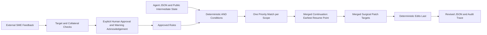
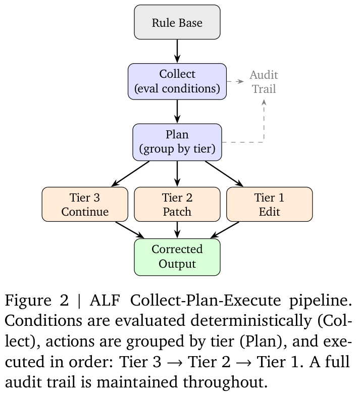

# Agent Gym: Evolving Correction Rules Separately from the Acting Agent

<!-- source-sha256: f41a43a7de90bce7407709824b193c929bb3e7d33064e60c8187aac852974de3 -->

[简体中文](README.md)

> CPU / L1 only: deterministic ALF rules, actual JSON state changes, merged three-tier execution, and explicit human admission. No invoice-processing agent, LLM rule discovery, or semantic investigation. The full system is **not reproduced because of high cost; review DONE**. This is an August-paper backfill triggered by Google's site, not a November 12 first release.

## Paper Information

| Field | Value |
| --- | --- |
| Paper | [Agent Gym: A Framework for Continuous Evaluation and Evolution of LLM Agents Through Human-in-the-Loop Feedback](https://arxiv.org/abs/2608.15591); reviewed [v3](https://arxiv.org/html/2608.15591v3) |
| Company / institution / university | First author Pouya Ghiasnezhad Omran and all four coauthors: Google Cloud; visually checked on the v3 PDF's first page |
| First public release | 2026-08-16 07:27:26 UTC, arXiv v1; reviewed v3 released 2026-11-03 23:26:41 UTC |
| Author code | Public [GoogleCloudPlatform/generative-ai invoice-processing reference](https://github.com/GoogleCloudPlatform/generative-ai/tree/8c7b207806b3d4754d6722ecf08785b1f33bf542/agents/invoice-processing); README and ALF engine read only, without cloning, deploying, or executing |
| Local adapter / key | None (`adapter: null`); component key `agent-gym` |
| Local code | `src/auto_research/agent_research/agent_gym.py`; `tests/agent_research/test_nov12_agent.py` |

## Original Paper Summary

### Background and Main Changes

Business rules can change faster than agent releases. Agent Gym adds an independently versioned correction layer after the acting agent's JSON output instead of retraining or directly editing that agent. Deterministic detection, scope-aware collection, tier-wise action merging, and expert approval make corrections editable, reversible, and auditable.



<!-- paper-figure:start -->
### Key Figure from the Original Paper

[](https://arxiv.org/pdf/2608.15591v3#page=7)

Figure 2, v3 PDF page 7. The image comes from the [original paper](https://arxiv.org/pdf/2608.15591v3#page=7); copyright belongs to the authors. The original diagram and caption are cropped without scientific redrawing. Source hashes and crop coordinates are in [assets/provenance.json](assets/provenance.json). LLM continuation and patch results are external inputs; that model system was not run locally.
<!-- paper-figure:end -->

### Core Equations

Section 3.4.3 joins conditions with AND, not majority voting: $m_r(x)=\bigwedge_j c_{r,j}(x)$. At most one matching rule is selected per scope; the upstream implementation evaluates smaller priority numbers first. For selected actions $A$:

$$
O'=E_1\!\left(E_2\!\left(E_3(O;\min\mathrm{resume},\mathcal C_3);\bigcup\mathrm{fields},\mathcal C_2\right);A_1\right).
$$

Merge continuation first, then surgical patches, then constant field edits. Each model tier is called at most once, for at most two external model calls per case rather than one per matching rule. Applying Edit before Continuation could overwrite the intended final correction.

Section 3.5 requires a candidate rule to match the target, assesses collateral matches, and then requests explicit SME approval. After at most three automatic narrowing attempts, remaining collateral can be shown with a warning for human review. This is not a guarantee of semantic correctness or permission to derive rules from test answers.

### Reported Offline and Online Outcomes

The paper presents a public single-domain invoice implementation and functional tests, not randomized production A/B uplift or a full multi-domain capability comparison. Deployment paths and operational readiness are not measured production benefit. Automated bootstrap, promotion into the acting agent's code, and periodic rule retirement remain future work.

## Local Component

### Data Protocol and Code Mapping

`Condition` executes eight common operators described in the paper: `equals`, `not_equals`, `contains`, `starts_with`, `greater_than`, `less_than`, `in_list`, and `is_null`, with `_DYNAMIC_<path>_` references inside public case data. This is not all 21 paper operators. The current upstream README says 24; that does not retroactively change v3's count.

`assess_impact()` accepts explicit adaptation cases, returning target coverage and collateral IDs; test-based selection is rejected. `admit()` requires an assessment bound to the exact rule SHA-256, a named external human approval, and explicit acknowledgement of unresolved collateral. Approval is an outer trust boundary, not authenticated human identity or manufactured consent. LLM generation and the three-round automatic narrowing loop are not implemented.

`execute()` selects by scope/priority, merges continuations at the earliest stage and patch-target unions, actually receives revised JSON from external callbacks, and then performs type-preserving deterministic edits. Missing callbacks cannot count as success; patches cannot change undeclared fields. Failures leave caller-owned output unchanged. Duplicate IDs, same-scope priority collisions, stale approvals, absent fields, and inconsistent JSON types are rejected. Results retain `semantic_correctness_verified: false`.

```bash
PYTHONPATH=src python -c 'from auto_research.agent_research.agent_gym import diagnostic; print(diagnostic(42))'
PYTHONPATH=src python -m pytest -q tests/agent_research/test_nov12_agent.py
```

### Local Results and Negative Controls

The [three-seed diagnostics](metrics/component-cpu-seeds42-44.json) use the same explicit rule contract: one of four matching rules is suppressed by scope priority; two external functions actually update JSON; execution order is 3→2→1, preserving the final constant edit. There is no invoice accuracy, model gain, or real SME-efficiency claim. Three seeds do not turn a fixed truth table into a capability evaluation.

Tests additionally cover earliest-stage continuation merging, patch-target deduplication, AND conditions, dynamic references, target/collateral checks, missing approval, scope conflicts, input isolation, and result types. No actor, real LLM discovery/investigation, persistence, automated lifecycle management, or unified Evolve integration is supplied. CUDA is rejected.

### High-Cost Full System

Section 6 includes a nine-stage acting pipeline, three-layer investigation, LLM rule discovery/correction, and SME sessions. The pinned upstream README configures `gemini-3.5-flash` and `gemini-3.5-pro` for continuation/investigation. The paper does not report full token or wall-clock cost; Section 7 leaves large-scale cost quantification to future work. GPU counts and runtime must not be invented.

These paid proprietary models, repeated document reasoning, and human feedback cannot be replaced without qualification by a local state test or a single-card open model. Under the public configuration and unresolved-cost gate, the full system is **not reproduced because of high cost; review DONE**. No API calls, document-package downloads, or trial deployment are attempted, and no automatic retry, implementation, or Evolve queue is created.
