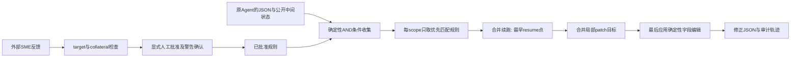
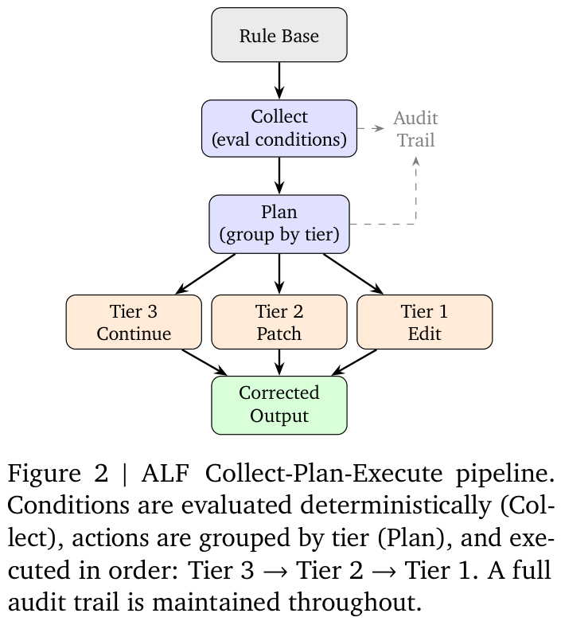

# Agent Gym：把纠错规则与原 Agent 分层演化

[English](README-en.md)

> 仅纯 CPU / L1：ALF 确定性规则、真实 JSON 状态变更、三层动作合并执行与显式人工准入。没有真实发票 Agent、LLM 规则发现或语义审查。完整系统**成本过高，不复现（审查 DONE）**。这是 Google 官网触发的八月论文补漏，不是 11 月 12 日新首发。

## 论文信息

| 字段 | 内容 |
| --- | --- |
| 论文链接 | [Agent Gym: A Framework for Continuous Evaluation and Evolution of LLM Agents Through Human-in-the-Loop Feedback](https://arxiv.org/abs/2608.15591)；核对 [v3 正文](https://arxiv.org/html/2608.15591v3) |
| 公司 / 机构 / 学校 | 一作 Pouya Ghiasnezhad Omran 与其余四位作者均为 Google Cloud；已目视核对 v3 PDF 首页署名 |
| 首次公开日期 | 2026-08-16 07:27:26 UTC，arXiv v1；审查版本 v3 发布于 2026-11-03 23:26:41 UTC |
| 原作者开源代码 | [GoogleCloudPlatform/generative-ai 的 invoice-processing](https://github.com/GoogleCloudPlatform/generative-ai/tree/8c7b207806b3d4754d6722ecf08785b1f33bf542/agents/invoice-processing)，公开参考实现；仅阅读 README 与 ALF 引擎，未克隆、部署或执行 |
| 本地 Adapter / key | 无（`adapter: null`）；组件 key：`agent-gym` |
| 本地复现代码 | `src/auto_research/agent_research/agent_gym.py`；`tests/agent_research/test_nov12_agent.py` |

## 原始论文总结

### 背景与主要改动

业务规则变化往往比 Agent 代码发布更快。Agent Gym 不重新训练或直接改写 acting agent，而在其 JSON 产物之后加独立纠错规则层：确定性条件检测、按作用域收集、按动作层级合并，再由领域专家审核新规则。规则和原 Agent 可以独立版本化、撤销与审计。



<!-- paper-figure:start -->
### 原论文关键图

[](https://arxiv.org/pdf/2608.15591v3#page=7)

Figure 2，v3 PDF 第 7 页。图片来自[原论文](https://arxiv.org/pdf/2608.15591v3#page=7)，版权归原作者所有；截取原图与图注，未重绘科学内容。来源 hash 与裁切范围见 [assets/provenance.json](assets/provenance.json)。图中的 LLM 续跑和 patch 由外部提供，本地未运行该模型系统。
<!-- paper-figure:end -->

### 核心公式

论文 §3.4.3 的条件是 AND，而不是票数多数：$m_r(x)=\bigwedge_j c_{r,j}(x)$。同一 scope 最多选择一条匹配规则；上游实现按 priority 从小到大评估。令选中规则的动作集合为 $A$，执行顺序为

$$
O'=E_1\!\left(E_2\!\left(E_3(O;\min\mathrm{resume},\mathcal C_3);\bigcup\mathrm{fields},\mathcal C_2\right);A_1\right).
$$

即先合并完整续跑，再合并局部 patch，最后应用常量字段编辑。每种 LLM 层合并一次，所以最多两个外部模型调用；不是每条匹配规则各调用一次。三个动作都存在时，不能先 Edit 再用 Continuation 覆盖掉它。

§3.5 的新规则必须匹配目标案例并检查其他案例的 collateral matches，随后由 SME 明确批准。原文最多三次自动收窄后仍可能带警告交给人工；这不等于“程序保证规则语义永远正确”，也不是让 test/gold 自动生成规则。

### 论文离线与线上效果

原文展示单一发票处理领域的公开参考实现和功能测试，没有报告随机生产 A/B 或量化线上提升，也没有完整多领域能力对照。部署路径与“operational readiness”不能改写成已验证生产收益。自动 bootstrap、长期规则晋升为原 Agent 代码和周期性规则淘汰仍是未来工作。

## 本地复现

### 数据协议与代码映射

`Condition` 实际支持八个原文描述的常用操作：`equals`、`not_equals`、`contains`、`starts_with`、`greater_than`、`less_than`、`in_list`、`is_null`；支持公开 case 内的 `_DYNAMIC_<path>_` 引用。不声称实现论文的全部 21 个操作；当前上游 README 已写 24，但本轮没有据此倒改 v3 的 21。

`assess_impact()` 只读取显式 adaptation cases，返回目标匹配和 collateral ID；拒绝 test 选择。`admit()` 要求与精确规则 SHA-256 对应的目标评估、外部具名人工批准，以及未消除 collateral 的显式确认。批准参数是外层信任边界，组件不认证真人身份、不伪造批准，也不实现 LLM 自动生成/三轮收窄。

`execute()` 按 scope/priority 选择规则，将续跑合并到最早阶段，把 patch 目标取并集，实际调用外层 callback 接收修订 JSON，再执行 type-preserving 字段编辑。无 callback 不会假装成功；patch 不能改未声明字段，错误不改调用者的原始对象。同 scope 同 priority 冲突、重复 ID、过期批准、未知字段和不一致 JSON 类型均拒绝。调用结果并非语义正确证明，返回 `semantic_correctness_verified: false`。

```bash
PYTHONPATH=src python -c 'from auto_research.agent_research.agent_gym import diagnostic; print(diagnostic(42))'
PYTHONPATH=src python -m pytest -q tests/agent_research/test_nov12_agent.py
```

### 结果、负控与边界

[三 seed 诊断](metrics/component-cpu-seeds42-44.json)使用相同明确构造的规则合同：四条匹配规则中，同 scope 的低优先规则被抑制；两个外部函数实际更新 JSON；执行顺序为 3→2→1，最终常量修正保留。它没有发票准确率、模型改进或真实 SME 效率结论。三 seed 不把固定真值表升级为能力评测。

专测还核对多个 continuation 的最早阶段合并、patch 目标去重、AND 条件、动态引用、target/collateral、人类批准缺失、同 scope 冲突、输入隔离和返回对象类型。没有 Agent 执行器、真实 LLM discovery/investigation、文件持久化、自动生命周期管理或统一 Evolve；CPU 路径拒绝 CUDA。

### 高成本完整实验

v3 §6 的系统包含九阶段 acting pipeline、三层 investigation、LLM rule discovery/correction 及 SME 会话；固定上游 README 配置 `gemini-3.5-flash`，续跑/调查使用 `gemini-3.5-pro`。原文没有给完整 token/墙钟费用，且 §7 将大规模成本量化列为未来工作；不能捏造所需 GPU 数或小时数。

这些付费专有模型、多次文档推理与人工反馈不能由本地控制流测试或单卡开源模型无差别替代。依据公开配置与成本不确定性门槛，完整系统**成本过高，不复现（审查 DONE）**；不调用 API、不下载文档包、不试部署，不进入自动重试/实现/Evolve 队列。
