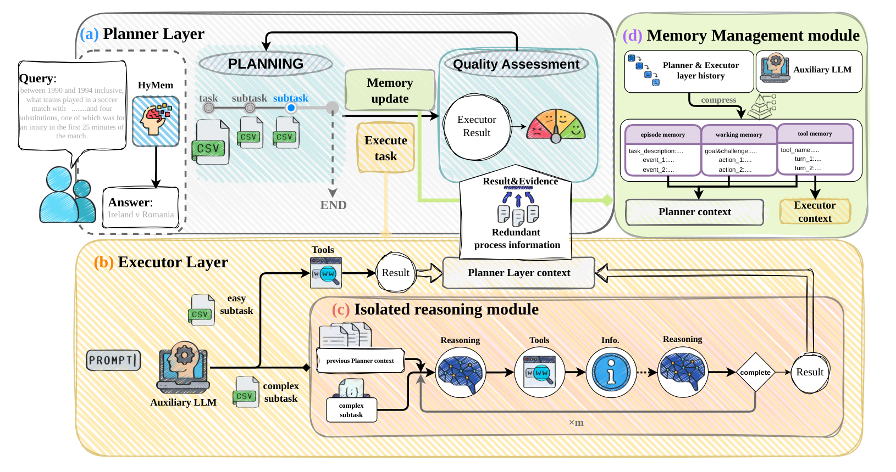

# HyMem: Hierarchical Context Management for Long-Horizon Agents via Information Isolation

<!-- source-sha256: c9758c1b7d03f41e2487a27fd202d7e589e6fd94cc0216996d9fc17921c15445 -->

[简体中文](README.md)

> **Core agent-mechanism mini-suite.** Implements independent planning, memory, credit assignment, or topology paths and records process counts on deterministic tasks, not the full external environment.

## Paper information

| Field | Details |
|---|---|
| Paper | [arXiv 2608.15703](https://arxiv.org/abs/2608.15703) |
| Organization | Institute of Automation, Chinese Academy of Sciences |
| First public release | 2026-08-16 (arXiv v1) |
| Authors' code | No public author code was found as of 2026-08-24. |
| Adapter / method | `hymem` |
| Local reproduction code | `src/auto_research/agent_research/historical_b10_b11.py` |
| First author | XinQi Wang |

## Original paper

### Motivation and method

Separate planning, execution, and isolated reasoning into layers. Structured summaries preserve task progress across context refreshes.


<!-- paper-figure:start -->
### Key figure from the paper

[](https://arxiv.org/html/2608.15703v1/hymem_overview.png)

> **Figure 2:** Core architecture, modules, and connections. From the [original paper](https://arxiv.org/abs/2608.15703); copyright remains with the authors.
<!-- paper-figure:end -->

### Core equation

$$
C_t=C_t^{plan}\oplus C_t^{exec}\oplus M_t^{summary}
$$

### Paper results

DeepSeek-V4 Pass@1 reaches 66.7% on GAIA and 61.3% on BrowseComp-plus. These are paper results, not local mini-suite or online conclusions.

## Local reproduction

On 120 planbench-mini episodes, HyMem has joint success 1.0000 and mean cost 0.5200. The long-context control scores 1.0000 and costs 64.5000. With saturated success, inspect traces, source, and method-specific counts rather than inventing improvement. See the [method metrics](metrics/planbench-mini-seed42.json) and [batch index](../../experiments/historical-b07-b11-seed42.json).

```bash
auto-research agent-research --method hymem --benchmark planbench-mini --episodes 120 --seed 42
```

## Reproduction boundaries

The deterministic mini-suite does not access real browsers, AppWorld, SWE-bench, or external tool services. It verifies mechanism branches, intermediate states, and reporting contracts. Reproducing full environments requires the paper's resources. Raw runs are in runs/agent-research/; the repository keeps only metrics. See [experiments](../../experiments/).
