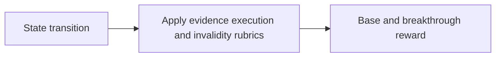
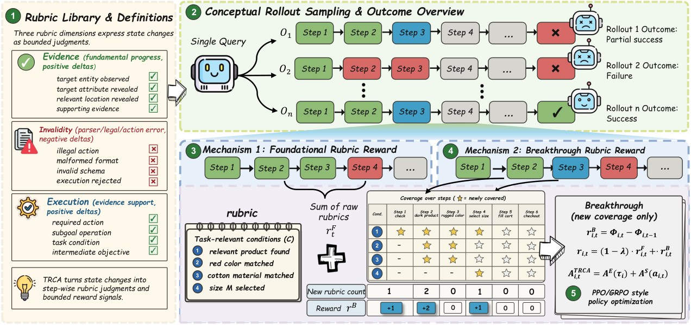

# TRCA: Transition-wise Rubric Credit Assignment for Long-horizon LLM Agents

<!-- source-sha256: 57d92ca897c3a6715c0d87edea07264d572f7a15291a1038ba46eb8a29f35757 -->

[简体中文](README.md)

> Deterministic core credit mechanism, not a full external environment.

## Paper information

| Field | Details |
|---|---|
| Paper | [Paper or original source](https://arxiv.org/abs/2608.16156) |
| Institution | No affiliation disclosed; first author Huan Zhang. |
| First public release | 2026-08-17 (arXiv v1) |
| Author code | No public author code found as of 2026-08-24. |
| Local adapter or method key | `trca` |
| Local reproduction code | `src/auto_research/agent_research/historical_b10_b11.py` |

## Paper method and evidence

Without successful anchors, derive base and breakthrough rewards for each transition from evidence, execution and invalidity rubrics.



<!-- paper-figure:start -->
### Original paper figure

[](https://arxiv.org/html/2608.16156v1/Overview2.png)

Figure shows transition-wise credit construction. From the [original paper](https://arxiv.org/abs/2608.16156); copyright remains with the authors.
<!-- paper-figure:end -->

### Core equation

$$
r_t=r_t^{evidence}+r_t^{execution}-r_t^{invalid}+r_t^{breakthrough}
$$

### Reported results

The paper reports +6.0%–12.6% on WebShop and mean +1.9%–18.3% on SearchQA versus baselines.

## Local reproduction

PlanBench mini 120 episodes: TRCA joint success **1.0000**, mean cost **0.7100**; long context **1.0000**, **64.5000**. [Metrics](metrics/planbench-mini-seed42.json), [Batch index](../../experiments/historical-b07-b11-seed42.json). With saturated accuracy, inspect traces, provenance and method-specific counters rather than claiming gains. No real browser, AppWorld, SWE-bench or external services. Raw outputs stay under `runs/agent-research/`; only [metrics](../../experiments/) are committed.

```bash
auto-research agent-research --method trca --benchmark planbench-mini --episodes 120 --seed 42
```
