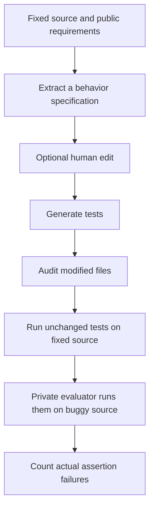
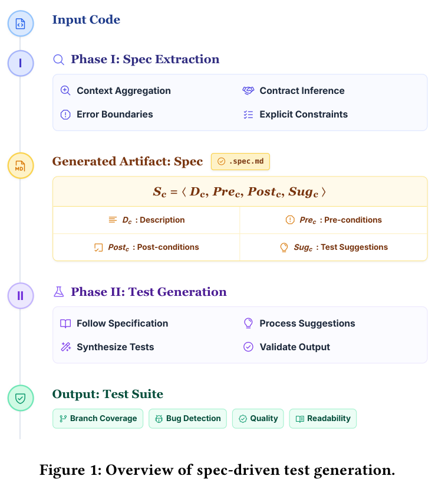

# Specification-driven tests: Define the behavior contract before generating tests

<!-- source-sha256: ae535433885ba901b23ab5ac4e752d743478fca02ded6aa759ee5772d3b5bfdc -->

[简体中文](README.md)

> **L1 protocol diagnostic, not a code agent capability reproduction.** Trusted external callbacks extract specifications, generate tests and execute them. Deterministic fixtures check phase gating and evaluation semantics, not autonomous code understanding, defect-detection gains or full sandboxing.

## Paper information

| Field | Details |
|---|---|
| Paper | [Grounding AI Agents in Contracts](https://arxiv.org/abs/2608.17177v1); [pinned v1 full text](https://arxiv.org/html/2608.17177v1) |
| Institution | First author Michele Tufano: Google, USA |
| First public release | 2026-08-17 22:36:12 UTC; a historical backfill, not an October first release |
| Author code | No author repository identified on Google's official entry or in v1. The 90 historical production defects are internal; this is not an assertion that no code exists anywhere. |
| Local adapter | `spec-driven-tests`, protocol key rather than a full-model adapter |
| Local reproduction code | `src/auto_research/agent_research/spec_driven_tests.py`; `scripts/run_oct21_priority_backfill.py` |

## Paper method and evidence

Direct unit-test generation can miss input boundaries and implicit contracts. The agent first reads fixed source and writes each unit's description, preconditions, postconditions and test suggestions. It records tested/untested conditions in `.spec.md` before generating tests. A developer may revise the specification, but the paper's automated comparison did not use human editing.



<!-- paper-figure:start -->
### Original paper figure

[](https://arxiv.org/html/2608.17177v1#S3)

From page 3 of the [original PDF](https://arxiv.org/pdf/2608.17177v1). Input, specification artifact, second stage and output direction were checked. Copyright remains with the authors; this is not local empirical evidence.
<!-- paper-figure:end -->

$$
S_c=\langle D_c,Pre_c,Post_c,Sug_c\rangle.
$$

Only fixed source is provided to the agent; historical bugs, patches and commits stay hidden. Detection requires the same tests to compile and pass on fixed code and compile but fail at least one assertion on buggy code. Compilation failure is not detection. Modifying target source or disallowed existing files invalidates a run without retry. Aggregate whether any of the first k attempts detects each bug, not whether each test independently detects a bug.

In 90 internal Google defects, the authors compare direct vs specification-driven generation using the same Gemini 3 Flash and harness, with Gemini 3.1 Pro evaluating quality. Detect@5 is 63.2% vs 53.4%; branch coverage rises by 2.5 percentage points. These are private offline results, not production A/B or local measurements. [Setup and results](https://arxiv.org/html/2608.17177v1#S4).

## Local reproduction

```bash
PYTHONPATH=src python scripts/run_oct21_priority_backfill.py \
  --device cpu --components spec-driven-tests --seeds 42,43,44 \
  --output runs/spec-driven-tests/fresh-result.json
```

- `Specification` stores unique units and D/Pre/Post/Sug, emits Markdown, and requires suggestions for untested conditions. Stricter structural checks are not proof of semantics.
- `generate` enforces specification, optional revision, then tests. Its callbacks get a reconstructed public fixed-source allowlist with no buggy/gold fields. Existing tests can be supplied, but default to empty for greenfield use.
- `evaluate` calls trusted execution with identical tests, fixed first and then buggy. It distinguishes compile errors, test failure, no detection and illegal modifications.
- `pass_detect_at_k` groups by bug and reports observed at-least-one outcomes, not the unbiased combinatorial pass@k estimator.

This API is not an OS sandbox. A trusted diff audit must supply `modified_existing_paths`; do not trust model self-reporting or let callbacks access hidden evaluation data through closures/files. The default does not execute generated text or start a shell. There is no implementation of defect, branch or semantic contract coverage.

Three seeded integer fixtures test phase order, public-field isolation, dual execution, illicit modification rejection, compile-error controls and per-bug aggregation. `actual_llm_calls=0`: this is a protocol test, not an agent success rate. [CPU diagnostics](metrics/component-cpu-seeds42-44.json).

### Full experiment not reproduced

The 90 internal defects, two arms of five Gemini generations, repeated strong-model judgments and private builds cannot be faithfully run at low cost on one A100/A30 or a Mac. **Too costly, not reproduced (review DONE).** No large model downloads, paid APIs, fake private defects or retry queue. `diagnostic_only=true`, `promotion_eligible=false`, `evolve_integrated=false`.
