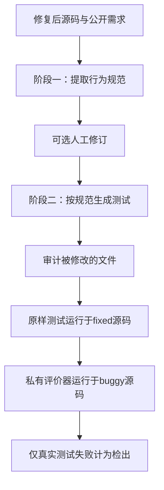
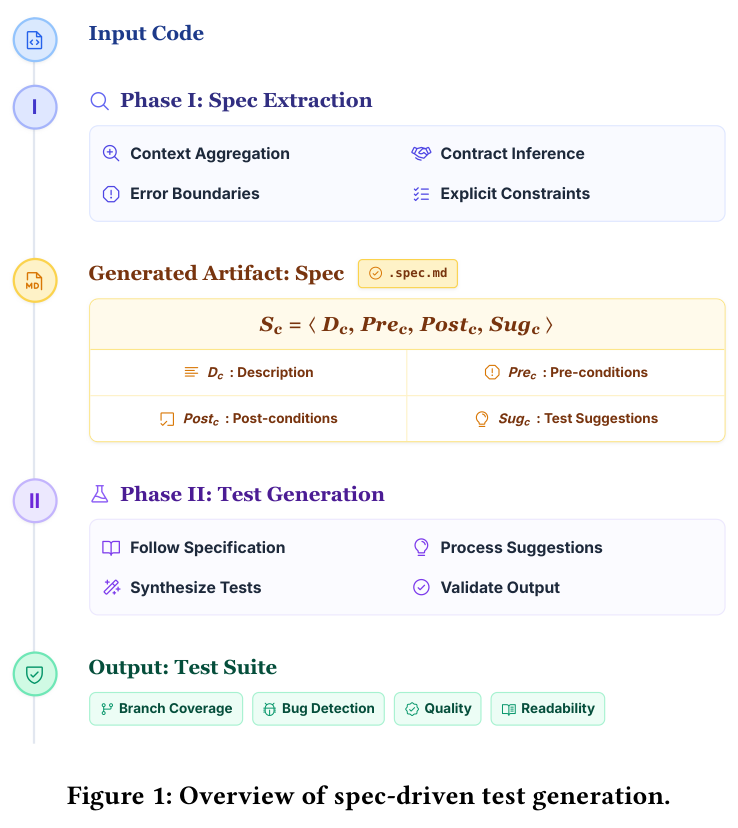

# 规范驱动测试：先建立行为契约，再生成测试

## 论文信息

| 字段 | 内容 |
| --- | --- |
| 论文链接 | [Grounding AI Agents in Contracts](https://arxiv.org/abs/2608.17177v1)，固定核对[v1正文](https://arxiv.org/html/2608.17177v1) |
| 公司/机构 | 一作Michele Tufano：Google, USA |
| 首次公开日期 | 2026-08-17 22:36:12 UTC；这是历史补发现，不是10月新首发 |
| 原文开源代码 | 在Google官方详情和v1正文未找到作者实现仓库；90个历史生产缺陷为内部数据，不声称全网未开源 |
| 本地 Adapter | `spec-driven-tests`，协议组件键，不是完整模型adapter |
| 本地复现代码 | `src/auto_research/agent_research/spec_driven_tests.py`；`scripts/run_oct21_priority_backfill.py` |

> **L1协议诊断，不是代码Agent能力复现。** 外部可信回调负责提取规范、生成测试和执行。本地确定性夹具只检查阶段门控与评价语义，不声称能自主理解代码、提升缺陷检出率或实现完整沙箱。

## 原始论文总结

### 背景与主要改动

直接让模型编写单元测试，可能遗漏输入边界或隐含的行为约定。本文先让Agent读取修复后的源码，写出每个代码单元的描述、前置条件、后置条件与测试建议；把条件标为已测试或未测试，保存为`.spec.md`，之后才允许生成测试。中间可由开发者修订规范；论文自动比较没有启用人工干预。



<!-- paper-figure:start -->
### 原论文关键图

[](https://arxiv.org/html/2608.17177v1#S3)

> 图片来自[原论文](https://arxiv.org/pdf/2608.17177v1)PDF第3页Figure 1，已核对输入、规范产物、阶段二和输出方向。图片版权归原作者所有，不是本地重绘的效果证据。
<!-- paper-figure:end -->

### 核心定义

每个代码单元的规范为：

$$
S_c=\langle D_c,Pre_c,Post_c,Sug_c\rangle.
$$

生成时仅给Agent修复后的源码，隐藏历史bug、补丁及提交信息。检出条件为：同一个测试集在fixed版本编译并通过，在buggy版本编译成功但至少一个测试断言失败。**编译失败不算检出。** 若Agent改动了被测源码或非允许的既有文件，该次运行作废且不自动重试。论文还汇总每个bug的前k次尝试中是否至少有一次成功，而非把每条测试当成独立bug。

### 论文离线与线上效果

作者在90个Google内部历史缺陷上，用同一个Gemini 3 Flash及Harness比较直接生成与规范驱动生成，另用Gemini 3.1 Pro评价测试质量。论文报告detect@5为63.2%，对照53.4%，分支覆盖增加2.5个百分点。这些是作者的离线私有数据结果，不是线上A/B，也不是本地测量。[实验设计与结果](https://arxiv.org/html/2608.17177v1#S4)

## 本地复现

```bash
PYTHONPATH=src python scripts/run_oct21_priority_backfill.py \
  --device cpu --components spec-driven-tests --seeds 42,43,44 \
  --output runs/spec-driven-tests/fresh-result.json
```

### 已实现与未实现

- `Specification`保存唯一代码单元及D/Pre/Post/Sug，输出Markdown；未测试条件须有建议。本地结构校验比论文提示约束更严格，但不把它当语义正确性证明。
- `generate`先完成规范提取，再可选修订、生成测试。传入回调的是重新构建的公共fixed-source白名单对象，不携带buggy/gold字段；原文允许的existing-tests输入默认留空以适配greenfield。
- `evaluate`将同一测试交给可信执行器，固定先fixed后buggy；区分编译失败、实际测试失败、未检出和非法修改。
- `pass_detect_at_k`按bug分组计算观测到的至少一次通过/检出，不伪装成组合无偏pass@k估计器。

API不是操作系统安全沙箱。`modified_existing_paths`必须由外部可信文件差异审计提供，不能相信模型自报；回调本身不得通过闭包或文件系统偷看私有评价数据。默认不`exec`生成文本，不自动启动shell。缺陷覆盖、分支覆盖和契约语义覆盖均未实现，不能由规范是否非空推断它们。

### 本地结果与边界

三seed的确定性小整数fixture检查阶段顺序、公共字段隔离、相同测试双执行、非法源码修改拒绝、编译错误负控及按bug汇总。回调并非LLM，`actual_llm_calls=0`；其通过只是协议工作正常，不是Agent成功率。[CPU诊断指标](metrics/component-cpu-seeds42-44.json)

### 成本与完整实验

90个内部缺陷、两臂各5次Gemini生成、强模型多次评审及私有构建环境无法在单A100/A30或Mac上忠实低成本重做。**成本过高，不复现（审查 DONE）**。不下载大模型、不请求付费API、不替代私有缺陷造假；没有自动重试或待训练队列。组件保持`diagnostic_only=true`、`promotion_eligible=false`、`evolve_integrated=false`。
