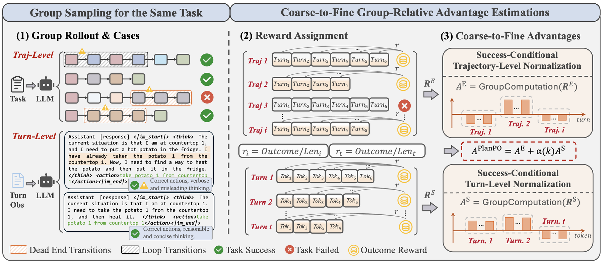

# PlanPO: Group Planning-Aware Policy Optimization for Multi-Turn Agentic LLMs

<!-- source-sha256: f9cebfaa4ec6b250e6bb31d6e3674611243fb626584c2a229ca104da2dc166e7 -->

[简体中文](README.md)

> **Core agent-mechanism mini-suite.** Implements independent planning, memory, credit assignment, or topology paths and records process counts on deterministic tasks, not the full external environment.

## Paper information

| Field | Details |
|---|---|
| Paper | [arXiv 2608.17289](https://arxiv.org/abs/2608.17289) |
| Organization | Xiamen University |
| First public release | 2026-08-18 (arXiv v1) |
| Authors' code | No public author code was found as of 2026-08-24. |
| Adapter / method | `planpo` |
| Local reproduction code | `src/auto_research/agent_research/historical_b10_b11.py` |
| First author | Dayang Liang |

## Original paper

### Motivation and method

Within successful trajectories, compare both the number of turns and the length of individual responses to build coarse-to-fine planning advantages.


<!-- paper-figure:start -->
### Key figure from the paper

[](https://arxiv.org/html/2608.17289v1/figure/fw.png)

> **Figure 2:** Overview of the paper's method and key components. From the [original paper](https://arxiv.org/abs/2608.17289); copyright remains with the authors.
<!-- paper-figure:end -->

### Core equation

$$
A=A_{outcome}+\alpha A_{turn-count}+\beta A_{response-length}
$$

### Paper results

ALFWorld, WebShop, and SciWorld improve by +27.2% on average relative to GRPO, with negligible added overhead. These are paper results, not local mini-suite or online conclusions.

## Local reproduction

On 120 planbench-mini episodes, PlanPO has joint success 1.0000 and mean cost 0.6400. The long-context control scores 1.0000 and costs 64.5000. With saturated success, inspect traces, source, and method-specific counts rather than inventing improvement. See the [method metrics](metrics/planbench-mini-seed42.json) and [batch index](../../experiments/historical-b07-b11-seed42.json).

```bash
auto-research agent-research --method planpo --benchmark planbench-mini --episodes 120 --seed 42
```

## Reproduction boundaries

The deterministic mini-suite does not access real browsers, AppWorld, SWE-bench, or external tool services. It verifies mechanism branches, intermediate states, and reporting contracts. Reproducing full environments requires the paper's resources. Raw runs are in runs/agent-research/; the repository keeps only metrics. See [experiments](../../experiments/).
