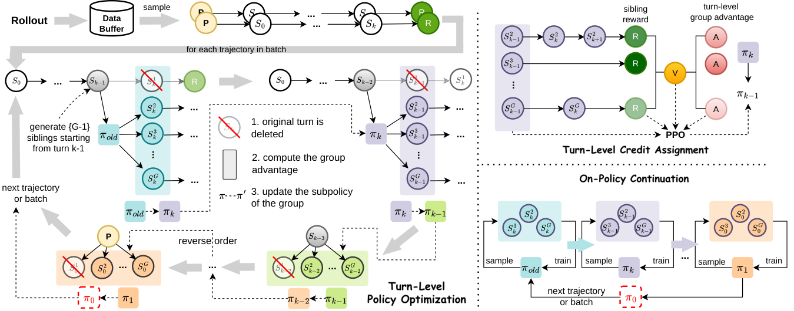

# RTPO: Reverse-Turn Policy Optimization for Stabilizing Agentic RL Training

<!-- source-sha256: 1e977e33446db09466aa35d5c00a779bf6a8eb633ccf81cea1851c076154277f -->

[简体中文](README.md)

> **Core agent-mechanism mini-suite.** Implements independent planning, memory, credit assignment, or topology paths and records process counts on deterministic tasks, not the full external environment.

## Paper information

| Field | Details |
|---|---|
| Paper | [arXiv 2608.18682](https://arxiv.org/abs/2608.18682) |
| Organization | Adelaide University |
| First public release | 2026-08-19 (arXiv v1) |
| Authors' code | No public author code was found as of 2026-08-24. |
| Adapter / method | `rtpo` |
| Local reproduction code | `src/auto_research/agent_research/historical_b10_b11.py` |
| First author | Yugu Li |

## Original paper

### Motivation and method

Organize multi-turn rollouts as sparse backward trees. Update turns in reverse temporal order so decisions remain on-policy with downstream continuations.


<!-- paper-figure:start -->
### Key figure from the paper

[](https://arxiv.org/html/2608.18682v1/figure2_jimmy.png)

> **Figure 2:** Core architecture, modules, and connections. From the [original paper](https://arxiv.org/abs/2608.18682); copyright remains with the authors.
<!-- paper-figure:end -->

### Core equation

$$
\pi_{t}\leftarrow\arg\max_\pi\mathbb E[A_t^{reverse}\log\pi(a_t|s_t)]
$$

### Paper results

Improvements over trajectory-level and turn-level baselines are 21.50% and 10.76%, respectively. These are paper results, not local mini-suite or online conclusions.

## Local reproduction

On 120 planbench-mini episodes, RTPO has joint success 1.0000 and mean cost 0.6800. The long-context control scores 1.0000 and costs 64.5000. With saturated success, inspect traces, source, and method-specific counts rather than inventing improvement. See the [method metrics](metrics/planbench-mini-seed42.json) and [batch index](../../experiments/historical-b07-b11-seed42.json).

```bash
auto-research agent-research --method rtpo --benchmark planbench-mini --episodes 120 --seed 42
```

## Reproduction boundaries

The deterministic mini-suite does not access real browsers, AppWorld, SWE-bench, or external tool services. It verifies mechanism branches, intermediate states, and reporting contracts. Reproducing full environments requires the paper's resources. Raw runs are in runs/agent-research/; the repository keeps only metrics. See [experiments](../../experiments/).
