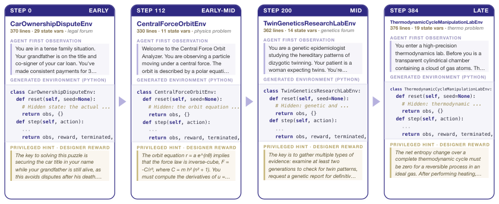

# SPADE: Self-Play in Adaptive Synthetic Executable Environments

<!-- source-sha256: 9532f0f0201fae2239a769a6a3c914760dcf84361de82bf97da88fb9c7a05109 -->

[简体中文](README.md)

> **Core agent-mechanism mini-suite.** Implements independent planning, memory, credit assignment, or topology paths and records process counts on deterministic tasks, not the full external environment.

## Paper information

| Field | Details |
|---|---|
| Paper | [arXiv 2608.19197](https://arxiv.org/abs/2608.19197) |
| Organization | University of Washington |
| First public release | 2026-08-19 (arXiv v1) |
| Authors' code | [spade](https://github.com/spade-rl/spade) |
| Adapter / method | `spade` |
| Local reproduction code | `src/auto_research/agent_research/historical_b10_b11.py` |
| First author | Bo Liu |

## Original paper

### Motivation and method

The same LLM plays environment designer and reasoning agent. Regret between runs with and without privileged hints trains it to produce executable environments at the capability boundary.


<!-- paper-figure:start -->
### Key figure from the paper

[](https://arxiv.org/html/2608.19197v1/env_curriculum_filmstrip.png)

> **Figure 2:** Overview of the paper's method and key components. From the [original paper](https://arxiv.org/abs/2608.19197); copyright remains with the authors.
<!-- paper-figure:end -->

### Core equation

$$
R_{designer}=R_{hint}-R_{agent}
$$

### Paper results

At 30B, the mean gain over eight held-out tasks is +5.3; BFCL v4 gains +5.7 and ACEBench-Agent +13.9. These are paper results, not local mini-suite or online conclusions.

## Local reproduction

On 120 planbench-mini episodes, `spade` has joint success `1.0000` and average cost `0.7400`. The long-context control has `1.0000` and `64.5000`. With saturated success, inspect traces, source, and method-specific counts rather than inventing improvement. See the [method metrics](metrics/planbench-mini-seed42.json) and [batch index](../../experiments/historical-b07-b11-seed42.json).

```bash
auto-research agent-research --method spade --benchmark planbench-mini --episodes 120 --seed 42
```

## Reproduction boundaries

The deterministic mini-suite does not access real browsers, AppWorld, SWE-bench, or external tool services. It checks mechanism branches, intermediate state, and reporting contracts. Reproducing full environments requires the paper's resources. Raw runs live in `runs/agent-research/`; the repository keeps only metrics. See [experiments](../../experiments/).
