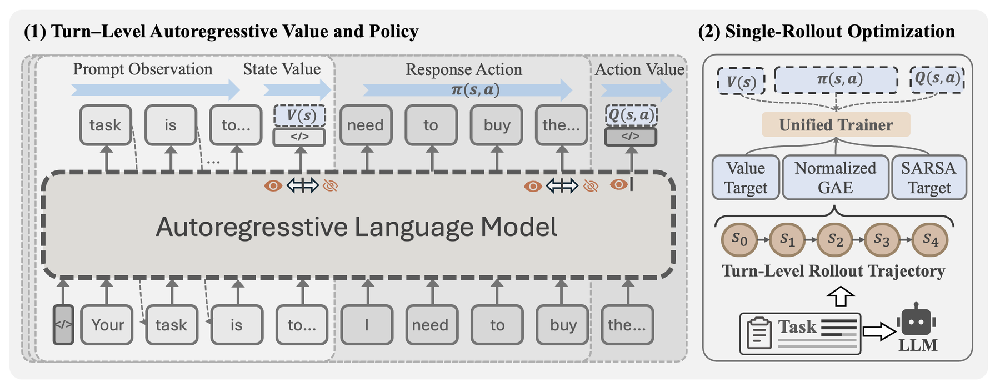

# SAPO: Single-Rollout Autoregressive Policy Optimization for Agentic Reinforcement Learning

<!-- source-sha256: 940238f0802ce73643018e1b55586e1942b226628d78a2858550907689825044 -->

[简体中文](README.md)

> **Core agent-mechanism mini-suite.** Implements independent planning, memory, credit assignment, or topology paths and records process counts on deterministic tasks, not the full external environment.

## Paper information

| Field | Details |
|---|---|
| Paper | [arXiv 2608.19842](https://arxiv.org/abs/2608.19842) |
| Organization | Xiamen University |
| First public release | 2026-08-20 (arXiv v1) |
| Authors' code | No public author code was found as of 2026-08-24. |
| Adapter / method | `sapo` |
| Local reproduction code | `src/auto_research/agent_research/historical_b10_b11.py` |
| First author | Dayang Liang |

## Original paper

### Motivation and method

One autoregressive backbone outputs policy and value at different causal boundaries, combining PPO, on-policy SARSA, and trajectory GAE.


<!-- paper-figure:start -->
### Key figure from the paper

[](https://arxiv.org/html/2608.19842v1/sapo_fw.png)

> **Figure 1:** Core architecture, modules, and connections. From the [original paper](https://arxiv.org/abs/2608.19842); copyright remains with the authors.
<!-- paper-figure:end -->

### Core equation

$$
\hat A_t^{GAE}=\sum_{l\ge0}(\gamma\lambda)^l\delta_{t+l}
$$

### Paper results

Across ALFWorld and WebShop, mean results beat PPO by 15.1 points and GRPO by 12.1 points; iteration time falls 33.2% versus PPO. These are paper results, not local mini-suite or online conclusions.

## Local reproduction

On 120 planbench-mini episodes, SAPO has joint success 1.0000 and mean cost 0.6200. The long-context control scores 1.0000 and costs 64.5000. With saturated success, inspect traces, source, and method-specific counts rather than inventing improvement. See the [method metrics](metrics/planbench-mini-seed42.json) and [batch index](../../experiments/historical-b07-b11-seed42.json).

```bash
auto-research agent-research --method sapo --benchmark planbench-mini --episodes 120 --seed 42
```

## Reproduction boundaries

The deterministic mini-suite does not access real browsers, AppWorld, SWE-bench, or external tool services. It verifies mechanism branches, intermediate states, and reporting contracts. Reproducing full environments requires the paper's resources. Raw runs are in runs/agent-research/; the repository keeps only metrics. See [experiments](../../experiments/).
