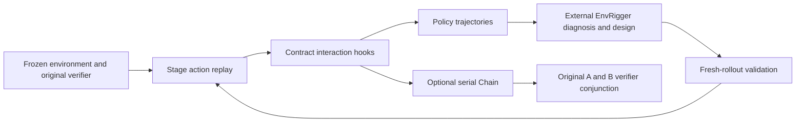
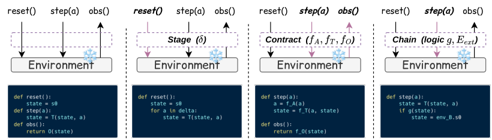

<!-- source-sha256: e357850c5f1831857a5407e97b0f548405fa5caa71fe3cf6cd1c39215e6ace1e -->
# EnvHarness: composable environment wrappers with independent verifiers

[简体中文](README.md)

> **L1 CPU environment-control components, not EnvRigger or an agent-learning system.** Local code implements Stage/Contract/serial Chain interface semantics. External environments and verifiers must be real and trusted. Toy transition truth tables are not agent-success measurements.

## Paper information

| Field | Value |
| --- | --- |
| Paper | [EnvHarness: Awakening Static Worlds for Agent Learning](https://arxiv.org/abs/2608.19880v1), [fixed v1](https://arxiv.org/html/2608.19880v1), [project](https://www.envharness.com/) |
| Institution | First author Chengsong Huang, **Washington University in St. Louis**; the PDF footnote states work during a Google Cloud AI Research internship. Google collaboration remains a separate priority signal, not a reassignment of the first author |
| Original publication | **2026-08-20 10:42:06 UTC**; the PDF's August 21 header does not override the original arXiv submission. This is a historical repair |
| Original code | [google-research/envharness](https://github.com/google-research/envharness), public, including environment adapters, design loops and experiment entries; their presence does not mean those entries ran locally |
| Local key / adapter | `envharness`; `adapter=null`; no Evolve integration |
| Local code | `src/auto_research/agent_research/envharness.py` |

## Original paper

### Motivation and main changes

Static environments cannot keep targeting the current policy's weaknesses. Rather than generate a world from scratch or replace its scorer, EnvHarness wraps a frozen environment's reset/step/observe/evaluate interface. Stage changes reachable initial states; Contract changes allowed actions, transition feedback and observations; Chain extends task horizons. The base environment still determines success, and serial chains combine the original verdicts.

EnvRigger observes policy trajectories, then diagnoses, writes and validates. It scaffolds weak policies and makes already-solved tasks harder. A candidate set is evaluated on fresh rollouts, not accepted merely because generated code runs. Appendix settings use five baseline rollouts per task, five fresh rollouts per candidate and at most five write–validate attempts. None of this model-driven design or learning loop is locally implemented.

### Architecture



<!-- paper-figure:start -->
### Key original figure

[](https://arxiv.org/html/2608.19880v1/components.png)

From the [original paper](https://arxiv.org/html/2608.19880v1#S2.F3); copyright remains with the original authors. These are the official HTML Figure 3 PNG bytes, without cropping, redrawing or PDF rendering. The figure depicts the full interface concept; local code supplies only the narrow wrappers below, not EnvRigger or real benchmarks.
<!-- paper-figure:end -->

### Core equations

Stage advances a reset state through ordinary base-environment actions, rather than changing private internal fields:

$$
s'_0=T(\cdots T(T(s_0,a_1),a_2)\cdots,a_k).
$$

Contract defaults its three mappings to identity, transforming action, transition feedback and observation without changing R. Local hooks are trusted Python callbacks, not reproductions of the upstream dynamic-source loader and subprocess isolation.

$$
(\mathcal A',T',\mathcal O')=(f_A(\mathcal A),f_T(T),f_O(\mathcal O)),\qquad R'=R.
$$

Only serial Chain is local: B is lazily reset when A succeeds and shared step budget remains. Its final verdict is the conjunction of cached original verdicts:

$$
R' = R_A\land R_B.
$$

This does not judge semantic compatibility, generate a verifier for a combined objective, or support branching, interleaving or shared semantic state. Wrapper order generally does not commute. Upstream Setups/Rules/Link correspond to the paper's Stage/Contract/Chain; local names do not imply full ABI compatibility.

### Author results

Across ALFWorld, WebArena, SWE-bench Verified, OfficeQA and SpreadsheetBench, the authors report improved skill learning relative to static environments, including up to nine percentage points and roughly 9.8% fewer steps. These are reports from different settings, not equal gains on every task. ALFWorld leave-one-type-out improves by 3.1 points on average but regresses by 8.7 points on heat. Improvements are not unconditional across domains.

Learned skills are tested on untouched benchmarks, with separate GRPO experiments. These are not production-user A/B tests, and none were run locally.

## Local reproduction

### Protocol and code mapping

| Component | Actual behavior and conventions |
| --- | --- |
| `StageWrapper` | Replay ordinary steps after reset, then notify the inner environment to rewind episode bookkeeping; preparation must not finish the task or continue after termination |
| `ContractWrapper` | Rewrite actions or return Blocked; blocked actions do not advance the inner environment and instead re-observe/filter it; transition and observation hooks preserve typed responses; evaluate delegates to the original verifier |
| `SerialChain` | Shared submitted-step budget; never start B after A fails; reset B only at handoff; cache boundary verdicts instead of rerunning scorers; success requires both A and B |

Hooks may terminate early but cannot revive an already-terminal inner environment. A failed step/reset callback poisons the episode until reset. The narrow interface exposes strings, not the full upstream runtime-safe state schema. There is no dynamic compilation, arbitrary generated-script execution or security sandbox. Verifier truth still needs independent auditing: delegation does not establish scorer correctness and supplies no gold to an actor.

```bash
PYTHONPATH=src python -c 'from auto_research.agent_research.envharness import diagnostic; print(diagnostic(42))'
PYTHONPATH=src python -m pytest tests/agent_research/test_envharness.py -q
```

### Evidence and negative controls

Frozen-source CPU seeds 42, 43 and 44 were actually run; see [component contract metrics](metrics/component-cpu-seeds42-44.json). Fixed toy environments test replay, blocked-action non-advancement, filtered observations, lazy handoff, shared budgets and cached original verifiers. This is not a public-benchmark bridge or learning comparison. CUDA is rejected; no GPU path or receipt is required.

## Boundaries

EnvRigger trajectory diagnosis/component generation/fresh-rollout acceptance, skill extraction, policy, RL, real Docker/browser/game bridges, upstream persistence and source-compilation isolation are absent. There is no Evolve registration or automatic promotion. Real user accounts and irreversible actions do not meet the resettable-environment assumption and should not be tested casually with these wrappers.

### Full experiment not reproduced

Appendix G estimates 228.0M total tokens for ALFWorld and 137.3M for WebArena, dominated by real-environment rollouts. Not every comparison executes the same kind of work. Appendix F's RL setup uses **Qwen3-8B, eight NVIDIA H100s and 150 steps**, not a small single-GPU run. The full commercial-model/five-benchmark/environment-design/skill/RL matrix is **too costly and not reproduced (review DONE)**. No API, training probe, checkpoint download or real benchmark was started. CPU control checks and non-reproduction of the full experiment are separate facts; automatic retry remains disabled.
