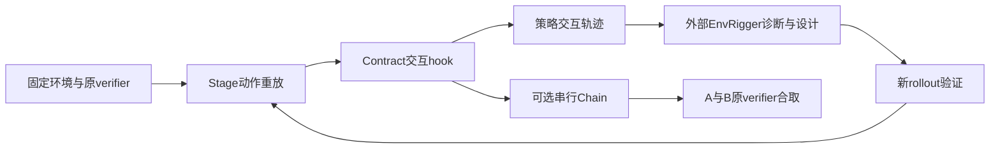
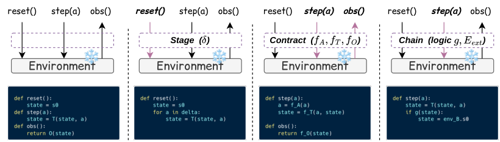

# EnvHarness：可组合环境包装与独立成功判据

[English](README-en.md)

> **L1 CPU 环境控制组件，不是 EnvRigger 或 Agent 学习系统。** 本地只做 Stage／Contract／串行 Chain 的接口语义；外部环境与 verifier 必须真实且可信，toy transition 真值表不表示 Agent 成功率。

## 论文信息

| 字段 | 内容 |
| --- | --- |
| 论文链接 | [EnvHarness: Awakening Static Worlds for Agent Learning](https://arxiv.org/abs/2608.19880v1)，[固定 v1](https://arxiv.org/html/2608.19880v1)，[项目](https://www.envharness.com/) |
| 公司 / 机构 | 一作 Chengsong Huang，**Washington University in St. Louis**；PDF 脚注注明 Google Cloud AI Research 实习期间完成。Google 合作优先属性保留，不把一作直接归 Google |
| 首次公开日期 | **2026-08-20 10:42:06 UTC**；PDF 页眉 8/21 不覆盖 arXiv 原始提交日期；历史漏项修复 |
| 原作者代码 | [google-research/envharness](https://github.com/google-research/envharness)，已公开，包含环境适配、设计循环及实验入口；不等于本地已运行这些入口 |
| 本地 adapter / key | `envharness`；`adapter=null`；未接入 Evolve |
| 本地复现代码 | `src/auto_research/agent_research/envharness.py` |

## 原始论文总结

### 背景与主要改动

静态环境不能针对当前策略的弱点持续提供练习。EnvHarness 不从头生成世界或替换评分器，而是在固定环境的 `reset/step/observe/evaluate` 接口外加包装层：Stage 改初始可达状态；Contract 改允许动作、转换反馈和观察；Chain 延长任务。原成功判据仍由基础环境判断，串行链组合各自成功。

EnvRigger 先观察策略轨迹，再 Diagnose、Write、Validate，针对失败提供脚手架，针对全成功任务增加难度。候选作为一组组件，使用 fresh rollouts 验证而非只看生成代码能运行。附录设置为每任务 5 个基线 rollout、每候选 5 个新 rollout、最多 5 次 write–validate。这整个模型驱动设计与学习环节未在本地实现。

### 架构与流程



<!-- paper-figure:start -->
### 原论文关键图

[](https://arxiv.org/html/2608.19880v1/components.png)

图片来自[原论文](https://arxiv.org/html/2608.19880v1#S2.F3)，版权归原作者所有。使用官方 HTML 的 Figure 3 PNG 原始字节，未裁剪、重画或 PDF 渲染。图示是完整接口概念，本地只有下述窄包装器，不包含 EnvRigger 或真实 benchmark。
<!-- paper-figure:end -->

### 核心公式

Stage 通过基础环境已有动作把 reset 状态推进到可达状态，不直接改私有内部字段：

$$
s'_0=T(\cdots T(T(s_0,a_1),a_2)\cdots,a_k).
$$

Contract 默认三种映射为 identity，在接口上变换动作、转换反馈及观察，不改 R；本地窄接口使用可信 Python callback，不复现原作动态源码加载和 subprocess 隔离。

$$
(\mathcal A',T',\mathcal O')=(f_A(\mathcal A),f_T(T),f_O(\mathcal O)),\qquad R'=R.
$$

本地仅串行 Chain：A 成功并有剩余共享步预算才 lazy reset B；最终判定是已缓存的原判据合取：

$$
R' = R_A\land R_B.
$$

它不判断任务语义是否兼容，不生成组合目标判据，不支持分支、交错、共享语义状态；包装次序一般不交换。上游命名 `Setups/Rules/Link` 对应论文 `Stage/Contract/Chain`，本地名称不暗示 ABI 完全相同。

### 论文离线与线上效果

作者在 ALFWorld、WebArena、SWE-bench Verified、OfficeQA、SpreadsheetBench 五项 benchmark 上报告技能学习相对静态环境的改进，包括最高 9.0 个百分点及约 9.8% 更少步骤；这些是不同设置中的报告，不是每个任务都等量改善。ALFWorld leave-one-type-out 平均提高 3.1 点，但 heat 类退步 8.7 点。没有把收益写成全域无条件提升。

学习得到的技能在未包装的 benchmark 测试，另有 GRPO 训练实验；均非用户生产流量 A/B，本地没有运行它们。

## 本地复现

### 数据协议与代码映射

| 组件 | 实际执行与约定 |
| --- | --- |
| `StageWrapper` | reset 后用普通 step 重放，再通知内部环境恢复 episode 计数；准备重放不得完成任务或越过 terminal |
| `ContractWrapper` | 动作可重写或 `Blocked`；阻止时不推进 inner，重新 observe 并过滤；转换／观察 hook 保留 typed response；evaluate 委托原 verifier |
| `SerialChain` | 共享提交步预算，A 失败不启动 B；B 在交接才 reset，缓存边界判定，不重复运行 scorer；只有 A、B 都成功才成功 |

本地 hook 可提前终止，但不得复活已 terminal 的 inner；step/reset 回调失败后该 episode 不可继续，必须 reset。窄接口观察是字符串，不是上游完整 runtime-safe 状态 schema；没有自动源码编译、任意生成脚本执行或安全沙箱。外部 verifier 真伪仍需独立审计，接口委托本身不保证评分正确，也不向 actor 提供 gold。

```bash
PYTHONPATH=src python -c 'from auto_research.agent_research.envharness import diagnostic; print(diagnostic(42))'
PYTHONPATH=src python -m pytest tests/agent_research/test_envharness.py -q
```

### 结果与负控

CPU seed 42／43／44 已按冻结源码实际运行，见 [组件合同指标](metrics/component-cpu-seeds42-44.json)。固定 toy 环境只测试动作重放、阻止动作不推进状态、filtered observation、lazy handoff、共享预算和缓存原 verifier；它不是任何公开 benchmark 接入或学习对照。本地明确拒绝 CUDA，无 GPU 路径或 GPU 回执要求。

## 复现边界

未实现 EnvRigger 的轨迹诊断／组件生成／fresh-rollout 验收、技能提取、策略、RL、桥接真实 Docker／浏览器／游戏环境、上游持久化与源码编译隔离。未注册 Evolve，也没有自动晋级能力结果。真实用户账户／不可逆动作不满足可 reset 环境假设，不应拿该包装器随意尝试。

### 高成本完整实验

附录 G 估计 ALFWorld 总 228.0M token、WebArena 137.3M token，主要消耗在真实环境 rollout；并非所有对照执行的工作类型相同。附录 F 的 RL 使用 **Qwen3-8B、8×NVIDIA H100、150 steps**，不是单卡小实验。完整商业模型、五 benchmark、环境设计、技能评测及 RL 矩阵**成本过高，不复现（审查 DONE）**。未调用 API、试训、下载 checkpoint 或启动真实 benchmark；CPU 控制组件与完整实验不复现是独立事实，不进入自动重试队列。
