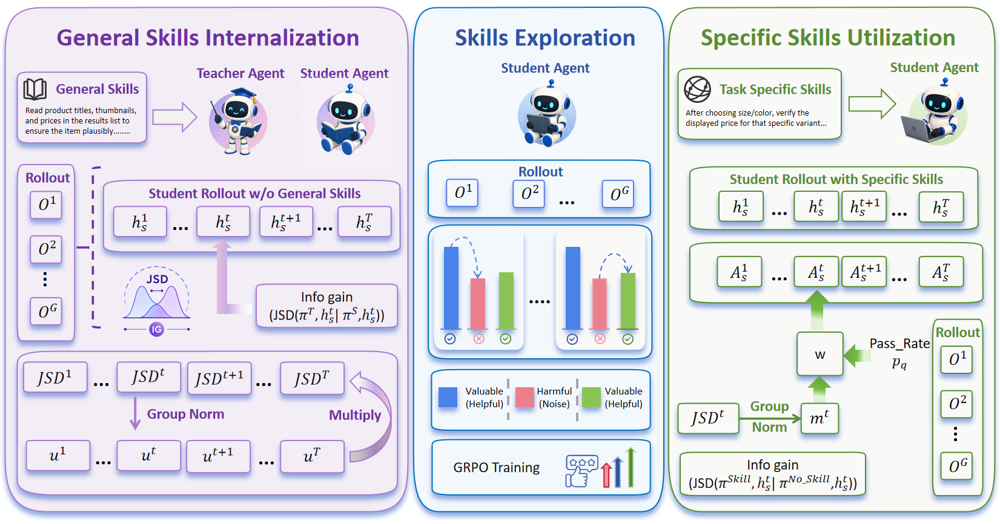

# AUSO: From skill internalization to action-level use

<!-- source-sha256: b6c9cf92eb8f0be4583cf4a3a42d9dea4ef6d03e591b17566899aefd79e1fb4a -->

[简体中文](README.md)

> **Fidelity: core-mechanism mini-suite.** Exercises skill internalization, action-distribution JSD, bounded utilization and reuse phase switching.

## Paper information

| Field | Details |
|---|---|
| Paper | [Paper or original source](https://arxiv.org/abs/2608.21292) |
| Institution | University of Science and Technology of China |
| First public release | 2026-08-21 (arXiv v1) |
| Author code | Yes: [Action-Skill](https://github.com/JordanSancholhz/Action-Skill). |
| Local adapter or method key | `auso` |
| Local reproduction code | [`src/auto_research/agent_research/latest_20260824.py`](https://github.com/daiwk/auto-research/blob/main/src/auto_research/agent_research/latest_20260824.py) |

## Paper method and evidence

External skill retrieval costs context, but complete internalization loses task-specific choice; trajectory-level success cannot tell which action benefits. A skill-conditioned teacher first internalizes reusable skills, then the system explores with outcome feedback. Action-level JSD between with-skill and without-skill policies yields bounded GRPO advantage weights. Bounds prevent flipping the original trajectory advantage's sign.


<!-- paper-figure:start -->
### Original paper figure

[](https://arxiv.org/html/2608.21292v1/figure/model.png)

Figure 2 shows the main stages. From the [original paper](https://arxiv.org/abs/2608.21292); copyright remains with the authors.
<!-- paper-figure:end -->

### Core equation

$$
D_t=\operatorname{JSD}(\pi(\cdot\mid h_t,S)\,\|\,\pi(\cdot\mid h_t)),
\qquad
w_t=1+\beta(s)g(p_q)m_t,
$$

The bound is $1-\beta\le w_t\le1+\beta$.

### Reported results

ALFWorld ID/OOD success is 94.3/67.9 vs 85.1/54.7 without action-level internalization. SearchQA overall is 47.5 vs SkillRL 47.1. The paper also tests WebShop; no industrial A/B.

## Local reproduction

On matched PlanBench-mini (120 episodes), SkillRise vs AUSO joint success stays 1.0 and average cost goes 0.6550→0.5955 (−9.09%). AUSO creates 12 skills, reuses them 108 times and performs 108 action updates. [Stable metrics](metrics/planbench-mini-seed42.json) · [batch index](../../experiments/recent-papers-20260824-seed42.json). No ALFWorld/WebShop/SearchQA, LLM token rollouts or full GRPO; the deterministic mini-suite validates the lifecycle and reweighting control flow, not paper success rates.

### Unified isolated L2.1 capability result

On held-out `toolroute-l2.1-v1`, 60 episodes per seed 42/43/44, joint success is 0.7556, plan step F1 0.7887, recovery 0.6667 and mean cost 4.5192. Cross-episode skill memory maintains success while reducing decision cost. [Metrics](metrics/toolroute-l2-seeds42-44.json) · [Protocol](../capability-benchmark.md).

```bash
auto-research agent-eval --method auso --benchmark planbench-mini --episodes 120 --seed 42
```
