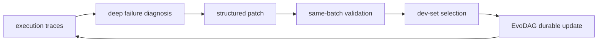
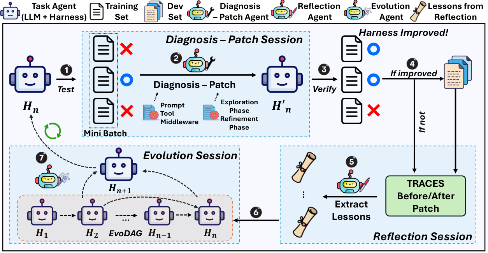

<!-- source-sha256: 3684d142fc535e160bbfcd6db3464a660c503fdae1485214e0904daa1eab2a0a -->

[简体中文](README.md) · English

# AutoSaddler: Automatically improving agent harnesses from failed traces

> **Core mechanism mini-suite.** Runs deep failure diagnosis, structured patching, local and held-out verification, and durable harness updates.

## Paper information

| Field | Details |
| --- | --- |
| Paper | [arXiv 2608.23041](https://arxiv.org/abs/2608.23041) |
| Institution | Microsoft / POSTECH (first author's work completed during a Microsoft internship) |
| First public release | 2026-08-24 (arXiv v1) |
| Author code | No released source found; the paper links a [project page](https://aka.ms/AutoSaddler-website). |
| Local adapter or method key | `autosaddler` |
| Local reproduction code | [`src/auto_research/agent_research/latest_20260825.py`](https://github.com/daiwk/auto-research/blob/main/src/auto_research/agent_research/latest_20260825.py) |

## Original paper summary

### Background and main changes

Small prompt, tool-config and middleware mistakes compound on long tasks, while manual harness tuning is costly. AutoSaddler treats the harness as code: diagnose minibatch failure traces, generate bounded structured patches, check causal effects on that batch, select updates on dev, and persist versions in EvoDAG.



<!-- paper-figure:start -->
### Key figure from the paper

[](https://arxiv.org/html/2608.23041v1/main_figure_revised.png)

> **Figure 2:** Overall design and components. From the [paper](https://arxiv.org/abs/2608.23041); copyright belongs to the authors. Click for the source.
<!-- paper-figure:end -->

### Core equations

$$
J(\theta)=\mathbb E_{(x,y^*)\sim\mathcal T}
\mathbb E_{(\tau,\hat y)\sim P_\theta(\cdot\mid x)}[\mu(\hat y,y^*)],
\qquad \hat\theta=\arg\max_{\theta\in\mathcal V_{K,dev}}\hat J_{D_{dev}}(\theta).
$$

### Offline and online results

GAIA2, SWE-Bench Pro and Terminal-Bench 2.0 improve **9.0 / 9.6 / 10.0 points** over respective base harnesses. Ablations find deep diagnosis, targeted modification and generalization-aware selection all necessary. No industrial A/B.

## Local reproduction

PlanBench-mini, 120 episodes, seed 42: joint success **1.0000**, 12 failure diagnoses and durable updates, 108 reuses and average cost **0.5440**. See [metrics](metrics/planbench-mini-seed42.json) and [batch index](../../experiments/latest-20260825-seed42.json).

```bash
auto-research agent-eval --method autosaddler --benchmark planbench-mini --episodes 120 --seed 42
```

## Scope

No GAIA2, SWE-Bench Pro, Terminal-Bench 2.0 or paper production harness ran. Only the optimization loop, verification boundaries and durable reuse are verified.
