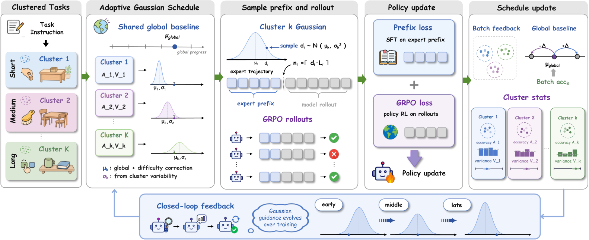

<!-- source-sha256: 9e66b96b1559711cb8a03d69582a829fb88500d7452e558cc334c976e77aab76 -->

[简体中文](README.md) · English

# Agent-G²: Online Gaussian estimation of guidance depth

> **Fidelity: core-mechanism mini-suite.** Samples expert prefix depth for each task from a Gaussian updated online, without extra probe rollouts.

## Paper information

| Field | Details |
| --- | --- |
| Paper | [arXiv 2608.23318](https://arxiv.org/abs/2608.23318) |
| Institution | Baidu (first-listed affiliation of the first author) |
| First public release | 2026-08-24 (arXiv v1) |
| Author code | [Released: ZJU-REAL/Agent-G2](https://github.com/ZJU-REAL/Agent-G2) |
| Local adapter or method key | `agent-g2` |
| Local reproduction code | [`src/auto_research/agent_research/latest_20260825.py`](https://github.com/daiwk/auto-research/blob/main/src/auto_research/agent_research/latest_20260825.py) |

## Original paper summary

### Background and main changes

Hint-based agent RL retains an expert trajectory prefix and then lets the policy explore. A fixed depth ignores task difficulty; per-example probes waste rollouts. Agent-G² estimates the center and variance of a guidance band for each difficulty cluster from existing policy rollouts, then samples a prefix depth per task.


<!-- paper-figure:start -->
### Key figure from the paper

[](https://arxiv.org/html/2608.23318v1/main.png)

> **Figure 4:** The overall workflow, stages, and data flow in the paper. From the [paper](https://arxiv.org/abs/2608.23318); copyright belongs to the authors. Click for the source.
<!-- paper-figure:end -->

### Core equations

$$
\mu_i=\operatorname{clip}(\mu_{global}+\lambda(p_{target}-A_k),0,1),\quad
\sigma_i=\max(\gamma V_k,\sigma_{min}),
$$

$$
z_i\sim\mathcal N(\mu_i,\sigma_i^2),\qquad r_i=\operatorname{clip}(z_i,0,1).
$$

### Offline and online results

On ALFWorld, Agent-G² improves over the strongest hint-based, hint-free, and Aux-RL baselines by **2.3 / 3.9 / 7.4 points**, respectively. Rollout cost is less than one third of per-example probing. The paper also evaluates WebShop and reports no industrial online A/B test.

## Local reproduction

On PlanBench-mini, 120 episodes, seed 42: joint success **1.0000**, 120 online guidance samples, average cost **0.8253**. See [`metrics/planbench-mini-seed42.json`](metrics/planbench-mini-seed42.json) and the [batch index](../../experiments/latest-20260825-seed42.json).

```bash
auto-research agent-eval --method agent-g2 --benchmark planbench-mini --episodes 120 --seed 42
```

## Scope

The mini-suite verifies online per-cluster estimates, Gaussian sampling, and the expert-prefix/policy-continuation control flow. It does not run Qwen2.5, ALFWorld/WebShop, or actual GRPO.

## Unified L2.1 isolated capability result

On the isolated `toolroute-l2.1-v1` test split (60 episodes/seed, seeds 42/43/44), joint success is **0.7778**, plan-step F1 **0.8276**, and failure recovery **0.6667**. The public-evidence verifier uses only public reliability, reversibility, and cost metadata. See [metrics](metrics/toolroute-l2-seeds42-44.json) and the [L2.1 isolated capability protocol](../capability-benchmark.md).
