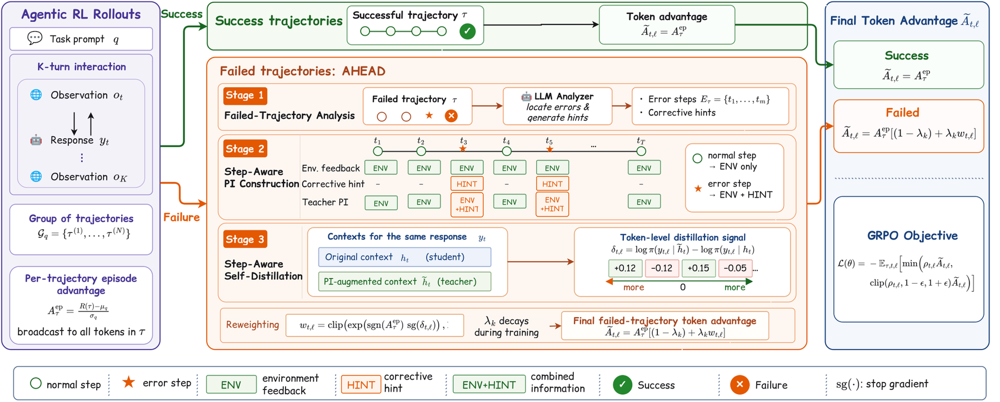

# AHEAD: Agent self-distillation with corrective hints only at error steps

<!-- source-sha256: 97a635510babdc2af813b8f887bf3bb03d492bfe6da41e962ad8e977f8b28af6 -->

[简体中文](README.md)

> **Fidelity: core-mechanism mini-suite.** Ordinary steps use environment feedback; error steps receive hints.

## Paper information

| Field | Details |
|---|---|
| Paper | [Paper or original source](https://arxiv.org/abs/2608.24114) |
| Institution | AWS AI Labs / Purdue University (first author affiliations) |
| First public release | 2026-08-25 (arXiv v1) |
| Author code | No author training code identified (checked 2026-08-26); [released model weights](https://huggingface.co/collections/Bruce-Jin/ahead-alfworld-and-webshop-agents). |
| Local adapter or method key | `ahead` |
| Local reproduction code | [`src/auto_research/agent_research/latest_20260826.py`](https://github.com/daiwk/auto-research/blob/main/src/auto_research/agent_research/latest_20260826.py) |

## Paper method and evidence

Trajectory-level GRPO assigns the same advantage to all steps, and blanket privileged information wastes context on ordinary steps. AHEAD analyzes failures to locate errors. The teacher sees environmental feedback at every step but an additional LLM corrective hint only at errors. A bounded teacher–student log-probability difference injects dense step credit into GRPO advantage.


<!-- paper-figure:start -->
### Original paper figure

[](https://arxiv.org/html/2608.24114v1/main.drawio.png)

Figure 2 shows the step-conditioned teacher and credit flow. From the [original paper](https://arxiv.org/abs/2608.24114); copyright remains with the authors.
<!-- paper-figure:end -->

### Core equation

$$
\delta_{t,l}=\log\pi_{old}(y_{t,l}\mid\tilde h_t)-\log\pi_{old}(y_{t,l}\mid h_t),
$$

$$
A_{t,l}=A^{ep}\left(1+\lambda\operatorname{clip}(\delta_{t,l},-\varepsilon,\varepsilon)\right).
$$

### Reported results

At 7B, the paper improves over GRPO by 13.3 points on ALFWorld and 11.0 success points on WebShop. It also evaluates search QA and three model sizes; no production A/B.

## Local reproduction

PlanBench-mini, 120 episodes: 24 hints, 360 dense-credit updates, joint success 1.0000 and mean cost 0.6160. [Metrics](metrics/planbench-mini-seed42.json) · [batch index](../../experiments/latest-20260826-seed42.json). Error positions are deterministic for control-flow validation; no LLM analyzer, Qwen, genuine GRPO or original benchmarks.

### Unified isolated L2.1 capability result

On held-out `toolroute-l2.1-v1`, 60 episodes per seed 42/43/44, joint success is 0.7556, plan step F1 0.7887, recovery 0.6667 and mean cost 4.5571. Context compression lowers decision cost; associated negative results are retained. [Metrics](metrics/toolroute-l2-seeds42-44.json) · [Protocol](../capability-benchmark.md).

```bash
auto-research agent-eval --method ahead --benchmark planbench-mini --episodes 120 --seed 42
```
