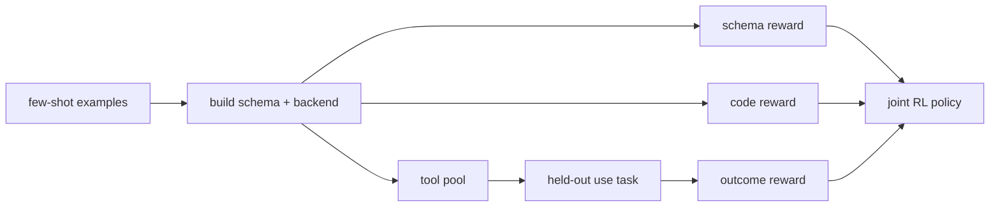
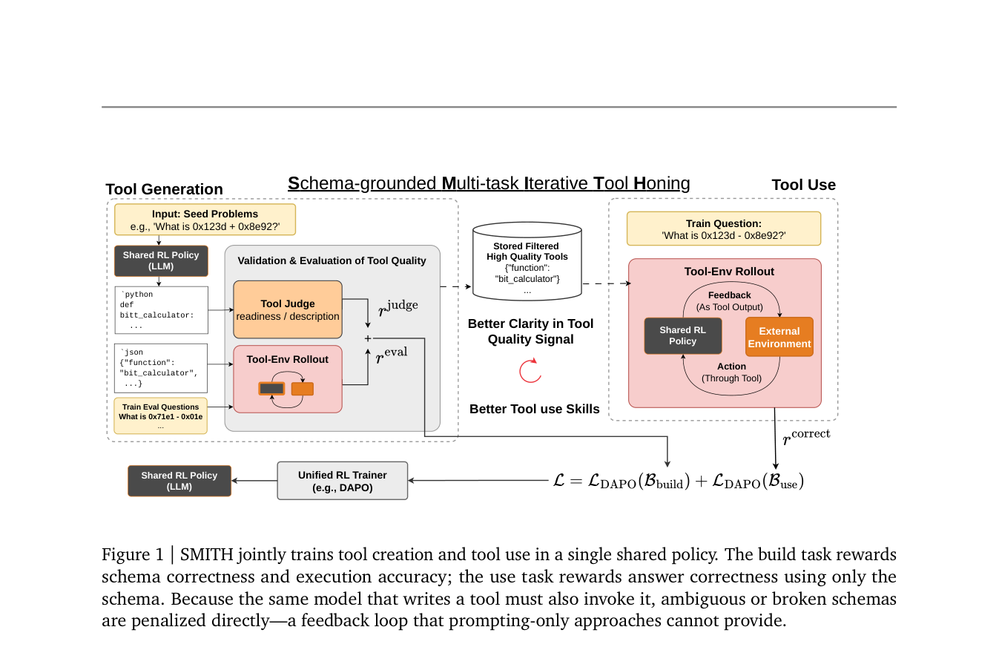

<!-- source-sha256: 4b938ba2d250f698df36b076147d7326f29c90540459832645144e79465cee48 -->

[简体中文](README.md) · English

# SMITH: Joint training for creating and using tools

> **Core mechanism mini-suite.** The same agent alternates build and use, with independent schema, code and outcome verifiers.

## Paper information

| Field | Details |
| --- | --- |
| Paper | [arXiv 2608.24571](https://arxiv.org/abs/2608.24571) |
| Institution | Appier AI Research / National Taiwan University (first author affiliations) |
| First public release | 2026-08-25 (arXiv v1) |
| Author code | Yes: [appier-research/smith](https://github.com/appier-research/smith). |
| Local adapter or method key | `smith` |
| Local reproduction code | [`src/auto_research/agent_research/latest_20260826.py`](https://github.com/daiwk/auto-research/blob/main/src/auto_research/agent_research/latest_20260826.py) |

## Original paper summary

### Background and main changes

Tool creation is often done at inference with a frozen model, without joint feedback for the builder and user. SMITH mixes build tasks that write schemas/backends from examples with held-out tasks that use the tool pool. It rewards schema validity, code execution and final outcomes separately, with harder questions encouraging reusable abstractions.



<!-- paper-figure:start -->
### Key figure from the paper

[](https://arxiv.org/pdf/2608.24571#page=3)

> **Figure 1:** Overall design and components. From the [paper](https://arxiv.org/abs/2608.24571); copyright belongs to the authors. Click for the source.
<!-- paper-figure:end -->

### Core equations

$$
\mathcal J(\theta)=\mathbb E_{\tau\sim\pi_\theta}[r_{schema}(\tau)+r_{code}(\tau)+r_{outcome}(\tau)],
$$

$$
\tau\sim\operatorname{Mix}(\mathcal D_{build},\mathcal D_{use}).
$$

### Offline and online results

Qwen3-4B reports **79.8%** macro accuracy on held-out Reasoning-Gym, **40.4** on TabMWP-Hard and **42.6** on GQA. GQA is **+7.6 points** over an inference-time baseline with the same backbone. No industrial A/B.

## Local reproduction

PlanBench-mini, 120 episodes: 12 tools built, 108 reuses and 360 verifier calls across the three dimensions. Joint success **1.0000**, average cost **0.4550**. See [metrics](metrics/planbench-mini-seed42.json) and [batch index](../../experiments/latest-20260826-seed42.json).

```bash
auto-research agent-eval --method smith --benchmark planbench-mini --episodes 120 --seed 42
```

## Scope

Local tools are structured plans. Build/use state and all three verifier dimensions execute separately. Qwen3-4B, an executable Python sandbox, Reasoning-Gym, TabMWP and GQA were not run.
