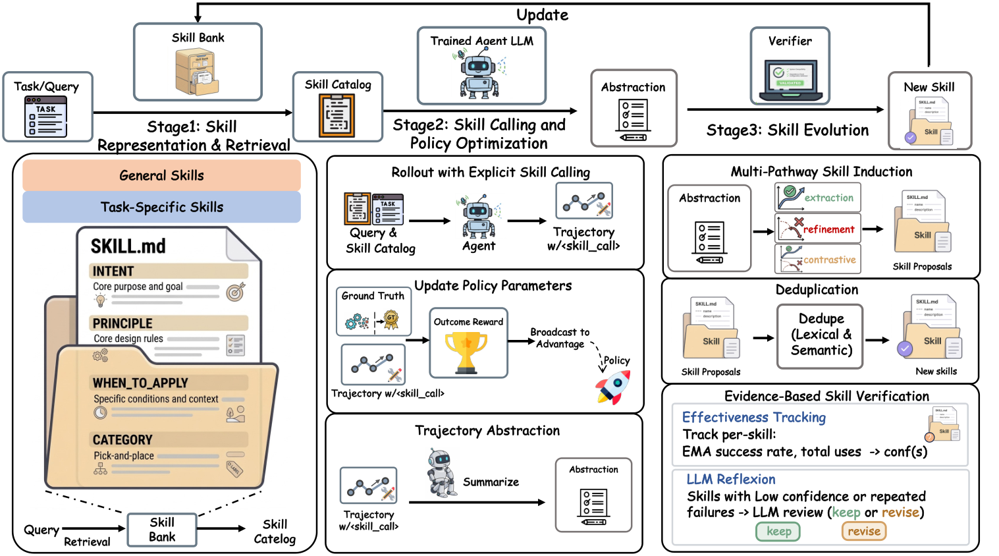

# SkillForge: A skill library that continuously verifies instead of only appending

<!-- source-sha256: e1d8400cc7efa4c78ea7b9e4abcbaf8afff67181d50531e27ddc578d7645a9c2 -->

[简体中文](README.md)

> Explicit skill use, posterior update and revision mini-suite.

## Paper information

| Field | Details |
|---|---|
| Paper | [Paper or original source](https://arxiv.org/abs/2608.24747) |
| Institution | AMAP, Alibaba Group (first-listed first-author affiliation). |
| First public release | 2026-08-25 (arXiv v1) |
| Author code | No public author code found as of 2026-08-26. |
| Local adapter or method key | `skillforge` |
| Local reproduction code | [`src/auto_research/agent_research/latest_20260826.py`](https://github.com/daiwk/auto-research/blob/main/src/auto_research/agent_research/latest_20260826.py) |

## Paper method and evidence

Appending extracted skills forever can retain erroneous or stale entries. Include explicit skill invocation in RL, induce candidates from successful, failed and contrastive traces, and use environment evidence to activate, revise or deduplicate.


<!-- paper-figure:start -->
### Original paper figure

[](https://arxiv.org/html/2608.24747v1/skillforge.png)

The original figure shows evidence-driven skill evolution. From the [original paper](https://arxiv.org/abs/2608.24747); copyright remains with the authors.
<!-- paper-figure:end -->

### Core equation

$$
\max_{\theta,\mathcal B}\;\mathbb E_{d\sim\mathcal D,\tau\sim\pi_\theta(\cdot\mid d,\mathcal B)}[r(\tau)],
$$

$$
\mathcal S_{ret}=\operatorname{TopK}_{s\in\mathcal B}\cos(e_d,e_s),\quad a_t=(a_t^{env},c_t).
$$

### Reported results

Without cold-start initialization, paper mean +6.3% versus SkillRL. Qwen3-4B ALFWorld/WebShop/AppWorld **87.9 / 84.0 / 44.6**. No industrial A/B.

## Local reproduction

PlanBench mini 120 episodes: **12** new skills, **108** reuses, joint success **1.0000**, mean cost **0.6200**. [Metrics](metrics/planbench-mini-seed42.json), [batch index](../../experiments/latest-20260826-seed42.json). Structured plans stand in for skills; no LLM induction, three external benchmarks or RL training.

```bash
auto-research agent-eval --method skillforge --benchmark planbench-mini --episodes 120 --seed 42
```
