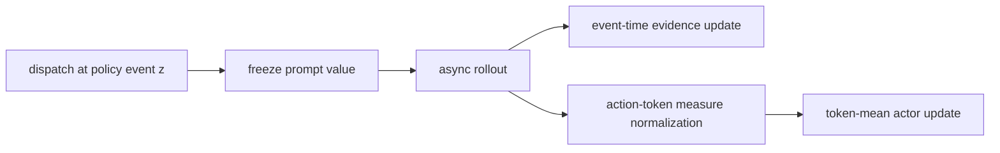
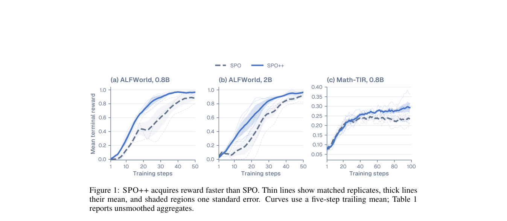

# SPO++: aligning event time and token measure in asynchronous agent RL

<!-- source-sha256: ffbef44f110a5d873a941bab9e502c803721f3afbc1f2f8110c401bde06c4a77 -->

[简体中文](README.md)

> **Core-mechanism mini-suite.** Freezes prompt value at each dispatch and consumes advantages under an action-token measure.

## Paper information

| Field | Details |
|---|---|
| Paper | [arXiv 2608.24870](https://arxiv.org/abs/2608.24870) |
| Organization | Renmin University of China, the first listed affiliation of the first author |
| First public release | 2026-08-25 (arXiv v1) |
| Authors' code | No public author code was found on 2026-08-26. |
| Adapter / method | `spo-plus-plus` |
| Local reproduction code | [`src/auto_research/agent_research/latest_20260826.py`](https://github.com/daiwk/auto-research/blob/main/src/auto_research/agent_research/latest_20260826.py) |

## Original paper

### Motivation and method

SPO avoids waiting for sibling rollouts with a single rollout and persistent prompt value. Completion order can contaminate history, and trajectory whitening uses a different measure than token-mean actor loss. SPO++ organizes evidence by policy-generation event, freezes the baseline at dispatch, and normalizes advantages with action-token-count weights.



<!-- paper-figure:start -->
### Key figure from the paper

[](https://arxiv.org/pdf/2608.24870#page=2)

> **Figure 1:** Overview of the paper's method and key components. From the [original paper](https://arxiv.org/abs/2608.24870); copyright remains with the authors.
<!-- paper-figure:end -->

### Core equations

$$
\hat v_x=\frac{\alpha_x}{\alpha_x+\beta_x},\quad A_i=R_i-\hat v_x,
$$

$$
\mu_{tok}=\frac{\sum_i L_iA_i}{\sum_iL_i},\quad \tilde A_i=\frac{A_i-\mu_{tok}}{\sigma_{tok}+10^{-8}}.
$$

### Paper results

Relative to SPO, ALFWorld reward-curve area rises **+19.00 / +15.92 points** for 0.8B/2B, and Math-TIR **+2.50 points**. No industrial online A/B is reported.

## Local reproduction

On 120 PlanBench-mini episodes, joint success is **1.0000** and average cost **0.6400**. The run executes 120 value freezes and 360 action-token measure updates. See the [metrics](metrics/planbench-mini-seed42.json) and [batch index](../../experiments/latest-20260826-seed42.json).

```bash
auto-research agent-eval --method spo-plus-plus --benchmark planbench-mini --episodes 120 --seed 42
```

## Reproduction boundaries

The deterministic mini-suite checks event-time state and measure alignment. No asynchronous Qwen3.5, ALFWorld, or Math-TIR training was run.
