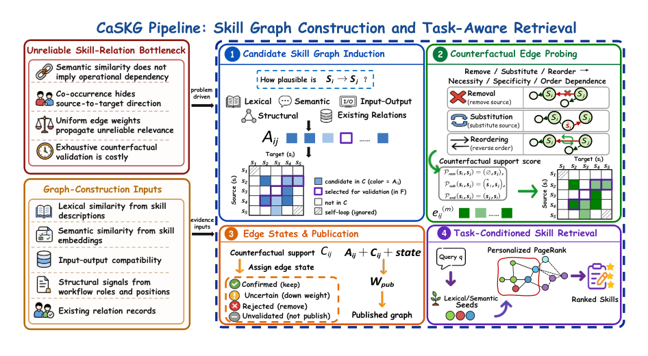

<!-- source-sha256: 3fa9aa3f57bd21d75f73dc59f628eb5982caa79c9a87a322ecef1a18de11b5d6 -->

[简体中文](README.md) · English

# CaSKG: Skill-graph retrieval with counterfactual causal calibration

> **Fidelity: core-mechanism mini-suite.** Executes paper-specific control flow and objectives. Success on deterministic tasks is not a reproduction of the paper's benchmarks.

## Paper information

| Field | Details |
| --- | --- |
| Paper | [arXiv 2608.25500](https://arxiv.org/abs/2608.25500) |
| Institution | Jilin University / Ant Group (first-listed affiliation of the first author) |
| First public release | 2026-08-26 (arXiv v1) |
| Author code | [Released on GitHub](https://github.com/ZhiyuanLi218/Caskg) |
| Local adapter or method key | `caskg` |
| Local reproduction code | [`src/auto_research/agent_research/latest_20260827.py`](https://github.com/daiwk/auto-research/blob/main/src/auto_research/agent_research/latest_20260827.py) |

## Original paper summary

### Background and main changes

CaSKG constructs a high-recall directed graph using semantic, lexical, I/O, and structural evidence. It calibrates the edges with three types of textual counterfactual probe: remove, substitute, and reorder. After Bayesian smoothing, it publishes only reliable relations.


<!-- paper-figure:start -->
### Key figure from the paper

[](https://arxiv.org/html/2608.25500v1/CaSKG_method_overview_final.png)

> **Figure 1:** The overall workflow, stages, and data flow in the paper. From the [paper](https://arxiv.org/abs/2608.25500); copyright belongs to the authors. Click for the source.
<!-- paper-figure:end -->

### Core equations

$$
p(e_{ij}|D)=\frac{\alpha_0+s_{ij}}{\alpha_0+\beta_0+n_{ij}},\qquad G^*=\{e:p(e|D)>\tau\}.
$$

### Offline and online results

Against Graph-of-Skills, the macro average across six models rises from **72.62 to 80.50** on ScienceWorld and **80.01% to 86.79%** on ALFWorld, with fewer environment steps.

## Local reproduction

### L2 isolated capability evaluation (primary result)

CaSKG learns reusable skill routes from the training split and invokes tools on the isolated test split using graph-based memory and candidate verification. Across three seeds on ToolRoute-L2.1, joint success is **0.8000**, plan-step F1 is **0.8327**, and average cost is **5.0116**.

See [`metrics/toolroute-l2-seeds42-44.json`](metrics/toolroute-l2-seeds42-44.json). The PlanBench-mini run below is a mechanism diagnostic only.

> **Local comparison:** Across 120 PlanBench-mini episodes, joint success is **1.0000** and average cost is **0.5200**. Inspect counterfactual probes, Bayesian edge updates, and graph size.

See [`metrics/caskg-planbench-mini-seed42.json`](metrics/caskg-planbench-mini-seed42.json) and the [batch index](../../experiments/latest-20260827-seed42.json).

```bash
auto-research agent-eval --method caskg --benchmark planbench-mini --episodes 120 --seed 42
```

## Scope

The local mini-suite isolates mechanism differences on public, deterministic candidate and planning tasks. It does not claim to reproduce the paper's checkpoints, private training data, external services, or full benchmarks.
