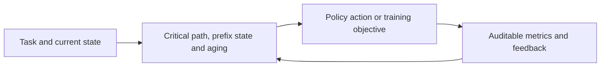
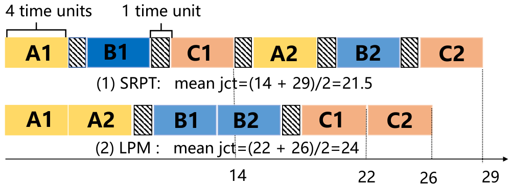

<!-- source-sha256: 79282c730e2115f0bd89a39c727104fbe498259b3d457fdcfbec7f4e65aa4898 -->

[简体中文](README.md) · English

# TOPAS: Prefix-state scheduling for workflows

> **Core mechanism mini-suite.** The paper-specific control flow or objective runs; deterministic task success is not paper benchmark reproduction.

## Paper information

| Field | Details |
| --- | --- |
| Paper | [arXiv 2608.25523](https://arxiv.org/abs/2608.25523) |
| Institution | University of Science and Technology of China (first listed affiliation of the first author) |
| First public release | 2026-08-26 (arXiv v1) |
| Author code | No public author code found on 2026-08-28. |
| Local adapter or method key | `topas` |
| Local reproduction code | [`src/auto_research/agent_research/latest_20260827.py`](https://github.com/daiwk/auto-research/blob/main/src/auto_research/agent_research/latest_20260827.py) |

## Original paper summary

### Background and main changes

Under a shared KV-cache budget, jointly estimate the longest remaining workflow path and downstream prefix-reuse benefit. Account for prefix movement, preemption and aging rather than optimizing only local hit rate or one request's progress.



<!-- paper-figure:start -->
### Key figure from the paper

[](https://arxiv.org/html/2608.25523v1/jizhi.png)

> **Figure 2:** Overall workflow, stages and data flow. From the [paper](https://arxiv.org/abs/2608.25523); copyright belongs to the authors. Click for the source.
<!-- paper-figure:end -->

### Core equations

$$
\Phi(S)=\sum_j w_j\,CP_j(S)-\lambda B_{reuse}(S)+\mu C_{move}(S).
$$

### Offline and online results

Mean/p99 JCT falls by up to **39.8%/49.4%** on synthetic workflows and **22.0%/26.6%** on MetaGPT-TL.

## Local reproduction

### L2 isolated capability evaluation (primary result)

In the stateful tool environment, TOPAS safely ranks and compresses candidates, then recovers based on call feedback. Three-seed ToolRoute-L2.1 joint success is **0.7556**, plan-step F1 **0.7887** and average cost **4.5571**.

See [ToolRoute metrics](metrics/toolroute-l2-seeds42-44.json). PlanBench-mini below is only a mechanism diagnostic.

> **Comparison:** On 120 PlanBench-mini episodes, joint success is **1.0000** and average cost **0.4098**. Only prefix hits, critical-path updates and aging are simulated.

See [PlanBench metrics](metrics/topas-planbench-mini-seed42.json) and [batch index](../../experiments/latest-20260827-seed42.json).

```bash
auto-research agent-eval --method topas --benchmark planbench-mini --episodes 120 --seed 42
```

## Scope

The public deterministic candidate/plan mini-suite isolates mechanism differences. The paper checkpoint, private training data, external services and full benchmark are not reproduced.
