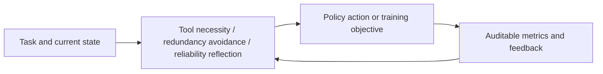
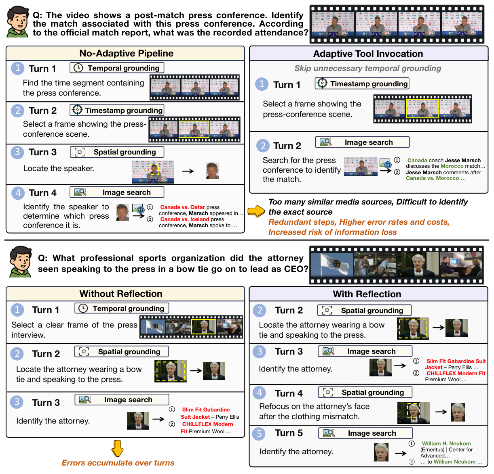

<!-- source-sha256: e89000c93feea2008ee2c8a34d06b2e5f4902513406e76078fb9107ec40d58e5 -->

[简体中文](README.md) · English

# AdaVDR: Adaptive tool use and reliability reflection

> **Fidelity: core-mechanism mini-suite.** Runs the paper-specific control flow and objectives. Deterministic task success is not a reproduction of the paper's benchmarks.

## Paper information

| Field | Details |
| --- | --- |
| Paper | [arXiv 2608.25559](https://arxiv.org/abs/2608.25559) |
| Institution | Accio Team, Alibaba Group / Beijing Institute of Technology (first-listed affiliation of the first author) |
| First public release | 2026-08-26 (arXiv v1) |
| Author code | [Released on GitHub](https://github.com/Accio-Lab/AdaVDR) |
| Local adapter or method key | `adavdr` |
| Local reproduction code | [`src/auto_research/agent_research/latest_20260827.py`](https://github.com/daiwk/auto-research/blob/main/src/auto_research/agent_research/latest_20260827.py) |

## Original paper summary

### Background and main changes

AdaVDR first filters tool calls that are unnecessary for the target model's capabilities and falls back to reflection only when intermediate evidence is unreliable. After SFT, a redundancy-aware RL reward balances video understanding, external retrieval, and call cost.



<!-- paper-figure:start -->
### Key figure from the paper

[](https://arxiv.org/html/2608.25559v1/teaser.png)

> **Figure 1:** Overall design and components. From the [paper](https://arxiv.org/abs/2608.25559); copyright belongs to the authors. Click for the source.
<!-- paper-figure:end -->

### Core equations

$$
R=R_{answer}-\lambda N_{redundant},\qquad a_t=\begin{cases}tool,&n(x_t)=1\\internal,&n(x_t)=0\end{cases}.
$$

### Offline and online results

In the VDR-EE ablation, adaptive data plus reflection reaches **48.0%** with tool calls decreasing from **7.73 to 7.26**. Adding RL yields **51.0%** accuracy with calls decreasing from **7.84 to 6.80**.

## Local reproduction

### L2 isolated capability evaluation (primary result)

AdaVDR runs candidate verification, failure reflection, and fallback in a stateful tool environment without an oracle. Across three seeds on ToolRoute-L2.1, joint success is **0.8167**, plan-step F1 **0.8366**, and average cost **5.0577**. The higher success rate comes with extra verifier cost.

See [`metrics/toolroute-l2-seeds42-44.json`](metrics/toolroute-l2-seeds42-44.json). The PlanBench-mini run below is a mechanism diagnostic only.

> **Local comparison:** Across 120 PlanBench-mini episodes, joint success is **1.0000** and average cost **0.4600**. Deterministic answers are not the main result. Inspect necessity filters, avoided calls, and reflections.

See [`metrics/adavdr-planbench-mini-seed42.json`](metrics/adavdr-planbench-mini-seed42.json) and the [batch index](../../experiments/latest-20260827-seed42.json).

```bash
auto-research agent-eval --method adavdr --benchmark planbench-mini --episodes 120 --seed 42
```

## Scope

The local mini-suite isolates mechanism differences on public, deterministic candidate and planning tasks. It does not claim to reproduce the paper's checkpoints, private training data, external services, or full benchmarks.
