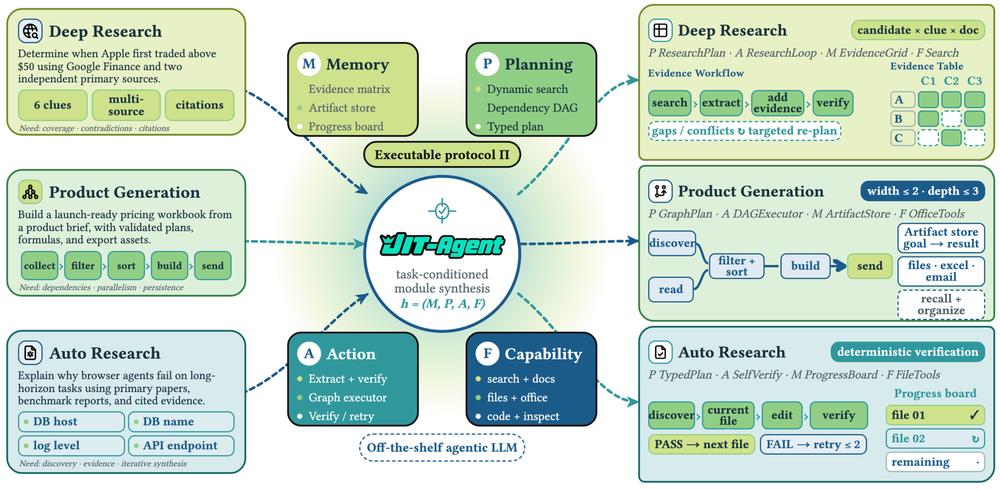

<!-- source-sha256: 61c873cadd34684a618228a61a9b79eb84001a19504d5e5f1199bc46c072280f -->

[简体中文](README.md) · English

# JIT-Agent: On-demand generation and evolution of task-specific agent harnesses

> **Fidelity: core-mechanism mini-suite.** Executes paper-specific control flow and objectives. Deterministic task success is not a reproduction of the paper's benchmarks.

## Paper information

| Field | Details |
| --- | --- |
| Paper | [arXiv 2608.25593](https://arxiv.org/abs/2608.25593) |
| Institution | LV-NUS Lab (first-listed affiliation of the first author) |
| First public release | 2026-08-26 (arXiv v1) |
| Author code | [Released on GitHub](https://github.com/bingreeky/JIT) |
| Local adapter or method key | `jit-agent` |
| Local reproduction code | [`src/auto_research/agent_research/latest_20260827.py`](https://github.com/daiwk/auto-research/blob/main/src/auto_research/agent_research/latest_20260827.py) |

## Original paper summary

### Background and main changes

The harness is formalized as four generatable modules: memory, planning, action protocol, and tools/skills. The model generates a harness for a task, repairs it after failure, and distills transferable patterns from an archive of earlier configurations.


<!-- paper-figure:start -->
### Key figure from the paper

[](https://arxiv.org/html/2608.25593v1/jit_method_overview_final.png)

> **Figure 2:** The core architecture, its main modules, and their connections. From the [paper](https://arxiv.org/abs/2608.25593); copyright belongs to the authors. Click for the source.
<!-- paper-figure:end -->

### Core equations

$$
h^*=\arg\max_h\;\mathbb E[R(\operatorname{Agent}(x;m,h))],\qquad h=(M,P,A,T).
$$

### Offline and online results

With the harness, DeepSeek-V4-Flash exceeds GPT-5.6 by **9.1 / 4.3 points** on DeepSearchQA / OdysseyBench, respectively. GLM-5.2 improves by up to **20.2 points**.

## Local reproduction

### L2 isolated capability evaluation (primary result)

The JIT harness writes and repairs reusable routes on demand on training tasks. Routes are frozen for validation and test, where execution uses only public observations, tool metadata, and actual call feedback. There is no answer, guide, or reference-plan interface. On ToolRoute-L2.1 across three seeds, joint success is **0.7556**, plan-step F1 **0.7887**, and average cost **4.4912**. The run no longer depends on the deterministic L1 environment that directly returned answers.

See [`metrics/toolroute-l2-seeds42-44.json`](metrics/toolroute-l2-seeds42-44.json). PlanBench-mini below is retained only as a mechanism diagnostic.

> **Local comparison:** Across 120 PlanBench-mini episodes, joint success is **0.1500** and average cost **0.6180**. The low success rate exposes limitations of axis-based archiving; it is not a paper result.

See [`metrics/jit-agent-planbench-mini-seed42.json`](metrics/jit-agent-planbench-mini-seed42.json) and the [batch index](../../experiments/latest-20260827-seed42.json).

```bash
auto-research agent-eval --method jit-agent --benchmark planbench-mini --episodes 120 --seed 42
```

## Scope

The local mini-suite isolates mechanism differences on public, deterministic candidate and planning tasks. It does not claim to reproduce the paper's checkpoints, private training data, external services, or full benchmarks.
