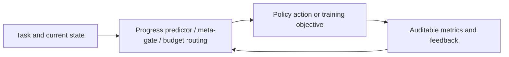
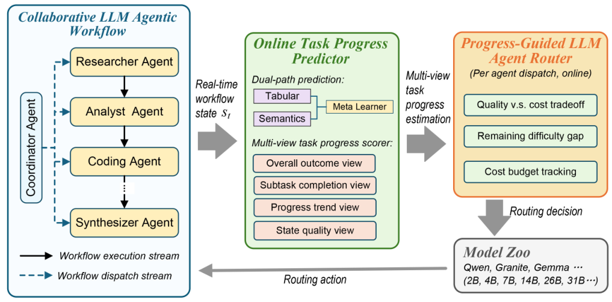

<!-- source-sha256: 037bb6a7d93ee8dfd23be606def5e7597f5c872b2aedd389280fc2792af167be -->

[简体中文](README.md) · English

# ProgRouter: Online progress-driven multi-agent routing

> **Fidelity: core-mechanism mini-suite.** The paper-specific control flow and objectives execute directly. Success on deterministic tasks is not a reproduction of the paper's benchmarks.

## Paper information

| Field | Details |
| --- | --- |
| Paper | [arXiv 2608.25992](https://arxiv.org/abs/2608.25992) |
| Institution | Aston University (first-listed affiliation of the first author) |
| First public release | 2026-08-26 (arXiv v1) |
| Author code | No author-released code found (checked 2026-08-28). |
| Local adapter or method key | `progrouter` |
| Local reproduction code | [`src/auto_research/agent_research/latest_20260827.py`](https://github.com/daiwk/auto-research/blob/main/src/auto_research/agent_research/latest_20260827.py) |

## Original paper summary

### Background and main changes

A multi-view scorer measures subtask completion, the progress trend, and state quality. A dual-path predictor estimates the marginal progress each candidate model would yield. A meta-gate makes stepwise routing decisions under quality, time, and long-run cost budgets.



<!-- paper-figure:start -->
### Key figure from the paper

[](https://arxiv.org/html/2608.25992v1/progrouter_procedures.png)

> **Figure 2:** The overall workflow, stages, and data flow in the paper. From the [paper](https://arxiv.org/abs/2608.25992); copyright belongs to the authors. Click for the source.
<!-- paper-figure:end -->

### Core equations

$$
m_t^*=\arg\max_m\frac{\widehat{\Delta p}(m|s_t)}{c(m)}-\lambda_t c(m).
$$

### Offline and online results

HumanEval+ pass rate is **93.0%** within a 4800J budget; MBPP reaches **79.4%** at 3376J; ASQA citation precision is **92.1%**.

## Local reproduction

### L2 isolated capability evaluation (primary result)

ProgRouter compiles verified tool choices into reusable program routes. Routes are frozen before validation and test execution. Across three seeds on ToolRoute-L2.1, joint success is **0.7778**, plan-step F1 is **0.8037**, and average cost is **4.6324**.

See [`metrics/toolroute-l2-seeds42-44.json`](metrics/toolroute-l2-seeds42-44.json). The PlanBench-mini run below is a mechanism diagnostic only.

> **Local comparison:** Across 120 PlanBench-mini episodes, joint success is **1.0000** and average cost **0.3100**. Inspect progress predictions, the meta-gate, and budget-driven downgrades.

See [`metrics/progrouter-planbench-mini-seed42.json`](metrics/progrouter-planbench-mini-seed42.json) and the [batch index](../../experiments/latest-20260827-seed42.json).

```bash
auto-research agent-eval --method progrouter --benchmark planbench-mini --episodes 120 --seed 42
```

## Scope

The local mini-suite isolates mechanism differences on public, deterministic candidate and planning tasks. It does not claim to reproduce the paper's checkpoints, private training data, external services, or full benchmark.
