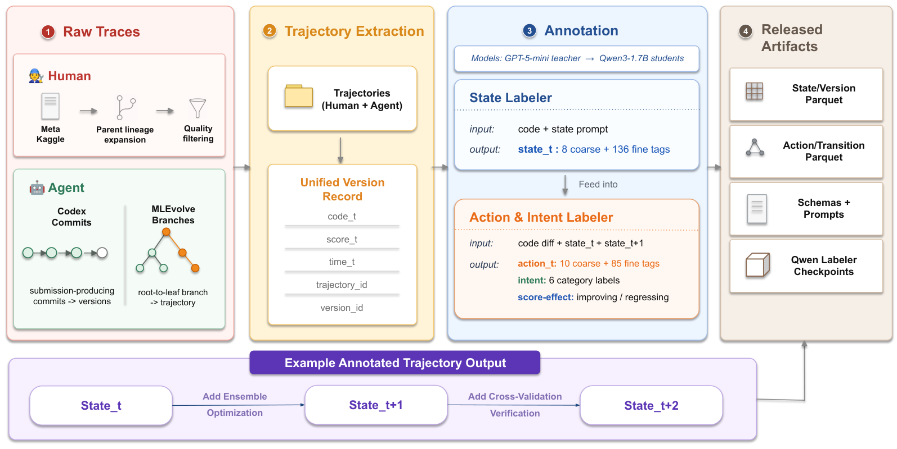

<!-- source-sha256: bee7c5a654e95c7b7c74b1d638451cfbb5aa30a7a759ed3549187ba433531d96 -->

[简体中文](README.md) · English

# TraceML: Extracting planning priors from human ML development trajectories

> **Fidelity: core-mechanism mini-suite.** Executes paper-specific control flow and objectives. Deterministic task success is not a reproduction of the paper's benchmarks.

## Paper information

| Field | Details |
| --- | --- |
| Paper | [arXiv 2608.26086](https://arxiv.org/abs/2608.26086) |
| Institution | Carnegie Mellon University (first-listed affiliation of the first author) |
| First public release | 2026-08-26 (arXiv v1) |
| Author code | [Released: TraceML dataset and extraction pipeline](https://huggingface.co/datasets/jerryyan/TraceML) |
| Local adapter or method key | `traceml` |
| Local reproduction code | [`src/auto_research/agent_research/latest_20260827.py`](https://github.com/daiwk/auto-research/blob/main/src/auto_research/agent_research/latest_20260827.py) |

## Original paper summary

### Background and main changes

TraceML records each code version, score, action intent, edit size, and impact in a unified format, comparing 4465 human trajectories with agent trajectories. It distills how humans alternate stages and reopen previous approaches into a planning prior.


<!-- paper-figure:start -->
### Key figure from the paper

[](https://arxiv.org/html/2608.26086v1/pipeline.png)

> **Figure 2:** The overall workflow, stages, and data flow in the paper. From the [paper](https://arxiv.org/abs/2608.26086); copyright belongs to the authors. Click for the source.
<!-- paper-figure:end -->

### Core equations

$$
\tau=\{(v_t,a_t,i_t,s_t,\Delta s_t)\}_{t=1}^T,\qquad p(a_{t+1}|\tau_{\le t},\text{human prior}).
$$

### Offline and online results

The release covers 4465 human trajectories across 134 Kaggle competitions, plus 430 paired human and 207 agent trajectories. A planning prompt improves scores without closing the behavioral gap.

## Local reproduction

### L2 isolated capability evaluation (primary result)

TraceML writes reflection priors from failures in the training split. Validation and test read the prior and progress using actual tool feedback, without reading hidden routes or answers. Across three ToolRoute-L2.1 seeds, joint success is **0.7278**, plan-step F1 **0.7786**, and average cost **4.7920**.

See [`metrics/toolroute-l2-seeds42-44.json`](metrics/toolroute-l2-seeds42-44.json). The 1.0 on PlanBench-mini below only shows saturation of the mechanism smoke test.

> **Local comparison:** Across 120 PlanBench-mini episodes, joint success is **1.0000** and average cost **0.4400**. Focus on coverage across all four stages, versioned edits, and reopened approaches.

See [`metrics/traceml-planbench-mini-seed42.json`](metrics/traceml-planbench-mini-seed42.json) and the [batch index](../../experiments/latest-20260827-seed42.json).

```bash
auto-research agent-eval --method traceml --benchmark planbench-mini --episodes 120 --seed 42
```

## Scope

The local mini-suite isolates mechanism differences on public, deterministic candidate and planning tasks. It does not claim to reproduce the paper's checkpoints, private training data, external services, or full benchmarks.
