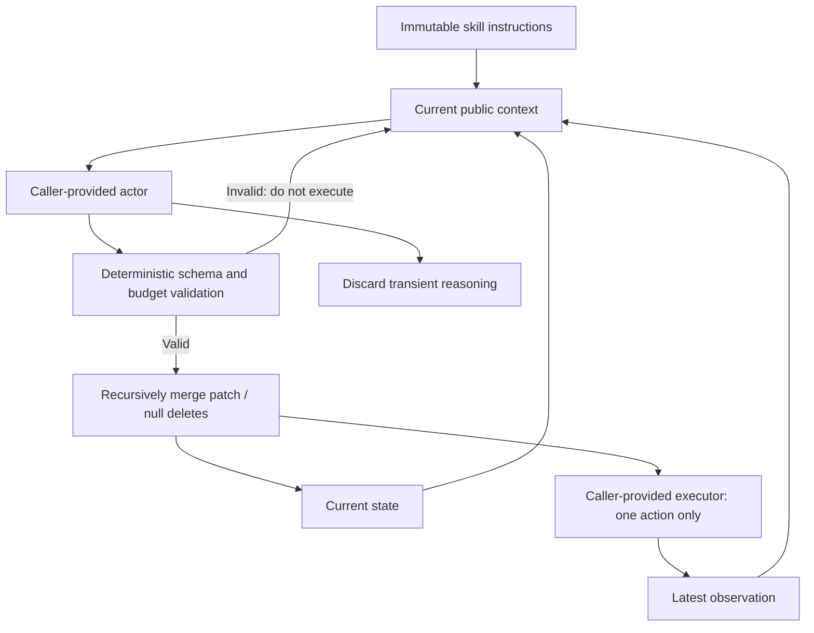
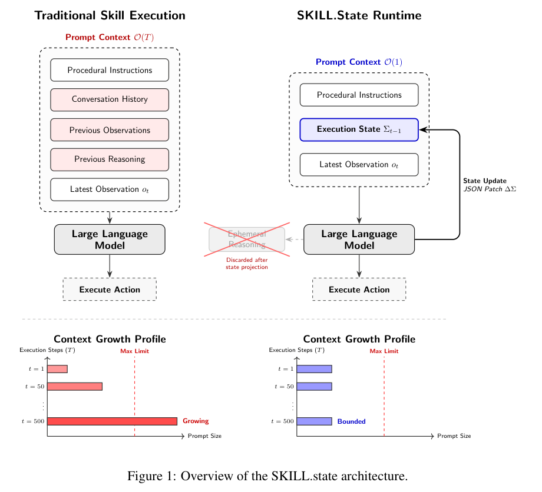

<!-- source-sha256: 539da27fc63f4bfe0d2f0bf8ca7f7187d2657f9671e17c7cd89be4f465b1b7dd -->

[简体中文](README.md) · English

# SKILL.state: Explicit execution state instead of growing conversation history

## Paper information

| Field | Details |
| --- | --- |
| Paper | [SKILL.state](https://arxiv.org/abs/2608.26263); reviewed against the [v3 full text](https://arxiv.org/html/2608.26263v3) |
| Institution | First author Sanket Badhe: Google LLC; collaborators include Purdue University |
| First public release | 2026-08-26 18:00:06 UTC; v3 dates to 2026-09-02. Rediscovered through a new link in the Google catalog; not an October first release. |
| Author code | No official author-released code found. A similarly named community implementation is not author code. |
| Local adapter or method key | `skill-state`: component key, not a registered full-paper CLI adapter |
| Local reproduction code | `src/auto_research/agent_research/skill_state.py`; entry point `scripts/run_oct19_skill_state.py` |

> **Runtime component only.** No LLM, commercial API, real terminal, or official benchmark is called. The fixed schema, format checks, and public context boundary execute; that does not reproduce long-horizon intelligence.

## Original paper summary

### Background and main changes

An ordinary agent repeatedly feeds prior observations, actions, and reasoning back into the next turn. SKILL.state projects persistent information into current execution state. Each step receives only the skill instructions, current state, and latest observation, rather than an extra state block appended to complete history. The model emits a structured patch and an action. The runtime validates before committing, and transient reasoning is discarded. See [§3 and Algorithm 1](https://arxiv.org/html/2608.26263v3#S3).



<!-- paper-figure:start -->
### Key figure from the paper

[](https://arxiv.org/pdf/2608.26263v3#page=4)

> **Figure 1:** The v3 execution architecture retains only fixed skills, current state, and the latest observation, then discards intermediate reasoning after validating the update. The image preserves the full left/right comparison and the context-growth illustration below. From the [original paper](https://arxiv.org/abs/2608.26263), copyright the authors. Click for the source.
<!-- paper-figure:end -->

### Core equations

$$
C_t=(P,\Sigma_t,O_t),\qquad
\Sigma_{t+1}=\Sigma_t\oplus\Delta\Sigma_t.
$$

$\oplus$ recursively merges fields, retaining unmodified ones; `null` deletes its key. The paper's linear cumulative-context result depends on a fixed schema sufficient to hold the task state, and on state and observations not growing without bound. It is not unconditional constant memory for arbitrary tasks. The assumption can fail when history is needed for auditing, the schema is unknown, or an early critical fact is omitted. See [limitations](https://arxiv.org/html/2608.26263v3#S7).

### Offline and online results

The authors compare long-horizon performance and context cost on controlled repositories, simulated code repositories, InterCode CTF, and tau-Bench. No production online A/B is reported. For a Gemini-3-Flash repository task with T=100, Table 1 reports about 65K tokens for SKILL.state versus about 1.06M for a stateful baseline retaining all history. This is the authors' setting, not a local measurement. Small open models mainly fail through state overwrite, type errors, and JSON formatting problems; these failures accompany the gains. See the [paper results and failure analysis](https://arxiv.org/html/2608.26263v3#S5).

## Local reproduction

```bash
PYTHONPATH=src python scripts/run_oct19_skill_state.py \
  --device cpu --seeds 42,43,44 \
  --output runs/oct19-skill-state/fresh-result.json
```

The runtime executes recursive merge, null deletion, schema rejection, original-state retention, and bounded retries. The actor receives an immutable string view containing only the three public fields, with no gold answer, grader, old response, or old observation. The caller injects the actor and executor. The local diagnostic uses public counter events and inert action callbacks, not a language model.

The local character cap and maximum of 8 format retries are resource safeguards, not paper constants. The paper commits valid state before executing an action. If an executor throws, the local runtime does not blindly retry or claim to undo external side effects. Callers must handle the latest observation from an action failure. The module is not a sandbox for Python callbacks or real tools.

### Data, results, and code mapping

The constructed input revision is `synthetic-skill-state-public-counter@oct19-skill-state-contract-v1`. Each seed processes 200 public events, recomputes state independently, injects one schema-invalid patch, and checks that it does not execute an action early. Appending all old text is the context-growth negative control. Only runtime characters and protocol counts are measured, not model accuracy, real token cost, or official task success. The shared acceptance runner writes [CPU metrics](metrics/component-cpu-seeds42-44.json).

### Cost and scope

The final CPU run covers 200 public events per seed for seeds 42/43/44. Independent state error, replayed reasoning count, and public-context drift during retry are each 0. Each seed has exactly one format rejection and retry. Artifacts are bound to commit `8c963f810e45ce3886e43b1b5da39980e41c95c0`. This verifies a runtime contract, not an LLM's ability to generate correct patches.

The full protocol has multiple models and runtimes, five seeds, runs of 10–200 steps, real tool benchmarks, and compression controls. One T=200 full-history baseline alone can accumulate millions of tokens. The current single A100/A30 or Mac budget does not cover this multi-arm long-horizon API/model matrix. **Too costly; not reproduced (review DONE).** No weights are downloaded, full trial launched, or automatic retry scheduled. Not a promotable Evolve operator: `diagnostic_only=true`, `promotion_eligible=false`, and `evolve_integrated=false`.
