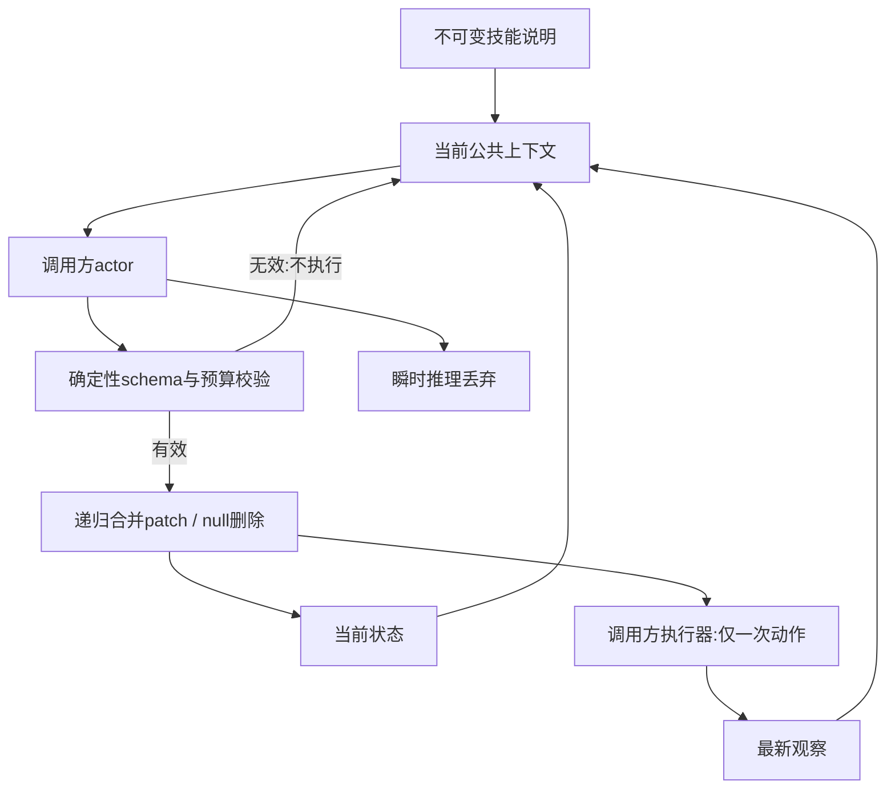
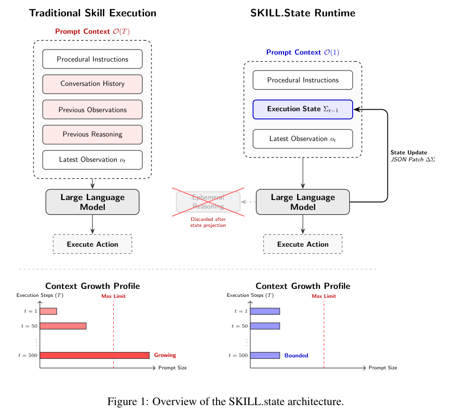

# SKILL.state：显式执行状态替代不断增长的对话历史

## 论文信息

| 字段 | 内容 |
| --- | --- |
| 论文链接 | [SKILL.state](https://arxiv.org/abs/2608.26263)，本轮核对[v3正文](https://arxiv.org/html/2608.26263v3) |
| 公司/机构 | 一作 Sanket Badhe：Google LLC；合作单位包括 Purdue University |
| 首次公开日期 | 2026-08-26 18:00:06 UTC；v3为2026-09-02，本轮因Google目录新增链接补发现，不是10月新发 |
| 原作者开源代码 | 未找到作者发布的官方代码；社区同名实现不当作作者开源 |
| 本地 Adapter | `skill-state`：组件键，未注册为完整论文CLI adapter |
| 本地代码 | `src/auto_research/agent_research/skill_state.py`；入口 `scripts/run_oct19_skill_state.py` |

> **仅运行时组件。** 不调用LLM、商业API、真实终端或官方benchmark；固定schema、格式校验和公共上下文边界可执行，不等于长程智能已复现。

## 原始论文总结

### 背景与主要改动

普通Agent把旧观察、动作和推理反复塞回下一轮。SKILL.state把可持续的信息投影到当前执行状态，每步只传技能说明、状态和最新观察；不是在完整对话外再加一个状态块。模型生成结构化patch和动作，运行时验证后提交，瞬时推理不保留。定义性流程见[§3与算法1](https://arxiv.org/html/2608.26263v3#S3)。



<!-- paper-figure:start -->
### 原论文关键图

[](https://arxiv.org/pdf/2608.26263v3#page=4)

> **原论文 Figure 1（关键图）**：SKILL.state v3 的执行架构：只保留固定技能、当前状态和最新观察，验证更新后丢弃中间推理；完整保留左右对比与下方上下文增长示意。图片来自[原论文](https://arxiv.org/abs/2608.26263)，版权归原作者所有；点击图片可查看来源。
<!-- paper-figure:end -->

### 核心公式

$$
C_t=(P,\Sigma_t,O_t),\qquad
\Sigma_{t+1}=\Sigma_t\oplus\Delta\Sigma_t.
$$

$\oplus$是保留未修改字段的递归合并，`null`删除对应键。原文的线性累计上下文结论依赖固定schema能够承载充分状态、观察与状态规模不随轮次无限增长；不是任意任务的无条件常数内存保证。需要历史本身作审计产物、schema未知或遗漏早期关键事实时，该假设可能失效。[局限](https://arxiv.org/html/2608.26263v3#S7)

### 论文离线与线上效果

作者在受控仓库、模拟代码仓库、InterCode CTF和tau-Bench上比较长程表现与上下文成本；没有生产线上A/B。表1在T=100的Gemini-3-Flash仓库任务中报告SKILL.state约65K tokens，而带完整历史的stateful基线约1.06M；这是作者设定的观察，不是本地测量。原文也报告小型开放模型主要失败于状态覆盖、类型错误与JSON格式问题，不能只保留收益。[原文结果与失败分析](https://arxiv.org/html/2608.26263v3#S5)

## 本地复现

```bash
PYTHONPATH=src python scripts/run_oct19_skill_state.py \
  --device cpu --seeds 42,43,44 \
  --output runs/oct19-skill-state/fresh-result.json
```

运行时实际执行递归合并、null删除、schema拒绝、原状态保留及有界重试。传入actor的是只含三种公共信息的不可变字符串视图，不包含gold、grader、旧回答或旧观察。actor与执行器由调用方注入，本地诊断只做公开计数事件和惰性动作回调；不是语言模型。

本地字符上限和最多8次格式重试是资源保护，不声称原文固定此数值。原文算法先提交有效状态、再执行动作；执行器抛错时本地不盲目重试，也不声称已撤销外部副作用。调用方必须处理动作失败的最新观察。该模块不是Python回调或真实工具的安全沙箱。

### 数据、结果和代码映射

构造输入版本为 `synthetic-skill-state-public-counter@oct19-skill-state-contract-v1`。每seed执行200个公共事件，独立重算状态，注入一次不合schema的patch，核对没有提前执行动作；以附加全部旧文本的负对照检验上下文增长。只报告运行时字符和协议计数，不报告模型准确率、真实token费用或官方任务成功率。稳定结果由统一验收器写入[CPU指标](metrics/component-cpu-seeds42-44.json)。

### 成本与复现边界

最终 CPU seeds42/43/44 每seed实际执行200个公共事件，独立状态重算误差、旧推理重放数和重试公共上下文漂移均为0；每seed恰有一次格式拒绝重试。产物绑定提交 `8c963f810e45ce3886e43b1b5da39980e41c95c0`，仍只是运行时合同验证，不代表LLM能够正确产生状态patch。

完整协议包括多个模型、多个运行时、五种子、多档10–200步流程、真实工具benchmark和压缩对照；仅一个T=200的历史基线就可能累计数百万tokens。现有单A100/A30或Mac不承担该多臂长程API/模型推理矩阵。**成本过高，不复现（审查 DONE）**；不下载权重、不试跑完整实验、不自动重试。未接入可晋级Evolve算子，`diagnostic_only=true`、`promotion_eligible=false`、`evolve_integrated=false`。
