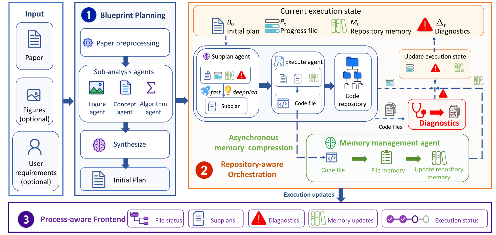

<!-- source-sha256: 87b335c281377d3c0afd54b370011d9c93101c9655f9c3d137de2befc959d81b -->

[简体中文](README.md) · English

# DeepRepro: Paper reproduction with repository-aware replanning

> **Core mechanism mini-suite.** Implements repository snapshots, state-aware subplans and runtime-feedback repair.

## Paper information

| Field | Details |
| --- | --- |
| Paper | [arXiv 2608.26557](https://arxiv.org/abs/2608.26557) |
| Institution | Institute of Computing Technology, Chinese Academy of Sciences / University of Chinese Academy of Sciences (first author affiliations) |
| First public release | 2026-08-27 (arXiv v1; CIKM 2026) |
| Author code | [Released DeepRepro code](https://github.com/ruyisy/DeepRepro). |
| Local adapter or method key | `deeprepro` |
| Local reproduction code | [`src/auto_research/agent_research/latest_20260831.py`](https://github.com/daiwk/auto-research/blob/main/src/auto_research/agent_research/latest_20260831.py) |

## Original paper summary

### Background and main changes

A one-shot global plan becomes stale as files, dependencies and interfaces change. At every stage, DeepRepro reads the current repository and runtime feedback, rewrites the detailed subplan, and advances implementation through repository-aware orchestration.


<!-- paper-figure:start -->
### Key figure from the paper

[](https://arxiv.org/html/2608.26557v1/fig_main.png)

> **Figure 1:** Core architecture, modules and connections. From the [paper](https://arxiv.org/abs/2608.26557); copyright belongs to the authors. Click for the source.
<!-- paper-figure:end -->

### Core equations

$$
p_{t+1}=\operatorname{Subplan}(paper,repo_t,feedback_t).
$$

## Local reproduction

PlanBench-mini, 120 episodes: joint success **1.0000**, average cost **0.4300**; state snapshots, subplan revisions and repairs are recorded. See [metrics](metrics/planbench-mini-seed42.json).

## Scope

The official PaperBench Code-Dev benchmark was not run. Deterministic plan/answer success is not a paper result; the local run verifies state-driven replanning.

## PaperBench / Code-Dev artifact replay

`public-agent-artifact-eval --method deeprepro` reads a pinned PaperBench Code-Dev or official DeepRepro export, replaying plans, executed steps and tests in paper/state order. It compares first-round static planning with subplans rewritten after reading repository state at each round. Three seeds only sample the matched-budget static baseline.

```bash
auto-research public-agent-artifact-eval --method deeprepro \
  --artifact paperbench-code-dev.jsonl --dataset-id paperbench-code-dev \
  --dataset-revision <immutable-sha> --seeds 42,43,44
```

The official repository releases system code but not all API-budget traces. Real artifact replay is supported, not a complete agent or API cost reproduction.
