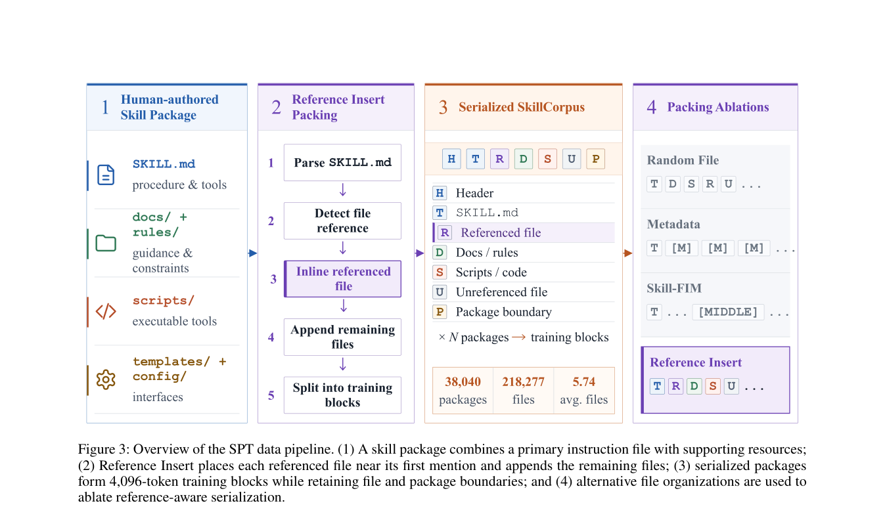

# SPT: Multi-File Skills as Agent Pretraining Data

<!-- source-sha256: f48848b41b69947f7606479b3df1ddc4a77f3d5d6e4e22292cfcf2ce4593e1e9 -->

[简体中文](README.md)

> **Core mechanism evidence.** Paper and local evaluation are separate.

## Paper information

| Field | Value |
| --- | --- |
| Paper | [arXiv 2608.26563](https://arxiv.org/abs/2608.26563) |
| Affiliations | Beijing University of Posts and Telecommunications (first affiliation), with Tsinghua University |
| First public release | 2026-08-27 (arXiv v1) |
| Authors' code | Artifact availability stated; no public repository found as of 2026-08-29. |
| Adapter / method | `spt` |
| Local code | [`src/auto_research/agent_research/latest_20260829.py`](https://github.com/daiwk/auto-research/blob/main/src/auto_research/agent_research/latest_20260829.py) |

## Original paper

### Background and contribution

Trajectories are expensive and describe one execution. Skill packages encode reusable workflows. Mid-train a causal LM on SkillCorpus before post-training; Reference Insert places cited files near first use.

<!-- paper-figure:start -->
### Key figure from the paper

Original Figure 3: SPT. From the [paper](https://arxiv.org/abs/2608.26563); copyright belongs to the authors. Not a local result.
<!-- paper-figure:end -->

### Core mechanism

$$
\mathcal D_\alpha=\alpha\mathcal D_{skill}+(1-\alpha)\mathcal D_{general},\quad \mathcal L=-\sum_t\log p_\theta(x_t\mid x_{<t}).
$$

### Paper results

Across three sizes and SFT/RL recipes, the paper beats no mid-training, generic corpora, and trajectory mid-training while largely retaining general ability.

## Local reproduction

ToolRoute L2.1 without oracle, three seeds: joint success 0.8056, plan F1 0.8340, mean cost 4.9439. [Results](metrics/toolroute-l2-seeds42-44.json) and [batch index](../../experiments/latest-20260829-seed42.json).

## Reproduction limits

No actual LLM checkpoint trained. The test covers multifile assembly and skill priors for oracle-free tool routing.
