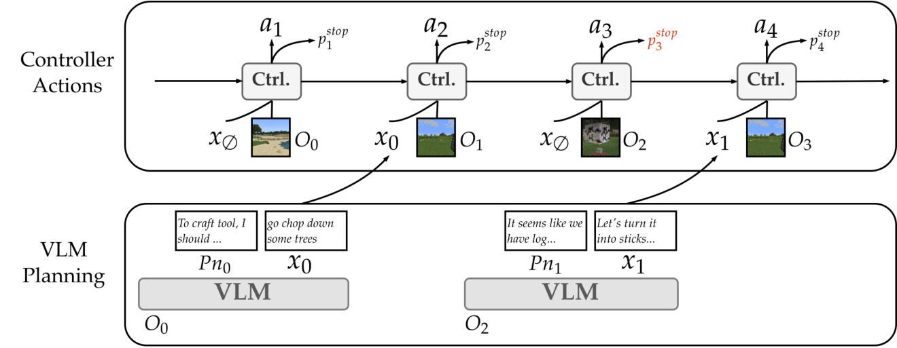

<!-- source-sha256: 82fd13e09ebc60a9ddef4b2986e7700afd4c1642d702a5ad847451245dd75ab7 -->
# Instruct-to-Act: post-hoc interval labels and instruction BC/stop objectives

[简体中文](README.md)

> **component_only/L1 mechanism diagnostics, not full-model or agent capability.** The full experiment is not reproduced because of cost (review DONE); only the explicitly bounded components below execute.

## Paper information

| Field | Value |
| --- | --- |
| Paper | [Decoupling Planning and Control for Instructable Agents](https://arxiv.org/abs/2608.26788v1), [fixed v1](https://arxiv.org/html/2608.26788v1) |
| Institution | First author Zineng Tang, UC Berkeley; verified priority affiliations: Google DeepMind. Collaboration does not replace the first-listed affiliation |
| Original publication | **2026-08-27 08:17:58 UTC**; a historical repair, not a November13 first release |
| Authors' code | [Verified public repository](https://github.com/zinengtang/instruct-to-act-code); presence does not mean the full system ran locally |
| Local adapter / key | `instruct-to-act`; `adapter=null`; no Evolve integration |
| Local code | `src/auto_research/agent_research/instruct_to_act.py` |

## Original paper

### Motivation and changes

VLMs provide high-level planning but struggle with unfamiliar low-latency control; world-model controllers act quickly but lack open-ended task guidance. Instruct-to-Act connects them with sparse language instructions and labels its own rollouts rather than expert demonstrations.

Non-overlapping replay intervals receive external VLM instruction embeddings, with completion only at the last step. BC trains labeled actions; stop predicts instruction completion. Model/value/actor losses remain necessary. The local objective does not replace Dreamer or fabricate a language encoder.

### Architecture


<!-- paper-figure:start -->
### Key original figure

[](https://arxiv.org/html/2608.26788v1/dynamicmodel.png)

From the [original paper](https://arxiv.org/html/2608.26788v1#S1.F1); copyright remains with the original authors. These are official HTML PNG bytes without cropping, redrawing or PDF rendering. The original decoupled VLM–controller architecture; local code provides labels and two loss terms only.
<!-- paper-figure:end -->

### Core equations

$$
L_{BC}=-\lambda_{BC}\sum_{[u,v]\in I}\sum_{t=u}^{v}\log\pi(a_t\mid s_t,e_t),\qquad
L_{stop}=-\sum_t[c_t\log p_t+(1-c_t)\log(1-p_t)].
$$

The kernel keeps the paper's sum reductions: BC covers annotated positions; stop covers every valid logged step, including unannotated completion=false negatives. Padding is excluded. Intervals are explicit zero-based inclusive non-overlapping ranges. Labels generate no instruction and establish no annotation quality.

### Author results

Across seven embodied environments, authors compare VLM planners, controller-only and direct action generation, reporting gains on most tasks and planner swapping. Failures and environment-specific training remain; this is not universal zero-shot robotics. No production A/B is reported. Local code reports no environment success.

## Local reproduction

### Protocol and code mapping

interval_labels builds annotation/completion masks for one logged episode. instruction_losses computes actual tensor BC and stop BCE, validating mask implications, log-prob≤0, finite values and devices. Diagnostic log-probabilities come from real softmax with backpropagation, not a device label.

```bash
PYTHONPATH=src python -c 'from auto_research.agent_research.instruct_to_act import diagnostic; print(diagnostic(42))'
PYTHONPATH=src python -m pytest tests/test_nov13_colm_agent_components.py -q
```

### Evidence and controls

Checks cover non-overlap, completion at interval ends, zero BC gradients on unannotated actions, unannotated stop negatives, excluded padding and exact sums. CUDA requires actual A100/A30 three-seed execution. These checks train no RSSM and establish no instruction-following capability.

Three-seed mechanism receipts are in [CPU metrics](metrics/component-cpu-seeds42-44.json) and [CUDA metrics](metrics/component-cuda-seeds42-44.json) and the batch's frozen record. Fixed-input diagnostics are not full training, capability gain or online benefit. GPU acceptance requires actual A100/A30 evidence.

## Boundaries

RSSM, Dreamer model/value/actor losses, MiniLM instruction encoding, GPT4o annotation, asynchronous planner threads, environments and policy learning are absent. Fixed tensor losses imply neither low-latency planning nor robotic safety. Evolve is not integrated.

### Full experiment not reproduced

Authors train an800M controller per environment across seven environments on four RTX A6000s, averaging23 and reaching36 hours per environment. GPT4o annotation adds about17% GPU-hours. This paper/upstream configuration exceeds the current single-A100/A30-or-Mac budget. It is a source-reported configuration, not local training measurement. No cost probe, paid API, checkpoint download or full experiment was attempted. **Too costly; not reproduced (review DONE)**. Automatic retry and implementation queues remain disabled.
