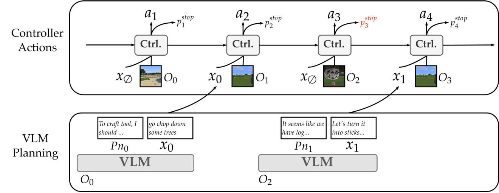

# Instruct-to-Act：后标注区间与指令 BC／停止目标

[English](README-en.md)

> **component_only／L1机制诊断，不是完整模型或Agent能力复现。** 完整实验成本过高，不复现（审查 DONE）；仅以下精确定义子组件可执行。

## 论文信息

| 字段 | 内容 |
| --- | --- |
| 论文链接 | [Decoupling Planning and Control for Instructable Agents](https://arxiv.org/abs/2608.26788v1)，[固定 v1 原文](https://arxiv.org/html/2608.26788v1) |
| 公司 / 机构 | 一作 Zineng Tang，UC Berkeley；已核优先署名：Google DeepMind，合作属性不覆盖第一署名机构 |
| 首次公开日期 | **2026-08-27 08:17:58 UTC**；历史补漏，不是2026-11-13新首发 |
| 原作者代码 | [已核公开仓库](https://github.com/zinengtang/instruct-to-act-code)；不代表本地已运行完整系统 |
| 本地 adapter / key | `instruct-to-act`；`adapter=null`；未接入Evolve |
| 本地复现代码 | `src/auto_research/agent_research/instruct_to_act.py` |

## 原始论文总结

### 背景与主要改动

VLM 擅长低频高层规划，但不擅长陌生环境的低延迟动作；world-model controller 能高频动作，却缺开放任务指导。Instruct-to-Act 用稀疏文本指令连接二者，并用自身rollout后标注指令，而非专家示范。

从replay选择互不重叠区间，为区间各步绑定同一外部VLM指令embedding，只在末步标complete。BC训练已标注动作，stop目标训练指令完成，模型／value／actor原损失仍须保留。局部loss不是拿BC替掉Dreamer或伪造语言encoder。

### 架构与流程


<!-- paper-figure:start -->
### 原论文关键图

[](https://arxiv.org/html/2608.26788v1/dynamicmodel.png)

图片来自[原论文](https://arxiv.org/html/2608.26788v1#S1.F1)，版权归原作者所有。保存官方HTML原PNG字节，未裁剪、重画或PDF渲染。原文VLM–controller解耦架构；本地仅标注标签和两个损失项。
<!-- paper-figure:end -->

### 核心公式

$$
L_{BC}=-\lambda_{BC}\sum_{[u,v]\in I}\sum_{t=u}^{v}\log\pi(a_t\mid s_t,e_t),\qquad
L_{stop}=-\sum_t[c_t\log p_t+(1-c_t)\log(1-p_t)].
$$

本地保留原文sum reduction：BC只作用于annotated位置，stop在所有valid日志步上计算，未标注valid位置complete=false，padding不计。区间用显式零基闭区间且不得重叠，completion只在末端；这一标签合同不生成指令或证明标注质量。

### 论文离线与线上效果

作者在七个具身环境中比较VLM planner、controller-only及直接动作生成，报告多数任务的收益与规划器替换能力。仍有环境失败和controller训练范围约束，不能写成通用零样本机器人。未报告生产线上 A/B；本地没有环境成功率。

## 本地复现

### 数据协议与代码映射

`interval_labels` 给已有单episode日志生成annotated/completion mask；`instruction_losses` 在真实张量计算BC与stop BCE，检查mask蕴含关系、log-prob≤0、有限值和同设备。诊断中log-prob来自真实softmax并反向传播，非只给device标签。

```bash
PYTHONPATH=src python -c 'from auto_research.agent_research.instruct_to_act import diagnostic; print(diagnostic(42))'
PYTHONPATH=src python -m pytest tests/test_nov13_colm_agent_components.py -q
```

### 结果与负控

检查区间不重叠、仅末端stop正标签、未标注动作无BC梯度、未标注有效步仍是stop负例、padding无梯度、sum精确值。CUDA须真实A100/A30三seed验证；这不训练RSSM或测得指令遵循能力。

三seed机制执行回执见[CPU组件指标](metrics/component-cpu-seeds42-44.json)与[CUDA组件指标](metrics/component-cuda-seeds42-44.json)及本轮冻结记录；它是固定输入机制诊断，不是完整训练、能力提升或线上收益。GPU验收仅以真实A100/A30回执为准。

## 复现边界

没有RSSM、Dreamer actor/value/model losses、MiniLM指令编码、GPT4o标注、异步VLM线程、Minecraft/其他环境bridge或策略学习。无法由固定tensorloss推断低延迟规划或机器人安全；本地不接Evolve。

### 高成本完整实验

800M每环境controller、7环境、4×RTXA6000、平均23h/最高36h每环境，GPT4o标注增17%GPUh；完整训练高成本不复现。 这是论文／上游配置成本依据，不是本地训练测量。没有为估价试训、调用收费API或下载checkpoint。**成本过高，不复现（审查 DONE）**；不进入自动重试或自动实现队列。
