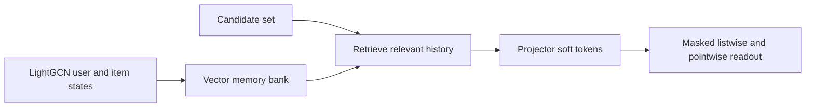
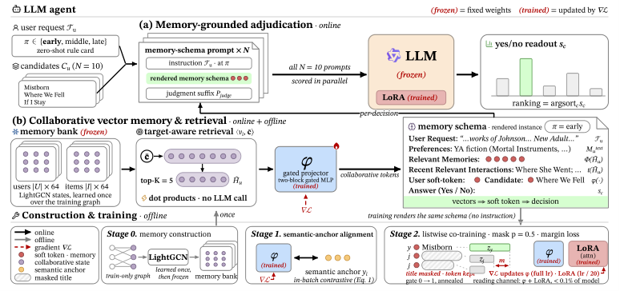

# CoVeMem: trainable collaborative vector memory for agents

<!-- source-sha256: 959a830c3b04af2a27bd0278afb70aef87ab5b02c13d8d7fa581e59c3e750bf8 -->

[简体中文](README.md)

> **Core mechanism plus L2.1 oracle-free evaluation.** Implements candidate-set retrieval, a vector-memory bank, and a soft-token read diagnostic.

## Paper information

| Field | Details |
|---|---|
| Paper | [arXiv 2608.26895](https://arxiv.org/abs/2608.26895) |
| Organization | Shenzhen Technology University, the first listed affiliation of the first author |
| First public release | 2026-08-27 (arXiv v1) |
| Authors' code | No public author code was found when checked on 2026-08-29. |
| Adapter / method | `covemem` |
| Local reproduction code | [`src/auto_research/agent_research/latest_20260829.py`](https://github.com/daiwk/auto-research/blob/main/src/auto_research/agent_research/latest_20260829.py) |

## Original paper

### Motivation and method

Text memory needs repeated LLM rewriting and loses full-catalog collaborative geometry. CoVeMem builds a bank from frozen LightGCN states, retrieves history relevant to the current candidate set, and projects it into soft tokens. Semantic alignment and masked listwise co-training teach the LLM to read memory.

<!-- paper-figure:start -->
### Key figure from the paper

> **Figure 2:** Overview of the paper's method and key components. From the [original paper](https://arxiv.org/abs/2608.26895); copyright remains with the authors.
<!-- paper-figure:end -->

### Core equations

$$
M_C=\operatorname{TopK}_{h\in H_u}\operatorname{sim}(e_h,\bar e_C),\qquad \mathcal L=\mathcal L_{align}+\lambda\mathcal L_{list}.
$$

### Paper results

CoVeMem matches or exceeds the strongest textual collaborative-memory method in **19 of 20 metric cells** across four InstructRec benchmarks. Memory maintenance adds **zero** LLM calls after static profiling.

## Local reproduction

Three ToolRoute-L2.1 seeds yield joint success **0.7708**, plan F1 **0.8004**, and mean cost **4.5197**.

See the [metrics](metrics/toolroute-l2-seeds42-44.json) and [batch index](../../experiments/latest-20260829-seed42.json).

## Reproduction boundaries

No LightGCN or LoRA checkpoint was trained. This verifies candidate-conditioned vector reads and control flow without text rewriting.
