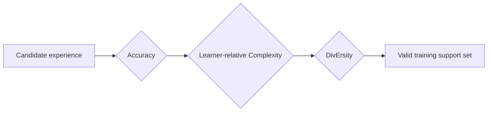
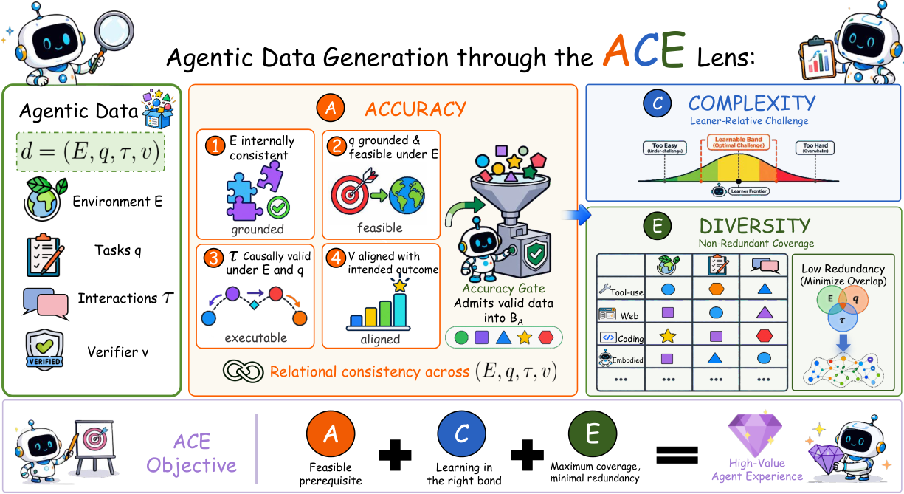

<!-- source-sha256: b040c674fb72f33298e61d32031fab4195c59d176dda775b8b878cd21d182b5a -->

[简体中文](README.md) · English

# ACE Lens: Accuracy, complexity and diversity in agent data

> **Executable framework mini-suite.** The survey proposes a common framework; the local version implements its three data-admission gates.

## Paper information

| Field | Details |
| --- | --- |
| Paper | [arXiv 2608.27260](https://arxiv.org/abs/2608.27260) |
| Institution | Huawei Technologies Co., Ltd. (first listed affiliation of the first author) |
| First public release | 2026-08-27 (arXiv v1; manuscript dated 2026-08-28) |
| Author code | Survey paper; no public author code found on 2026-08-31. |
| Local adapter or method key | `ace-data` |
| Local reproduction code | [`src/auto_research/agent_research/latest_20260831.py`](https://github.com/daiwk/auto-research/blob/main/src/auto_research/agent_research/latest_20260831.py) |

## Original paper summary

### Background and main changes

The paper represents agent data as $(E,q,\tau,v)$: environment, task, interaction trajectory and optional verifier. Accuracy defines trustworthy support, Complexity calibrates difficulty relative to the learner, and Diversity controls environment, task and behavior coverage.



<!-- paper-figure:start -->
### Key figure from the paper

[](https://arxiv.org/html/2608.27260v1/ace_lens.png)

> **Figure 1:** Overall design and components. From the [paper](https://arxiv.org/abs/2608.27260); copyright belongs to the authors. Click for the source.
<!-- paper-figure:end -->

### Core equations

$$
D=\{(E,q,\tau,v):A(E,q,\tau,v)=1,\ C\in\mathcal B_L,\ \operatorname{Div}(D)\ge\delta\}.
$$

## Local reproduction

On PlanBench-mini, 120 episodes produced joint success **1.0000** and average cost **0.3700**. The run records accuracy gates, complexity calibration and diversity accept/reject decisions. See [metrics](metrics/planbench-mini-seed42.json).

## Scope

This executes a framework admission contract, not a trained model or public benchmark SOTA.

## Public agent-data evaluation path

`public-agent-artifact-eval --method ace-data` accepts pinned public trajectory exports such as ToolACE and APIGen-MT. It requires verifier, learner loss, environment, task and trajectory fields, and compares random sampling with three-stage Accuracy → learner-relative Complexity → Diversity admission under the same budget.

```bash
auto-research public-agent-artifact-eval --method ace-data \
  --artifact toolace-export.jsonl --dataset-id Team-ACE/ToolACE \
  --dataset-revision <immutable-sha> --seeds 42,43,44
```

The paper is an analysis framework, not one checkpoint. The extension provides auditable data selection, matched three-seed controls and provenance, not an invented “ACE model.”
