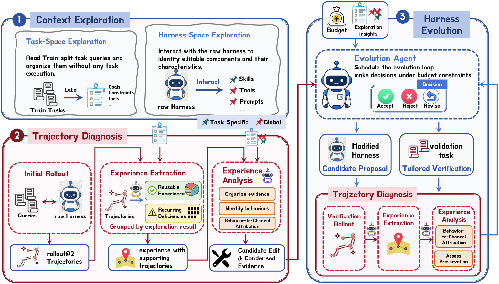

# HarnessLens: Low-budget, behavior-targeted harness verification

<!-- source-sha256: 3100193b7773779338fcb465a62d16395d2644032b7ca9772a236c377751ccd2 -->

[简体中文](README.md)

> Core mechanism plus oracle-free L2.1 evaluation: behavior selection, paired verification and attributable evidence.

## Paper information

| Field | Details |
|---|---|
| Paper | [arXiv 2608.27311](https://arxiv.org/abs/2608.27311) |
| Institution | School of Data Science, Fudan University (first-listed affiliation of first author). |
| First public release | 2026-08-27 (arXiv v1) |
| Author code | [jhxu5214/HarnessLens](https://github.com/jhxu5214/HarnessLens). |
| Local adapter or method key | `harnesslens` |
| Local reproduction code | [`src/auto_research/agent_research/latest_20260829.py`](https://github.com/daiwk/auto-research/blob/main/src/auto_research/agent_research/latest_20260829.py) |

## Paper method and evidence

A fixed validation set spends rollouts on unaffected behaviors and can average away regressions. Propose changes from execution traces, run paired checks only on tasks tied to affected behavior, and require evidence attributable to the change.

<!-- paper-figure:start -->
### Original paper figure

The original figure shows behavior-focused selection and verification. From the [original paper](https://arxiv.org/abs/2608.27311); copyright remains with the authors.
<!-- paper-figure:end -->

### Core equation

$$
\Delta_b=R_b(h')-R_b(h),\quad \mathrm{accept}(h')=\mathbf1[\Delta_b>0\land A_b=1].
$$

### Reported results

The paper reports **7.6%–13.6%** average held-out improvements across three harnesses and four benchmarks with lower validation budget.

## Local reproduction

Three-seed ToolRoute-L2.1 joint success **0.8194**, plan F1 **0.8372**, mean cost **5.0419**. [Metrics](metrics/toolroute-l2-seeds42-44.json) and [batch results](../../experiments/latest-20260829-seed42.json). Frozen test and real tool feedback without answer/guide interfaces; no full paper benchmarks.
