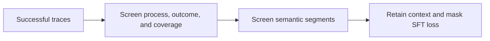
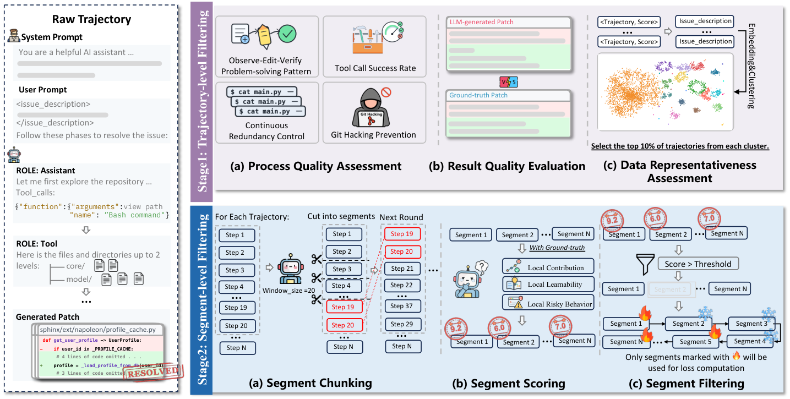

# SWE-Prime: Train software agents on fewer, higher-quality trajectory segments

<!-- source-sha256: a8d33f6a920a44e8e04db0da01a3cb45965d2d4abde0c535515610d42d952677 -->

[简体中文](README.md)

> Core mechanism plus oracle-free L2.1 evaluation: trajectory screening, segment screening and loss mask.

## Paper information

| Field | Details |
|---|---|
| Paper | [arXiv 2608.27449](https://arxiv.org/abs/2608.27449) |
| Institution | Sun Yat-sen University (first-listed affiliation of first author), with Huawei Cloud and Chongqing University. |
| First public release | 2026-08-27 (arXiv v1) |
| Author code | No public author code found as of 2026-08-29. |
| Local adapter or method key | `swe-prime` |
| Local reproduction code | [`src/auto_research/agent_research/latest_20260829.py`](https://github.com/daiwk/auto-research/blob/main/src/auto_research/agent_research/latest_20260829.py) |

## Paper method and evidence

Even successful trajectories can be redundant, unsafe or unlearnable. Select traces for process, outcome and representativeness, then select semantic segments for contribution, learnability and risk. Keep all context but compute SFT loss only on retained segments.

<!-- paper-figure:start -->
### Original paper figure

The original figure shows the trajectory and segment selection stages. From the [original paper](https://arxiv.org/abs/2608.27449); copyright remains with the authors.
<!-- paper-figure:end -->

### Core equation

$$
\mathcal L=-\sum_t m_t\log p_\theta(y_t\mid y_{<t},x),\quad m_t\in\{0,1\}.
$$

### Reported results

With only **10%** of the trajectories, the paper reports up to **12.2% / 24.2%** improvements over all-successful-trajectory training on SWE-Bench Pro / Verified.

## Local reproduction

Three-seed ToolRoute-L2.1 joint success **0.7708**, plan F1 **0.8004**, mean cost **4.5497**. [Metrics](metrics/toolroute-l2-seeds42-44.json) and [batch results](../../experiments/latest-20260829-seed42.json). No code LLM training or official SWE-Bench; this compares filters under the same observation/tool interface.
