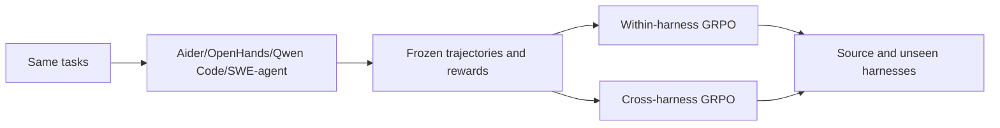
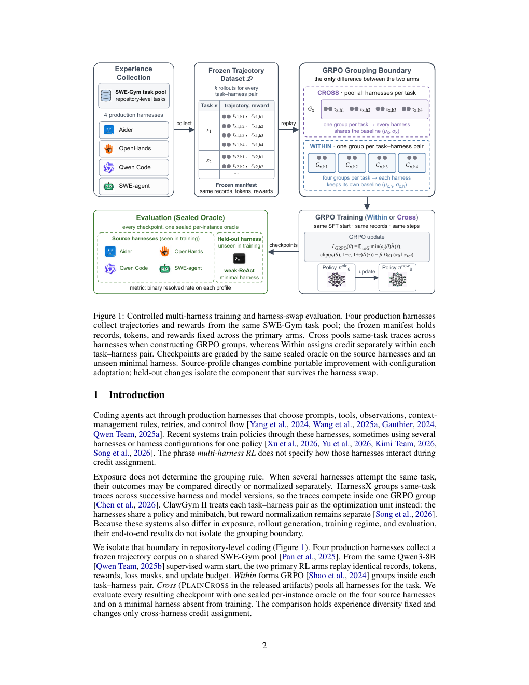

# Multi-Harness RL: Does the training gain come from the policy or the harness?

<!-- source-sha256: 3ceb05eb5ffa6d3e5a8d72ffe4fe4a63b8e1651e12f7a0f9ecb0cc1b896f2cc8 -->

[简体中文](README.md)

> **Fidelity: CPU group-credit and differentiable training operators.** Computes task-by-harness and task-level normalized advantages on identical rollouts. It does not include held-out harness transfer for a real coding agent.

## Paper information

| Field | Value |
| --- | --- |
| Paper link | [arXiv 2609.04518](https://arxiv.org/abs/2609.04518) |
| Organization | New York University (first listed affiliation of the first author) |
| First published | 2026-09-03 (arXiv v1) |
| Original author code | The paper says result artifacts were released, but no verifiable public repository link was found (checked 2026-09-07). |
| Adapter / method | `multi-harness-rl` |
| Local reproduction code | [`src/auto_research/agent_research/latest_20260907.py`](https://github.com/daiwk/auto-research/blob/main/src/auto_research/agent_research/latest_20260907.py) |

## Original paper summary

### Background and main changes

Multi-harness RL changes both execution-environment diversity and GRPO grouping, making gains hard to attribute. The study freezes the same task–harness trajectories and compares only within- and cross-harness advantages. It evaluates transfer on a minimal harness not used during training.

<!-- paper-figure:start -->
### Key figure from the paper

**Original Figure 1:** Frozen experience, two credit groupings, and sealed held-out evaluation. Image from the [original paper](https://arxiv.org/abs/2609.04518); copyright belongs to the authors. Click the image for its source.
<!-- paper-figure:end -->

### Core equation

Within normalizes rewards separately for each $(task,harness)$. Cross normalizes over different harnesses on the same task. Report actual transfer as $\Delta=R_{cross}-R_{within}$ on unseen harnesses with confidence intervals.

### Offline and online results in the paper

Across 24,000 sealed SWE-bench Verified evaluations, changing the evaluation harness shifts average resolution rate from 2.14% to 9.27%; the training recipe matters substantially less. Held-out Cross–Within is only +0.25pp, with a 95% CI of [-0.48,+1.02].

## Local reproduction

### 2026-09-08 fidelity correction

The old path returned evaluation labels directly. Its accuracy and plan success rates are withdrawn. The entry point now accepts only task_id, intent, and context. Regression tests fail on reading answer, plan, or hidden required_tools. New legacy results only diagnose public text formatting; a score of 1 is not agent capability. Cost counts records read, not tool fees.

The actual operator is in [`sep7_mechanisms.py`](https://github.com/daiwk/auto-research/blob/main/src/auto_research/agent_research/sep7_mechanisms.py). Run `python -m pytest tests/test_sep7_fidelity.py -q` for memory paths, private skill edits, unchanged state after rejection, cross-group credit differences, and backpropagation. Standalone operators do not demonstrate an integrated LLM, live tool environment, or end-to-end Evolve workflow.

See [metrics/mini-suite-seeds42-44.json](metrics/mini-suite-seeds42-44.json) for within/cross grouping, held-out audit, rolewise update, and cost at seeds 42/43/44.

> **Control:** The local experiment validates the protocol and counters, not SWE-bench Verified, Aider, or OpenHands integration.

## Reproduction limits

The real coding harnesses, Qwen3-8B RL, and sealed oracle are not reproduced. The operator is intended to prevent future Evolve experiments from mistaking harness differences for model capability.
