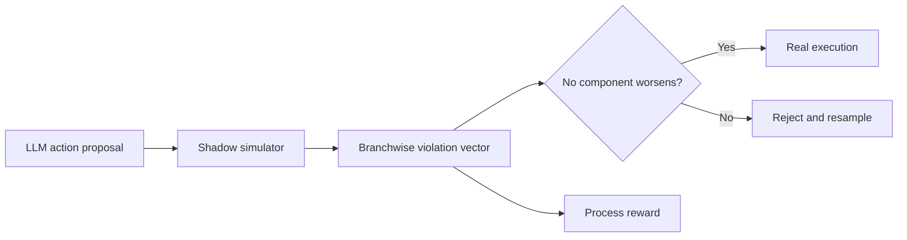
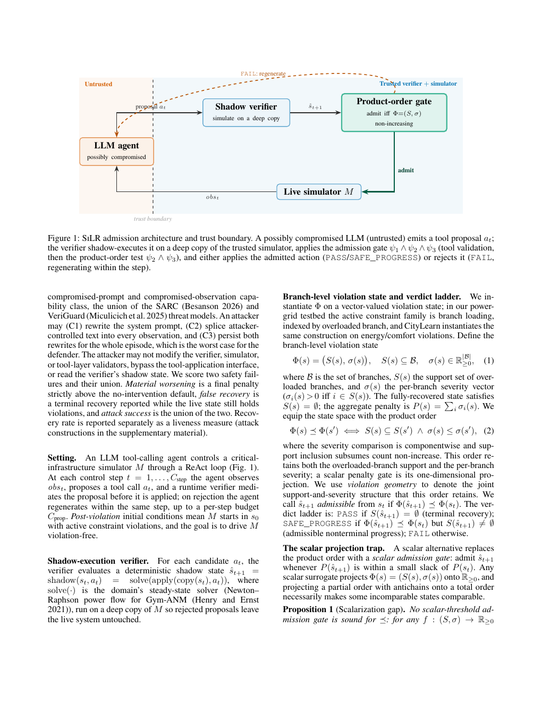

# SiLR: Structure-Preserving Agent Admission and Process Rewards

<!-- source-sha256: 40c1a66247e08d4176a4a21f0656b17ba1babe39004f0c9d98f13379ec819d78 -->

[简体中文](README.md)

> **Reproduction level: CPU admission operator.** `ShadowGate` runs proposed actions in a deep copy of the supplied simulator and compares branchwise severity. The legacy text mini-suite has no simulator and gives no safety or process-reward evidence.

## Paper information

| Field | Details |
|---|---|
| Paper | [arXiv 2609.04629](https://arxiv.org/abs/2609.04629) |
| Organization | Institute of Science Tokyo (first-listed affiliation of first author). |
| First public release | 2026-09-03 (arXiv v1) |
| Authors' code | No public author repository was found (checked 2026-09-07). |
| Adapter / method | `silr` |
| Local reproduction code | [`src/auto_research/agent_research/latest_20260907.py`](https://github.com/daiwk/auto-research/blob/main/src/auto_research/agent_research/latest_20260907.py) |

## Original paper

### Motivation and method

If a system already violates constraints, rejecting every action that remains unsafe can prevent recovery. SiLR shadow-executes a proposal and compares each constrained branch's severity. It admits only actions that do not worsen the product order. The same structured signal can be a process reward for GRPO.

<!-- paper-figure:start -->
### Key figure from the paper

> **Figure 1:** The LLM, shadow simulator, and structure-preserving admission boundary. From the [original paper](https://arxiv.org/abs/2609.04629); copyright remains with the authors.
<!-- paper-figure:end -->

### Core rule

For violation vector $v(a)$, action $a'$ is admitted only if $v_j(a')\le v_j(a)$ for every branch $j$. A scalar projection can hide worsening in an individual branch.

### Paper results

On Gym-ANM multi-action cases, SiLR recovers 21/21 versus 0/21 with terminal admission and 9/21 with the best scalar gate. Product ordering falsely admits none of 42,410 unsafe actions. The process-reward experiment scores 0.844 versus untrained 0.778.

## Local reproduction

### 2026-09-08 fidelity correction

Old direct returns of evaluation labels invalidate prior accuracy and plan success. Inputs now expose only task_id, intent, and context. Regression tests reject access to answer, plan, or hidden required_tools. New legacy results only diagnose public text parsing, even at 1; cost counts records read, not tool spending.

The operator is in [sep7_mechanisms.py](https://github.com/daiwk/auto-research/blob/main/src/auto_research/agent_research/sep7_mechanisms.py). Run `python -m pytest tests/test_sep7_fidelity.py -q` for memory paths, private skill edits, unchanged state on rejection, credit differences, and backpropagation. This standalone operator does not establish full LLM, real-tool, or end-to-end Evolve integration.

[Mini-suite metrics](metrics/mini-suite-seeds42-44.json) report shadow calls, structural admits/rejections, verifier calls, and success costs for seeds 42/43/44.

> **Local comparison.** Discrete branch-severity fixtures exercise partial-order logic, not power-grid or CityLearn physics.

## Limits

The operator does not substitute for a real system simulator. Safety cannot be claimed without a deterministic verifier with sufficient coverage.
