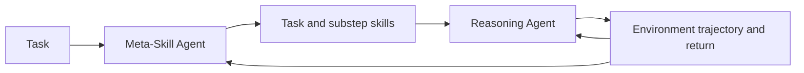
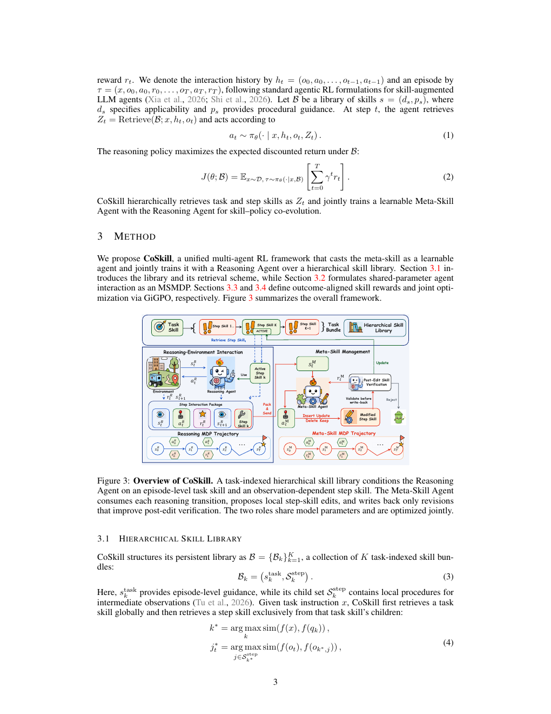

# CoSkill: Joint Reinforcement Learning of Reasoning and Meta-Skill Agents

<!-- source-sha256: a23a84380c04ad6a28f8be37efa969789e45d663843c91b7586e9477926d27c9 -->

[简体中文](README.md)

> **Reproduction level: public-checkpoint training experiment.** The same last-layer parameters of Qwen3-4B receive reasoning and skill-edit gradients, and model-generated actions execute in ToolRoute. This is not the paper's ALFWorld/WebShop, VERL, or 7B training reproduction.

## Paper information

| Field | Details |
|---|---|
| Paper | [arXiv 2609.04865](https://arxiv.org/abs/2609.04865) |
| Organization | Institute of Automation, Chinese Academy of Sciences (first-listed affiliation of the first author). |
| First public release | 2026-09-04 (arXiv v1) |
| Authors' code | [Released: jinyuan-cookie/CoSkill](https://github.com/jinyuan-cookie/CoSkill). |
| Adapter / method | `coskill` |
| Local reproduction code | [`coskill_rollout.py`](https://github.com/daiwk/auto-research/blob/main/src/auto_research/agent_research/coskill_rollout.py)、[`coskill_checkpoint.py`](https://github.com/daiwk/auto-research/blob/main/src/auto_research/agent_research/coskill_checkpoint.py) |

## Original paper

### Motivation and method

Past skill libraries either sit apart from policy optimization or encode meta-skills as fixed workflows. CoSkill lets a Reasoning Agent use task and substep skills and a trainable Meta-Skill Agent rewrite them from execution returns. They share a backbone and train jointly end to end.

<!-- paper-figure:start -->
### Key figure from the paper

> **Figure 3:** The joint reasoning and skill-optimization loop. From the [original paper](https://arxiv.org/abs/2609.04865); copyright remains with the authors.
<!-- paper-figure:end -->

### Core objective

Under shared team return $J(\theta_R,\theta_M)=\mathbb E_{\tau\sim\pi_R,\pi_M}[R(\tau)]$, training alternates reasoning and meta-skill policy updates so that selection and skill content both adapt to the task distribution.

### Paper results

The paper reports 98.4% ALFWorld and 90.6% WebShop success, 3.5 and 6.2 percentage points above comparisons, with better sample and wall-clock efficiency.

## Local reproduction

### 2026-09-08 fidelity correction

The old version directly returned evaluation labels, invalidating prior accuracy and planning success. Inputs now expose only task_id, intent, and context; regression tests fail on reads of answer, plan, or hidden required_tools. Legacy metrics diagnose public text parsing only, even if a metric is 1. Its cost counts records read, not actual tool spending.

The real checkpoint emits tool JSON and receives only public feedback from the current environment transition. The Meta-Skill agent applies private edits only after the full baseline group is complete. Relative return uses reset validation trajectories. Roles normalize credit independently and update the same trainable block. `toolroute-checkpoint` is integrated in the unified Evolve controller, which varies actually executable learning rates and rollout groups. Legacy mini-suite and name-only operators cannot promote. An A100 CLI run executes baseline → CoSkill candidate → validation → selection → final test → report and checks checkpoint restoration. Candidate parameter change is 828.94, but both candidate and baseline score 1.0 on validation, so the baseline remains champion.

Seeds 42/43/44 on A100 show actual parameter updates and nonzero gradients in both roles. Validation success does not improve consistently: 0.9167 → 0.8333, 0.8333 → 0.8333, and 0.9167 → 0.9167; test success is 0.9167, 0.7500, and 0.8333. No proposed edit earned positive gain on reset validation or promoted. See [sanitized metrics](metrics/qwen3-toolroute-a100-seeds42-44.json) and [GPU execution receipt](../../gpu-validations/coskill-checkpoint-a100-20260910.json). These negative results verify training and rejection behavior, not superiority to the frozen checkpoint or reproduction of the original benchmark.

[Mini-suite metrics](metrics/mini-suite-seeds42-44.json) cover task/substep skill retrieval, creation and reuse, collaboration turns, and costs for seeds 42/43/44.

> **Local comparison.** Legacy mini-suite stores programs from public observations; storage does not count as policy training. Regression tests check edit isolation, rejection of non-beneficial edits, and dual-role gradients, not benchmark-score reproduction.

## Limits

The local experiment uses the final Qwen3-4B layer and custom ToolRoute, without original offline skill initialization, SentenceT5 subskill retrieval, ALFWorld/WebShop, or original training scale. Its results are not directly comparable with the paper.
