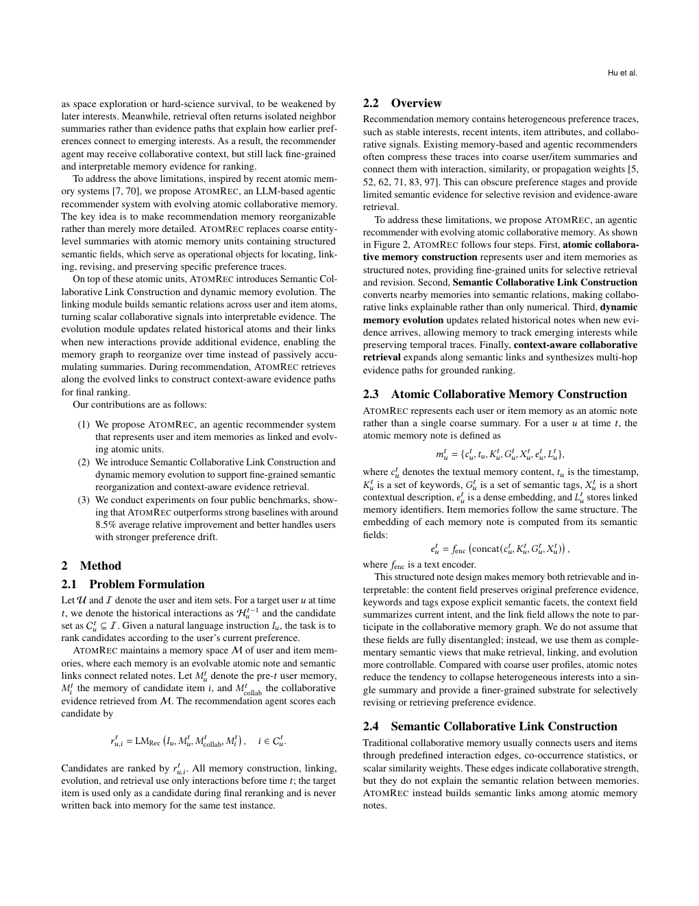

# AtomRec: Atomic Collaborative Memory for Agentic Recommendation

<!-- source-sha256: b1e210c42589cc5059a699e0db2d75112be065a0595e08d686e08b058e057efe -->

[简体中文](README.md)

> **Reproduction level: real-checkpoint atomic memory experiment.** Frozen Qwen generates fields, semantic links, history updates, and candidate rankings with hidden states as encoder. This is not the paper's production system or full benchmark.

## Paper information

| Field | Details |
|---|---|
| Paper | [arXiv 2609.04882](https://arxiv.org/abs/2609.04882) |
| Organization | Xi'an Jiaotong-Liverpool University (first-listed affiliation of first author); Xiaohongshu collaborates. |
| First public release | 2026-09-04 (arXiv v1) |
| Authors' code | No public author repository was found (checked 2026-09-07). |
| Adapter / method | `atomrec` |
| Local reproduction code | [`atomrec_semantic.py`](https://github.com/daiwk/auto-research/blob/main/src/auto_research/agent_research/atomrec_semantic.py)、[`atomrec_checkpoint.py`](https://github.com/daiwk/auto-research/blob/main/src/auto_research/agent_research/atomrec_checkpoint.py) |

## Original paper

### Motivation and method

Coarse profiles may overwrite old preferences, and a single collaborative edge is hard to explain. AtomRec splits item and user histories into independently evolving atomic fields, links them semantically and collaboratively, and retrieves multi-hop paths as recommendation evidence.

<!-- paper-figure:start -->
### Key figure from the paper

> **Figure 2:** Atomic memory, semantic links, and evidence paths. From the [original paper](https://arxiv.org/abs/2609.04882); copyright remains with the authors.
<!-- paper-figure:end -->

### Core formula

For query $q$, path evidence is $s(P|q)=\sum_{(u,v)\in P}\operatorname{sim}(q,m_v)+\lambda w_{uv}$. An update rewrites only matched fields, not the whole profile.

### Paper results

The authors report about 8.5% mean relative improvement across metrics over agentic and memory-augmented baselines on four public datasets.

## Local reproduction

### 2026-09-08 fidelity correction

Old results that directly returned evaluation labels are invalid. Inputs expose only task_id, intent, and context. Regression tests reject reads of answer, plan, or hidden required_tools. New legacy results diagnose public-format parsing only, even at 1; cost counts records read, not actual tool spending.

Memory is rebuilt at each held-out time from pre-target history, excluding the target and all later interactions from prompts. Generated links may reference only provided history IDs. Mean hidden states from the same frozen checkpoint rank supplied candidates by cosine, keeping the catalog closed without access to target labels. Illegal links and malformed JSON fail without falling back to the gold answer.

[Agent mini-suite metrics](metrics/mini-suite-seeds42-44.json) cover atomic writes, multi-hop retrieval, answer/plan success, and cost for seeds 42/43/44.

> **Local comparison.** Amazon Beauty 2014 5-core, six users, 10 candidates, seeds 42/43/44; not the paper's candidate protocol. Validation Hit@3 is 0.333/0.167/0.333 for AtomRec versus 0.500/0.500/0.667 for recent history. AtomRec test is zero on all seeds versus 0.500/0.667/0.667. A test linker referenced an unauthorized item and scored zero, for validity 0.833. See [complete metrics](metrics/amazon-beauty-checkpoint-seeds42-44.json) and [A100 receipt](../../gpu-validations/atomrec-checkpoint-a100-20260910.json). The negative result demonstrates memory and failure-path execution, not an improvement.

## Limits

Original code, prompts, and full configuration were unavailable. Qwen hidden states do not reproduce SentenceT5, and Amazon Beauty is not Xiaohongshu's online distribution. No original system or online A/B reproduction is claimed.
