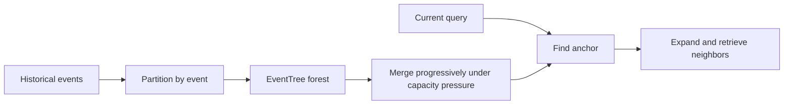
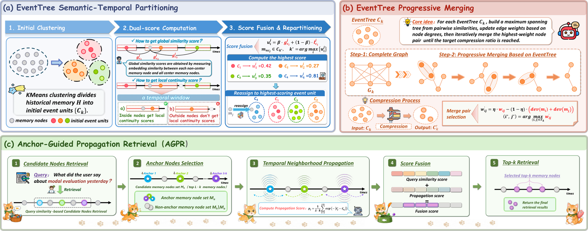

# MemForest: An event-tree forest for long-term memory

<!-- source-sha256: 79e6f34f132ccb1c98b9baa128d33288f17dd8e61036ba1d7b183ef43157b814 -->

[简体中文](README.md)

> Public-observation parsing diagnostic. Event partitioning, progressive merging and anchor-neighborhood retrieval are implemented; term overlap approximates semantics.

## Paper information

| Field | Details |
|---|---|
| Paper | [arXiv 2609.08273](https://arxiv.org/abs/2609.08273) |
| Institution | Shanghai Jiao Tong University (first author). |
| First public release | 2026-09-08 (arXiv v1) |
| Author code | [MemForest](https://github.com/Celina-love-sweet/MemForest). |
| Local adapter or method key | `memforest` |
| Local reproduction code | [`src/auto_research/agent_research/latest_20260912.py`](https://github.com/daiwk/auto-research/blob/main/src/auto_research/agent_research/latest_20260912.py) |

## Paper method and evidence

Partition history by event into separate trees instead of compressing it into one summary. Merge nodes progressively under capacity pressure. Start retrieval from a semantic anchor and expand through neighboring nodes, retaining temporal structure and links between events.

<!-- paper-figure:start -->
### Original paper figure

Figure 2 shows the event-tree memory architecture. From the [original paper](https://arxiv.org/abs/2609.08273); copyright remains with the authors.
<!-- paper-figure:end -->

## Local reproduction

The compact CPU `EventTree` selects trees by token Jaccard overlap and actually compacts them. [Three-seed metrics](metrics/mini-suite-seeds42-44.json). No author embedding model, LLM summarizer, or long-horizon benchmark was run.
