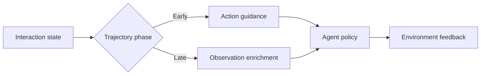
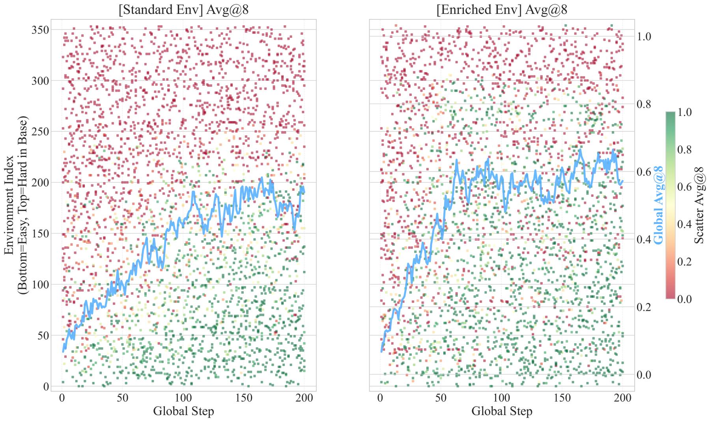

# Environments as Scaffold: switching feedback as trajectories progress

<!-- source-sha256: 1730c0f6bbd5987b15506aa1490fdf8e602c594568ebaf556262861f36e6f39a -->

[简体中文](README.md)

> **Public-observation parsing diagnostic.** Switches from public action guidance early to observation enrichment later, without reading a gold plan.

## Paper information

| Field | Details |
|---|---|
| Paper | [arXiv 2609.08404](https://arxiv.org/abs/2609.08404) |
| Organization | First-author affiliation: Fudan University |
| First public release | 2026-09-08 (arXiv v1) |
| Authors' code | [EnvAsScaffold](https://github.com/HongbangYuan/EnvAsScaffold) |
| Adapter / method | `feedback-scaffold` |
| Local reproduction code | [`src/auto_research/agent_research/latest_20260912.py`](https://github.com/daiwk/auto-research/blob/main/src/auto_research/agent_research/latest_20260912.py) |

## Original paper

### Motivation and method

A single feedback format does not suit the whole exploration process. When the agent is less capable, action guidance reduces the search burden. Later, observation enrichment lets the agent choose actions itself rather than relying indefinitely on demonstrations.

<!-- paper-figure:start -->
### Key figure from the paper

> **Figure 4:** Training flow and key optimization steps. From the [original paper](https://arxiv.org/abs/2609.08404); copyright remains with the authors.
<!-- paper-figure:end -->

## Local reproduction and limits

See the [three-seed results](metrics/mini-suite-seeds42-44.json). Only the first step may use a workflow explicitly present in the public observation. Later steps add only a state summary, and the hidden `AgentTask.plan` never enters the policy. No LLM was trained and no real-environment rollout was run.
