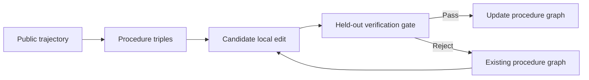
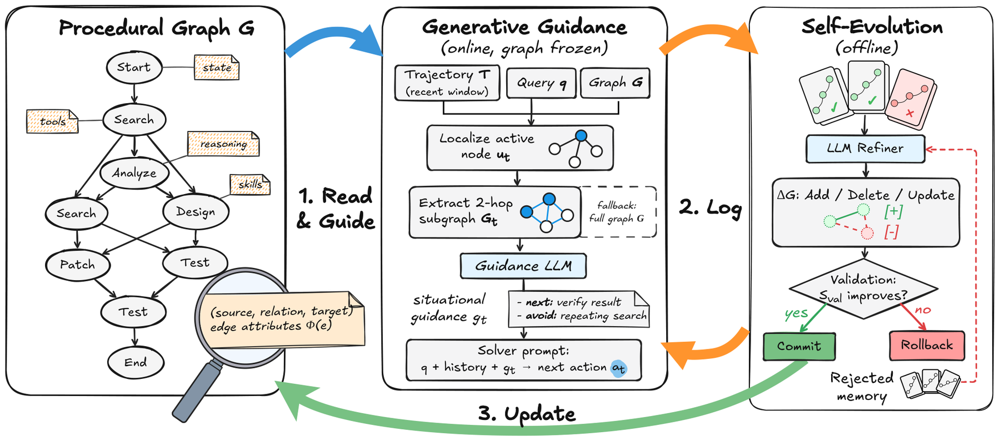

# Procedural Graphs: agents maintain their own verifiable procedure graphs

<!-- source-sha256: a11d65443460cbb742dc3ace8b41e8c46dfab827f529b2df158e36fedb883170 -->

[简体中文](README.md)

> **Public-observation parsing diagnostic.** Implements a procedure–relation–procedure graph and a conservative edit gate, not LLM generation or real-environment execution.

## Paper information

| Field | Details |
|---|---|
| Paper | [arXiv 2609.09153](https://arxiv.org/abs/2609.09153) |
| Organization | Google (first listed affiliation of the first author) |
| First public release | 2026-09-08 (arXiv v1) |
| Authors' code | No public author repository was found on 2026-09-12. |
| Adapter / method | `procedural-graphs` |
| Local reproduction code | [`src/auto_research/agent_research/latest_20260912.py`](https://github.com/daiwk/auto-research/blob/main/src/auto_research/agent_research/latest_20260912.py) |

## Original paper

### Motivation and method

Represent successful experience as a procedure–relation–procedure graph rather than free-text fragments. Turn new experiences into candidate local edits, then admit them to long-term structure only after held-out verification. This reduces contamination from bad experiences.

<!-- paper-figure:start -->
### Key figure from the paper

> **Figure 2:** Core architecture, main modules, and their connections. From the [original paper](https://arxiv.org/abs/2609.09153); copyright remains with the authors.
<!-- paper-figure:end -->

## Local reproduction and limits

See [three-seed evomem-mini results](metrics/mini-suite-seeds42-44.json). The local gate uses a deterministic proxy: an existing route must retain its first and last nodes. The policy sees no hidden answer or plan, and calls no real tools. This verifies graph updates and rejection paths only.
