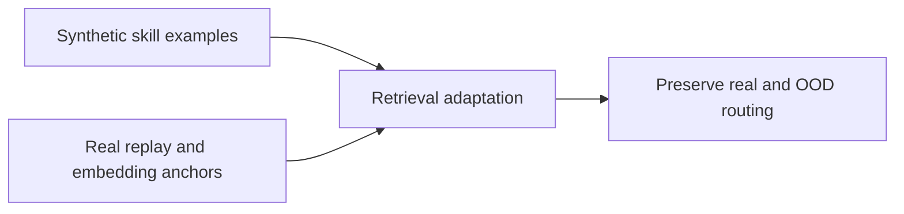
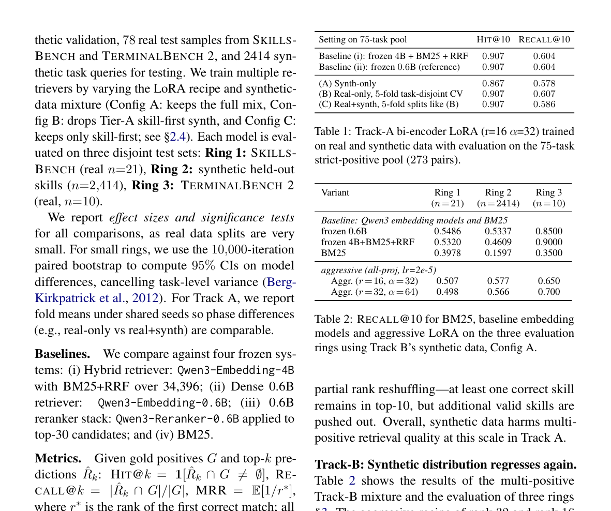

# When Synthetic Data Hurts: On Catastrophic Forgetting in Skill Retrieval for LLM Agents

<!-- source-sha256: 000599bb8baa4e5a83cafd98b3e93adf8ff6fb77340e9839129b8ac6d0ecffe9 -->

[简体中文](README.md)

> L1 real-route anchor, conflict penalty, and replay; no 0.6B training on 34,396 skills.

## Paper information

| Field | Details |
|---|---|
| Paper | [When Synthetic Data Hurts: On Catastrophic Forgetting in Skill Retrieval for LLM Agents](https://arxiv.org/abs/2609.10750) |
| Institution | Manulife (first author). |
| First public release | 2026-09-09 |
| Author code | [Author EMNLP 2026 repository](https://github.com/manulife-ai/emnlp2026/). |
| Local adapter or method key | `skill-retention` |
| Local reproduction code | [`src/auto_research/agent_research/latest_20260914.py`](https://github.com/daiwk/auto-research/blob/main/src/auto_research/agent_research/latest_20260914.py) |

## Paper method and evidence

Combine real-example replay with embedding anchoring/LwF-style regularization so synthetic skill tuning preserves real and OOD routing.

<!-- paper-figure:start -->
### Original paper figure

The original figure documents synthetic-data adaptation and retention. From the [original paper](https://arxiv.org/abs/2609.10750); copyright remains with the authors.
<!-- paper-figure:end -->

### Reported results

The paper reports +13.98% retrieval in the synthetic domain with preserved OOD performance using a 0.6B Qwen retriever/reranker. Not local or production evidence.

## Local reproduction

[Three-seed metrics](metrics/mechanism-seeds42-44.json) use the same public fixtures, budget, and seeds. The deterministic reference exposes decisions and state transitions; tests verify invariants and boundaries. These are not capability or production results.
