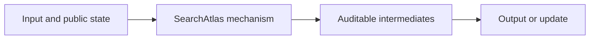
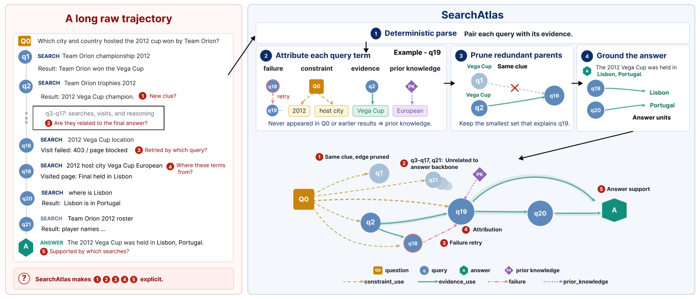

# SearchAtlas: Analyzing Agentic Search Strategies via Evidential Query Graphs

<!-- source-sha256: a6cb0277ce2036b8adda5bb7c382486e855d1c9ecc79a53f3f647e2b1ea46997 -->

[简体中文](README.md)

> **L1 core-mechanism diagnostic.** Builds evidence-propagation edges on a public fixture; does not run the paper's five search agents.

## Paper information

| Field | Details |
|---|---|
| Paper | [SearchAtlas: Analyzing Agentic Search Strategies via Evidential Query Graphs](https://arxiv.org/abs/2609.10901) |
| Organization | First-author affiliation: Duke University |
| First public release | 2026-09-09 |
| Authors' code | [https://github.com/DukeNLP/SearchAtlas](https://github.com/DukeNLP/SearchAtlas) |
| Adapter / method | `searchatlas` |
| Local reproduction code | [`src/auto_research/agent_research/latest_20260914.py`](https://github.com/daiwk/auto-research/blob/main/src/auto_research/agent_research/latest_20260914.py) |

## Original paper

### Motivation and method

Turn search trajectories into directed query–evidence–answer graphs, then audit whether evidence covers the question constraints and final answer.

<!-- paper-figure:start -->
### Key figure from the paper

> **Figure 1:** Overview of the paper's method and key components. From the [original paper](https://arxiv.org/abs/2609.10901); copyright remains with the authors.
<!-- paper-figure:end -->

### Core computation or operation

The local code implements the decisive operation as a deterministic reference kernel and explicitly reports gate, selection, projection, graph-edge, or state-update statistics. Tests cover formula invariants and boundary conditions.

### Paper results

Automatic graph parsing achieves 86.0% mean edge F1 against human annotations. These are paper results, not directly comparable with the scaled-down local run. No online gains are inferred in the absence of an online A/B test.

## Local reproduction

See the [three-seed metrics](metrics/mechanism-seeds42-44.json). All candidates share the public fixtures, budget, and seeds. The results verify actual execution of core state transitions only.

### Reproduction boundaries

The local diagnostic builds evidence-propagation edges on a public fixture. The paper's five search agents were not run.
