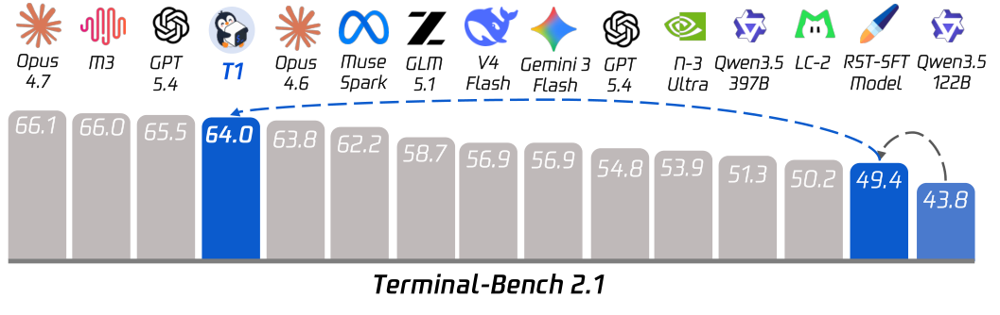

# T1: Terminal Agent Reinforcement Learning for Long-Horizon Tasks

<!-- source-sha256: 9601e5721f17d528aa4f1a5fda145c8406ebe0c90e4b964f76f2684f72f5d4fc -->

[简体中文](README.md)

> L1 exact-token and route-replay audit; no 122B MoE training or 300+ turn cloud sandbox.

## Paper information

| Field | Details |
|---|---|
| Paper | [T1: Terminal Agent Reinforcement Learning for Long-Horizon Tasks](https://arxiv.org/abs/2609.11042) |
| Institution | National University of Singapore / Tencent (first author). |
| First public release | 2026-09-09 |
| Author code | No public author repository found as of 2026-09-14. |
| Local adapter or method key | `t1-terminal-rl` |
| Local reproduction code | [`src/auto_research/agent_research/latest_20260914.py`](https://github.com/daiwk/auto-research/blob/main/src/auto_research/agent_research/latest_20260914.py) |

## Paper method and evidence

TITO trains on the actual sampled rollout token IDs; turn-boundary repair corrects drift, and R3 replays MoE routes.

<!-- paper-figure:start -->
### Original paper figure

The original figure shows the terminal training flow. From the [original paper](https://arxiv.org/abs/2609.11042); copyright remains with the authors.
<!-- paper-figure:end -->

### Core equation

The deterministic reference reports token/route state and verifies transitions.

### Reported results

Paper Terminal-Bench 2.1 improves from 43.8% to 64.0%; train–inference log-probability gap falls from 0.021 to 0.013. Not local or online evidence.

## Local reproduction

[Three-seed metrics](metrics/mechanism-seeds42-44.json) use the same public fixtures, budget, and seeds. The deterministic reference exposes decisions and state transitions; tests verify invariants and boundaries. These are not capability or production results.
