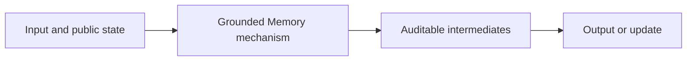
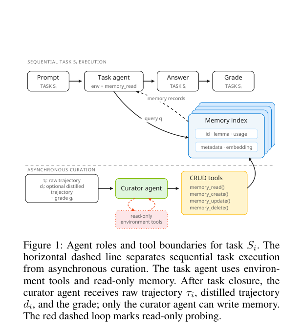

# Grounding Agent Memory: Environment-Probing Curation for Enterprise Agents

<!-- source-sha256: 6bc301fa0658e25eb9ab4d9ee56b0bae6884fde9bd5439c2b293cac85fd4769c -->

[简体中文](README.md)

> **L1 core-mechanism diagnostic.** Runs repeated probes, conflict rejection, and memory admission; does not connect to the GitHub Copilot SDK.

## Paper information

| Field | Details |
|---|---|
| Paper | [Grounding Agent Memory: Environment-Probing Curation for Enterprise Agents](https://arxiv.org/abs/2609.11060) |
| Organization | First-author affiliation: Microsoft |
| First public release | 2026-09-09 |
| Authors' code | No public author repository was found on 2026-09-14. |
| Adapter / method | `grounded-memory` |
| Local reproduction code | [`src/auto_research/agent_research/latest_20260914.py`](https://github.com/daiwk/auto-research/blob/main/src/auto_research/agent_research/latest_20260914.py) |

## Original paper

### Motivation and method

Give the asynchronous memory curator least-privilege, read-only tools to verify, scope, and refresh candidate memories before writing.

<!-- paper-figure:start -->
### Key figure from the paper

> **Figure 1:** Overview of the paper's method and key components. From the [original paper](https://arxiv.org/abs/2609.11060); copyright remains with the authors.
<!-- paper-figure:end -->

### Core computation or operation

The local code implements the decisive operation as a deterministic reference kernel and explicitly reports gate, selection, projection, graph-edge, or state-update statistics. Tests cover formula invariants and boundary conditions.

### Paper results

The paper reports CLBench pass rate rising from 39% to 73%, queries falling from 8.8 to 4.7, and task-agent cost falling from \$3.38 to \$1.68. These are paper results, not directly comparable with the scaled-down local run. No online gains are inferred in the absence of an online A/B test.

## Local reproduction

See the [three-seed metrics](metrics/mechanism-seeds42-44.json). All candidates share the public fixtures, budget, and seeds. The results verify actual execution of core state transitions only.

### Reproduction boundaries

The local run checks repeated probes, conflict rejection, and memory admission without the GitHub Copilot SDK.
