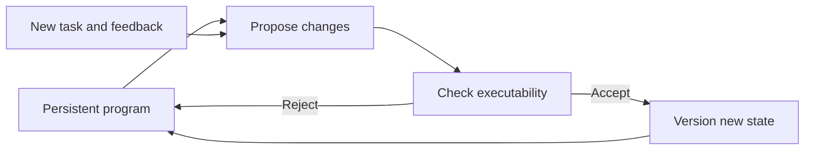
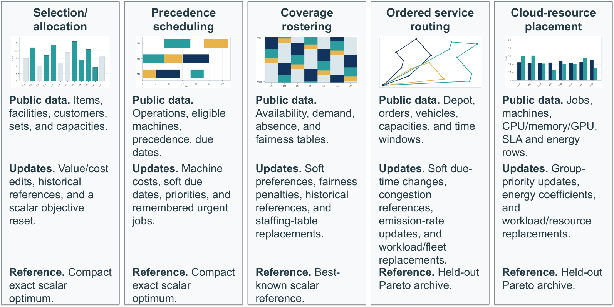

# MAPLE: A self-evolving agent that maintains executable optimization programs

<!-- source-sha256: d59714b8696cf77cc00f78944c7b04289f265e66176122506116ae4a66c97207 -->

[简体中文](README.md)

> Persistent-state diagnostic: candidate admission, cross-task reuse and versioning. No mathematical solver or LLM code generation.

## Paper information

| Field | Details |
|---|---|
| Paper | [arXiv 2609.11636](https://arxiv.org/abs/2609.11636) |
| Institution | Harbin Institute of Technology, Shenzhen (first author). |
| First public release | 2026-09-10 (arXiv v1) |
| Author code | [MAPLE](https://github.com/xin8coder/MAPLE). |
| Local adapter or method key | `maple` |
| Local reproduction code | [`src/auto_research/agent_research/latest_20260912.py`](https://github.com/daiwk/auto-research/blob/main/src/auto_research/agent_research/latest_20260912.py) |

## Paper method and evidence

Represent optimization knowledge as editable program state. Propose changes, check executability, accept improvements, and carry the versioned program into later tasks rather than prompting from scratch.

<!-- paper-figure:start -->
### Original paper figure

The paper's Figure 7 shows examples from the benchmark. From the [original paper](https://arxiv.org/abs/2609.11636); copyright remains with the authors.
<!-- paper-figure:end -->

## Local reproduction

The local harness accepts only public plans with nonempty named operations and checks later reuse. [Three-seed metrics](metrics/mini-suite-seeds42-44.json). No original solver, training, or external tools; mini-suite success does not establish paper-scale capability.
