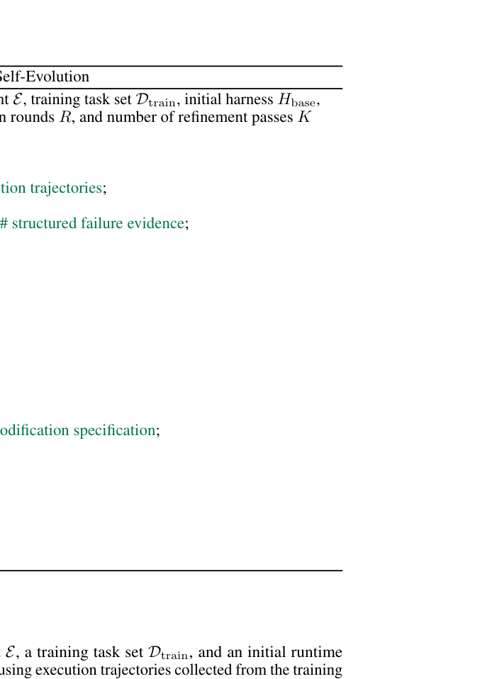

# Ecdysis: Efficient and Effective Training of Runtime Harnesses for LLM Agents

<!-- source-sha256: 29d7493d0e0a846b446372c17550debe4be6a665b88dfb01e700d8380273fa94 -->

[简体中文](README.md)

> L1 public-observation failure signatures and repair gate; no harness code generation or execution.

## Paper information

| Field | Details |
|---|---|
| Paper | [Ecdysis: Efficient and Effective Training of Runtime Harnesses for LLM Agents](https://arxiv.org/abs/2609.11677) |
| Institution | Chengdu Institute of Computer Applications, Chinese Academy of Sciences (first author). |
| First public release | 2026-09-10 |
| Author code | [cuiyu-ai/Ecdysis](https://github.com/cuiyu-ai/Ecdysis). |
| Local adapter or method key | `ecdysis` |
| Local reproduction code | [`src/auto_research/agent_research/latest_20260914.py`](https://github.com/daiwk/auto-research/blob/main/src/auto_research/agent_research/latest_20260914.py) |

## Paper method and evidence

Aggregate recurring failures across tasks to distinguish one-off model mistakes from systematic harness defects. Multi-role FDCR diagnosis turns those patterns into repair specifications.

<!-- paper-figure:start -->
### Original paper figure

The original figure describes the runtime-harness training workflow. From the [original paper](https://arxiv.org/abs/2609.11677); copyright remains with the authors.
<!-- paper-figure:end -->

### Core equation

The deterministic reference emits grouping and trigger statistics, with tests for decision invariants and boundaries.

### Reported results

The paper reports up to 1.84× faster harness training and up to 18.56% higher inference accuracy. These are not local or online results.

## Local reproduction

[Three-seed metrics](metrics/mechanism-seeds42-44.json) use the same public fixtures, budget and seeds and verify only the state transition.
