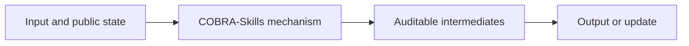
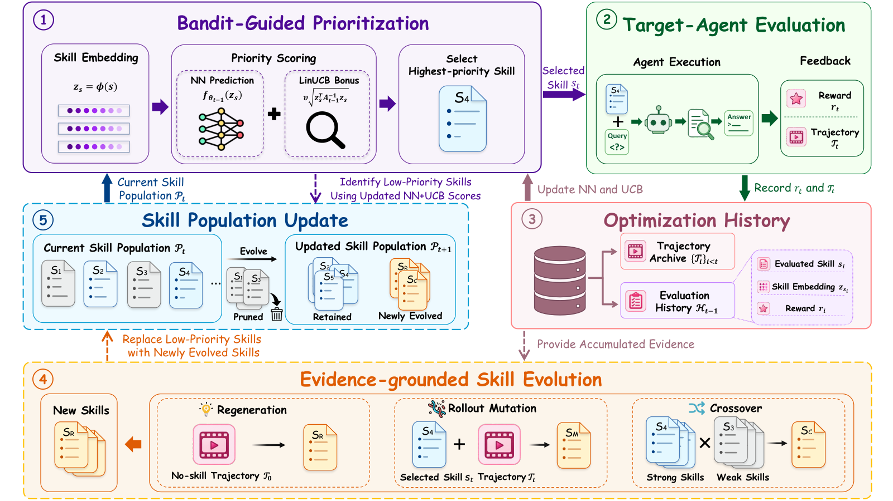

# COBRA-Skills: Contextual Bandit-Guided Evolution for Agent Skill Optimization

<!-- source-sha256: 24d3ef159e999ae385e4dfb7c31428544164d858a2bce94e0f39ea47c4c5a582 -->

[简体中文](README.md)

> **L1 core-mechanism diagnostic.** Runs contextual UCB allocation and feedback admission without external LLMs or six real environments.

## Paper information

| Field | Details |
|---|---|
| Paper | [COBRA-Skills: Contextual Bandit-Guided Evolution for Agent Skill Optimization](https://arxiv.org/abs/2609.11682) |
| Organization | First-author affiliation: The Chinese University of Hong Kong, Shenzhen |
| First public release | 2026-09-10 |
| Authors' code | [https://github.com/Jerry-LuP/COBRA-Skills](https://github.com/Jerry-LuP/COBRA-Skills) |
| Adapter / method | `cobra-skills` |
| Local reproduction code | [`src/auto_research/agent_research/latest_20260914.py`](https://github.com/daiwk/auto-research/blob/main/src/auto_research/agent_research/latest_20260914.py) |

## Original paper

### Motivation and method

Treat skill optimization as a budgeted contextual bandit over a dynamic candidate space. Evaluate high-reward or informative skills first and evolve them using execution feedback.

<!-- paper-figure:start -->
### Key figure from the paper

> **Figure 1:** Overview of the paper's method and key components. From the [original paper](https://arxiv.org/abs/2609.11682); copyright remains with the authors.
<!-- paper-figure:end -->

### Core computation or operation

The local deterministic reference kernel implements the decisive operation and reports gate, selection, projection, graph-edge, or state-update statistics. Tests cover formula invariants and boundaries.

### Paper results

Across six benchmarks and three models, cost falls 55%–58%, and performance improves by 13.1/26.9/22.5 percentage points against agents without skills. These paper results are not directly comparable with the scaled-down local run. No online gain is inferred without an online A/B test.

## Local reproduction

See the [three-seed metrics](metrics/mechanism-seeds42-44.json). All candidates use identical public fixtures, budgets, and seeds. These results establish only execution of the core state transitions.

### Reproduction boundaries

The local run exercises contextual UCB allocation and feedback admission, not external LLMs or six real environments.
