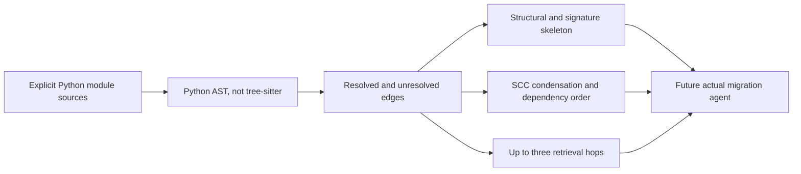
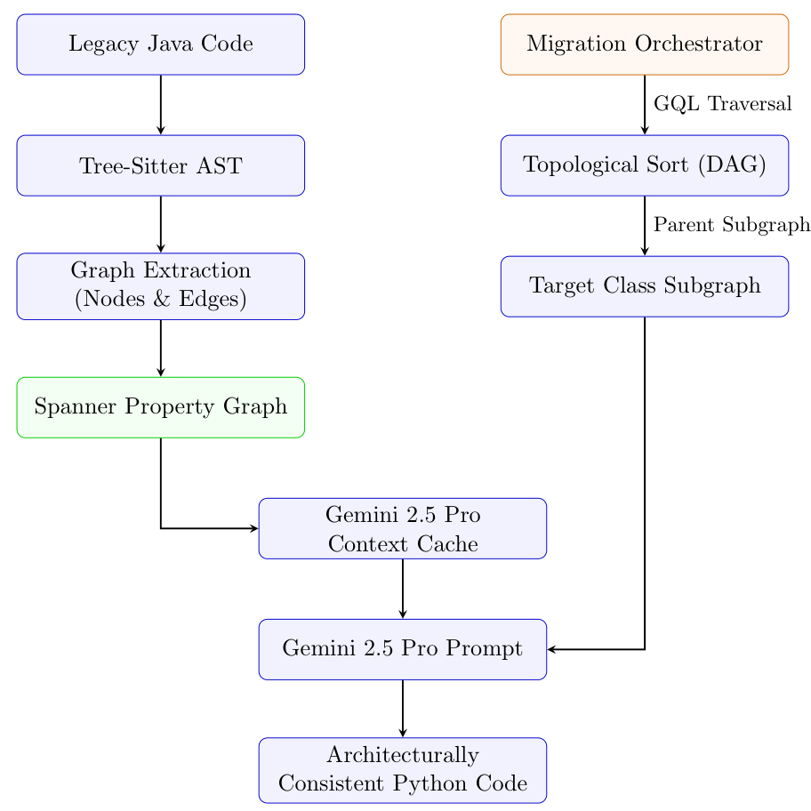

# HCRG: Build Dependency Context Before Migrating Code

<!-- source-sha256: 6f4e225f2fa865499179df1cf80c7a7dbf174b189e563efd2615a9b91c4e80ef -->

[简体中文](README.md)

> `component_only` / L0: Python AST graph subsystem only, not the Java tree-sitter pipeline or actual LLM migration. Full study too costly; not reproduced (review DONE).

## Paper information

| Field | Value |
| --- | --- |
| Paper | [arXiv 2609.12464](https://arxiv.org/abs/2609.12464), [v1 Sections 3–5](https://arxiv.org/html/2609.12464v1#S3) |
| Affiliation | First author Nilesh Jaiswal: Google Cloud, supported by the affiliation and Google email in the paper |
| First public release | 2026-09-11 05:54:41 UTC (arXiv v1); April 6 on the first page is not the arXiv submission date |
| Authors' code | No pipeline found in the paper or Google entry; spring-petclinic is input, not author implementation. |
| Adapter | None; standalone `hcrg` component |
| Local code | `src/auto_research/agent_research/google16_hcrg.py` |

## Original paper

### Background and contribution

HCRG extracts INHERITS/CALLS/IMPORTS from ASTs, caches the architectural skeleton, migrates parent dependencies first, and retrieves up to three hops of structured context. The vector-RAG control uses 800-character chunks, 150 overlap, top five. See [Sections 3–4](https://arxiv.org/html/2609.12464v1#S3).



<!-- paper-figure:start -->
### Key figure from the paper

[](https://arxiv.org/pdf/2609.12464v1#page=5)

v1 Figure 2, page 5, from the [paper](https://arxiv.org/abs/2609.12464); copyright belongs to the authors. Local Python does not reproduce tree-sitter, Spanner, or Gemini cloud paths. See [capture provenance](assets/provenance.json).
<!-- paper-figure:end -->

### Structure and results

Context is $N_{\le3}(v)$. For resolved edge $v\to p$, place $p$ before $v$. Cycles remain strongly connected groups, not a claimed internal topological order; the paper does not specify a complete cycle breaker.

For one Java→Python repo, DRQ rose 34.8%→65.9% and PCC 26.7%→45.5%, while complexity consistency fell 71.6%→46.7%. No live A/B or multi-repo/multi-seed generalization was reported. See [Section 6](https://arxiv.org/html/2609.12464v1#S6).

## Local reproduction

```bash
PYTHONPATH=src python -m pytest tests/test_google16_hcrg.py
```

Eight Python mechanism tests cover cross-module inheritance, hop bounds, signature skeleton, dependency order, explicit cycles, caching and partial metrics, and preservation of ambiguous, external, same-name unimported, and shadowed dependencies. See [diagnostics](metrics/component-contract.json).

`extract_python_graph` never executes or imports input; at most 64 modules, 100,000 characters each. Resolve only top-level dependencies in the module or through explicit imports. Parameter/local shadows do not map to global same-name symbols. Unresolved symbols are retained; method signatures enter the skeleton but dynamic calls, reflection, and Java syntax do not. `dependency_order` retains SCCs, `retrieve` caps at 3 hops, and `SkeletonCache` is local content hashing, not Vertex AI Context Cache.

`static_metrics` supplies Python→Python PCC/THC, controlled import DRQ, parsing, and docstring presence. Not implemented: Java complexity, pyflakes, full API hallucination or MQ, LLM migration, cloud services, vector fallback, end-to-end rebuild, GPU, or Evolve.

### Cost decision

The full tree-sitter Java, Spanner, Vertex embedding/one-hour cache, and Gemini2.5Pro repo migration is not cheaply verifiable within the short single-card budget; upstream implementation is unavailable. **Not reproduced for cost (review DONE)**. Graph tests are not end-to-end reproduction.
